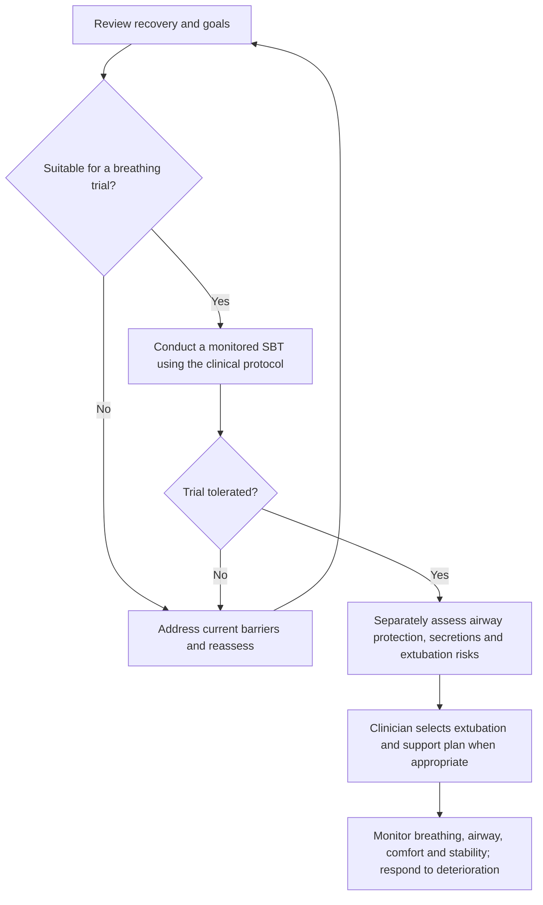

# Pain, airway and ventilation: worked clinical examples

**Evidence labels:** [Guideline/consensus recommendation](EVIDENCE_CLASSIFICATION.md#recommendations) (strength and population stated), **general clinical knowledge**, **context-dependent clinical practice**, and **synthetic example**. A case or original diagram is not a standardized treatment protocol.

28 October 2026. This companion applies publicly available clinical guidance to wholly synthetic ICU/CTICU examples. It explains established care principles and explicitly conditional options. It does not turn a narrative into an executable medication, intubation or ventilator order set. The [source register](CLINICAL_CARE_PUBLIC_SOURCES.md) distinguishes guidelines, consensus statements, reviews and official device information.

## Pain management and sedation workflow

**Guideline statements and recommendation (G01–G03):** Assess pain by self-report when possible, or an appropriate validated behavioral method when communication is impossible. Assess sedation separately; agitation can reflect pain, hypoxemia, delirium or another cause. Agree on a functional comfort goal, review exposure and organ function, address the cause, select analgesia, then reassess relief and unwanted effects. PADIS supports an assessment-driven approach and pain treatment before adding a sedative. [PADIS18](https://www.sccm.org/clinical-resources/guidelines/guidelines/guidelines-for-the-prevention-and-management-of-pa).

**Synthetic example / context-dependent clinical practice:** The CABG male cannot cough comfortably because of incisional pain; the female valve example has pain plus congestion and hypotension. The team treats pain while investigating the accompanying physiology. A multimodal cardiac pathway can combine appropriate nonopioid measures with individualized opioid analgesia and procedure-specific options. Circulatory state changes which drugs or techniques are tolerable. Improvement means better comfort and breathing/mobility without unacceptable sedation or circulatory harm, not a required opioid-free state. [CARDREC](https://www.annalsthoracicsurgery.org/article/S0003497523013176/pdf).

**Guideline recommendations (G04–G07), with context-dependent technique selection:** Acetaminophen may be an adjunct; selected postoperative patients may receive ketamine as an opioid-sparing adjunct. Neuropathic agents address a neuropathic component rather than every acute pain presentation. PADIS does not support routine IV lidocaine as an ICU opioid adjunct. Acetaminophen and postoperative ketamine are conditional suggestions with very low certainty; the recommendation for neuropathic medication with opioids in neuropathic pain is strong with moderate certainty. The recommendation against routine IV lidocaine adjunct use is conditional with low certainty. These options are not a fixed mixture. Regional techniques depend on procedure, coagulation and qualified assessment. [PADIS18](https://www.sccm.org/clinical-resources/guidelines/guidelines/guidelines-for-the-prevention-and-management-of-pa), [CARDREC](https://www.annalsthoracicsurgery.org/article/S0003497523013176/pdf).

**Synthetic sedation example / conditional recommendation G08:** A ventilated male needs light, interactive sedation; a female needs a different depth temporarily because of her respiratory/clinical requirements. Goals are individualized and revisited. The 2025 guideline conditionally favors dexmedetomidine over propofol when light sedation and/or delirium reduction are highest priorities; this is not a universal preference. Neither sedative substitutes for pain treatment. [PADIS25](https://www.sccm.org/clinical-resources/guidelines/guidelines/focused-update-padis-guideline).

**Context-dependent practice / official device-safety guidance:** With a prescribed infusion, the clinician checks the patient, drug/concentration, order, pump channel, line path, drug-library entry and response. Unexpected somnolence or a pressure change prompts patient/infusion assessment; a displayed programmed rate does not prove correct delivery or prescription. [PUMP](https://www.fda.gov/medical-devices/infusion-pumps/infusion-pump-risk-reduction-strategies-clinicians).

## Comfort-focused care example

**Synthetic example / context-dependent clinical practice:** For the male who chooses comfort-focused care, the team assesses pain, dyspnea and anxiety, documents the agreed plan and provides proportionate symptom treatment with reassessment. For the female with a DNI decision who still wants reversible illness treated, those treatments remain part of the plan. Palliative care does not itself specify one airway choice, sedation depth, drug dose or withdrawal schedule. [GOALS](https://link.springer.com/article/10.1007/s00134-024-07579-1).

## Intubation and airway protection example

**Synthetic example / context-dependent clinical practice:** A male with worsening lung failure is tiring despite support; a female after complex thoracic surgery has airway distress. The airway team evaluates oxygenation, ventilation, mental state, airway protection, circulation and anatomy. The surgical example may require a reconstruction-specific plan.

**General clinical practice, with guideline statements G09–G11:** Skilled clinicians coordinate personnel, oxygenation/preoxygenation, suction and airway equipment, circulation, an intubation plan and rescue options. An induction/sedative-hypnotic and a neuromuscular blocker have different roles when RSI is selected. Paralysis is not analgesia or unconsciousness. Drug selection and continuing analgesia/sedation account for physiology and the post-intubation period. SCCM labels a hypnotic when an NMBA is used as best practice, NMBA use with hypnotic induction as a strong recommendation (low certainty), and specific preoxygenation strategies as conditional recommendations. These do not establish one medication recipe. [RSI](https://www.sccm.org/clinical-resources/guidelines/guidelines/guidelines-rapid-sequence-intubation).

**Consensus guidance G12:** Sustained exhaled CO2 on waveform capnography is central to excluding esophageal placement after intended tracheal intubation. Inability to establish it requires an immediate trained response; auscultation or apparently adequate saturation alone is insufficient to exclude esophageal intubation. PUMA describes consensus guidance rather than international standards. This summary does not reproduce the complete rescue algorithm. [TUBE](https://pmc.ncbi.nlm.nih.gov/articles/PMC9804892/).

## Ongoing airway and ventilator assessment

**Synthetic example / context-dependent clinical practice:** A ventilated male develops increased airway pressure; a female has a new leak or reduced delivered volume. The clinician assesses the patient, tube/circuit, placement/securement, cuff, secretions, humidification, measured volumes/pressures and ventilator interaction. An alarm prompts cause assessment rather than an automatic sedation increase. AARC strongly recommends plateau-pressure, tidal-volume and PEEP/auto-PEEP assessment (high certainty; G13). FiO2, humidification and placement/securement assessment recommendations are conditional (G14), with low or very low certainty depending on the item. [VENTASSESS](https://pmc.ncbi.nlm.nih.gov/articles/PMC11298231/).

## Choosing respiratory support

| Support | What it does and a clinical example | Reassessment and public source | Classification |
|---|---|---|---|
| Supplemental oxygen | Supplies oxygen to a spontaneously breathing recovering postoperative patient. | Oxygen delivery alone does not establish adequate ventilation. [HFNC](https://publications.ersnet.org/content/erj/59/4/2101574), [GAS](https://www.aarc.org/wp-content/uploads/2025/03/davis-et-al-2013-aarc-clinical-practice-guideline-blood-gas-analysis-and-hemoximetry-2013.pdf) | General clinical knowledge; clinical use depends on need |
| HFNC | Heated, humidified high-flow nasal oxygen is an option for a suitable male with acute hypoxemic respiratory failure. | ERS recommendations are conditional and population-specific; worsening effort, gas exchange or stability requires reassessment. [HFNC](https://publications.ersnet.org/content/erj/59/4/2101574) | Function: general knowledge. Use: conditional guideline recommendation G15 |
| CPAP | Continuous positive pressure can support oxygenation without separate inspiratory pressure support; a suitable cardiogenic pulmonary-edema example may benefit. | Assess suitability, protection of the airway, tolerance and response. [NIV](https://www.thoracic.org/statements/resources/cc/niv-guidelines.pdf) | Function: general knowledge. Selected disease use: strong guideline recommendation G17 |
| Bilevel NIV | Higher inspiratory than expiratory pressure assists breathing through an interface; a female with COPD-related respiratory acidosis illustrates a recognized use. | Deterioration or inability to protect the airway requires urgent reassessment. [NIV](https://www.thoracic.org/statements/resources/cc/niv-guidelines.pdf) | Function: general knowledge. Selected disease use: strong guideline recommendation G16 |
| Invasive ventilation | An artificial airway and ventilator provide controlled or assisted breathing when required, such as respiratory failure or inadequate airway protection. | Assess delivered support and response, including circulatory effects. [RSI](https://www.sccm.org/clinical-resources/guidelines/guidelines/guidelines-rapid-sequence-intubation), [VENTASSESS](https://pmc.ncbi.nlm.nih.gov/articles/PMC11298231/) | General clinical knowledge and context-dependent practice |

**Context-dependent clinical practice:** For cardiogenic pulmonary edema, the ERS/ATS recommendation does not directly cover cardiogenic shock or acute coronary syndrome subgroups. The choice follows the underlying problem, capability, response and goals; patients do not need to progress through every device in a mandatory ladder. [NIV](https://www.thoracic.org/statements/resources/cc/niv-guidelines.pdf), [HFNC](https://publications.ersnet.org/content/erj/59/4/2101574).

## Ventilator mode basics

**General clinical knowledge:** Mode names vary by manufacturer. Identify the controlled variable, breath sequence, triggers and cycling, then check actual delivery. These are equipment principles, not evidence that one mode always improves outcomes. [MODES](https://journals.sagepub.com/doi/10.1177/17511437261470614).

| Mode family | What it does | Worked use and limitation |
|---|---|---|
| Volume assist/control | Mandatory breaths target volume; pressure varies. | A postoperative patient may receive this mode; monitor pressure and interaction. |
| Pressure assist/control | Mandatory breaths target pressure over time; volume varies. | Changing compliance or effort changes delivered volume; pressure targeting alone does not ensure lung protection. |
| Pressure support | Patient-triggered breaths receive inspiratory assistance. | A recovering spontaneously breathing patient may use it; assess drive, effort and the actual backup configuration. |
| Pure CPAP | Maintains baseline positive pressure without separate inspiratory assistance. | It is not full mandatory ventilation. |
| Adaptive volume-targeted pressure modes | Pressure adapts toward a volume target; implementations differ. | Verify the actual device behavior rather than relying on its mode name. |

Public explanation: [MODES](https://journals.sagepub.com/doi/10.1177/17511437261470614).

**Synthetic example / context-dependent clinical practice:** The CABG male initially requires mandatory support; the female is awake and breathing spontaneously as recovery progresses. The team checks whether mandatory or spontaneous assistance is appropriate and reviews delivered volumes/pressures, PEEP, FiO2 and comfort. Switching a mode does not establish readiness for tube removal. [VENTASSESS](https://pmc.ncbi.nlm.nih.gov/articles/PMC11298231/), [SBT](https://www.aarc.org/wp-content/uploads/2023/11/CPG2024SpontaneousBreathingTrial.pdf).

**Synthetic example / guideline recommendations G21–G22:** Poor oxygenation in a male and dyssynchrony in a female require individualized lung-protective support and cause assessment. The ATS update conditionally supports selected ARDS adjuncts and higher PEEP without recruitment maneuvers in moderate-to-severe ARDS (conditional, low-to-moderate certainty), and separately recommends against prolonged recruitment maneuvers in that population (strong, moderate certainty). Oxygenation benefit must be weighed against circulatory effects; the diagnosis does not select one universal PEEP or mode. [ARDS](https://pmc.ncbi.nlm.nih.gov/articles/PMC10870893/).

## Extubation and liberation examples

**Synthetic example / conditional guideline recommendations G18–G19:** The CABG male is improving and able to participate; the female with ongoing shock or respiratory difficulty has not reached the same point. The team reviews improvement of the cause, ability to initiate breathing and suitability for a spontaneous breathing trial (SBT). AARC supports standardized assessment and SBTs with or without pressure support; a rapid-shallow-breathing-index calculation is not required before every SBT. [SBT](https://www.aarc.org/wp-content/uploads/2023/11/CPG2024SpontaneousBreathingTrial.pdf).

**General clinical practice / strong guideline recommendation G20:** A satisfactory trial does not settle secretion handling, airway protection, upper-airway concerns or the complete extubation plan. The team evaluates these separately, plans post-extubation support and monitors for failure. ATS/CHEST strongly recommends preventive NIV (moderate certainty) after planned extubation for suitable patients at high risk of extubation failure who were ventilated for more than 24 hours and passed an SBT, not as a substitute for responding to post-extubation deterioration. [LIBERATE](https://www.thoracic.org/statements/resources/cc/weaning-exec-summary.pdf).

**Synthetic example / context-dependent clinical practice:** One example proceeds with a clinician-approved extubation plan; the other develops distress during the SBT and returns to appropriate support while its cause is evaluated. Neither elapsed time since surgery nor sex decides tube removal. [SBT](https://www.aarc.org/wp-content/uploads/2023/11/CPG2024SpontaneousBreathingTrial.pdf), [LIBERATE](https://www.thoracic.org/statements/resources/cc/weaning-exec-summary.pdf).

**Synthetic educational decision flow:** This original visual summary follows the cited SBT/liberation principles; it is not the full society algorithm.

## Connected examples

See the [equipment guide](ICU_EQUIPMENT_BASICS.md) for functions, settings and case uses, and the [laboratory examples](CLINICAL_LAB_EXAMPLES.md) for measurements and diagnosis. The [public source register](CLINICAL_CARE_PUBLIC_SOURCES.md) distinguishes recommendations, equipment definitions and authored fictional applications.
