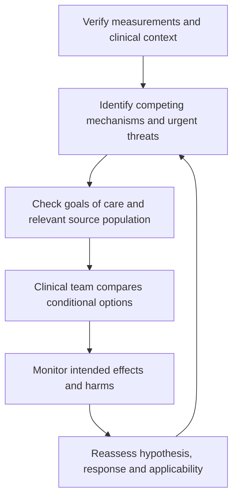

# ICU applied examples: all 42 topics

28 October 2026. Entirely synthetic educational cases, independent of real encounters/charts. Each of the 42 existing topics has a male and female example (84 profiles). These illustrate source-informed reasoning, not observed treatment, a dosing protocol or proof of clinical competence. All existing case text is retained.

## Consistent case format

For comparability, each fictional male is 60 years, 180 cm and 80 kg, and each fictional female is 60 years, 165 cm and 65 kg, nonpregnant. These are deliberately matched learning profiles, not typical or preferred values. Both share the stated topic vignette; the additional history below creates a question to investigate. Sex alone does not select a treatment. Medication doses, device settings and treatment ceilings cannot be derived from this incomplete information. Local or professional standards govern real care.

The same general anesthesia-options teaching set is available locally in [the shared guide](ANESTHESIA_OPTIONS_AND_CASES.md). It does not replace condition-specific ICU guidance.

## How reasoning is standardized

Verify observations and context → identify competing mechanisms → identify patient goals and source applicability → discuss conditional options and monitoring → reassess response and unwanted effects. The standardized element is the reasoning and documentation, not one regimen for every patient.

## Worked calculation examples

- P:F example: PaO2 80 mmHg / FiO2 0.50 = 160 mmHg. This is arithmetic, not an ARDS diagnosis or escalation threshold; compare measurement/support conditions [ARDS].
- Simplified CPP example: MAP 85 − ICP 18 = 67 mmHg. Reference levels, measurement quality and disease context matter; this is not a prescribed target [TBI, SAH].
- Cardiac-index example: output 4.2 L/min / body surface area 2.0 m² = 2.1 L/min/m². This neither selects an inotrope nor proves a single shock mechanism [POSTCARD].

## ICU-01-01 — Postoperative hemodynamic instability

**Original exercise:** [case_set_01_multisystem_critical_care_scenarios.md — scenario 1](case_set_01_multisystem_critical_care_scenarios.md).

**Shared fictional situation:** A fictional postoperative adult develops hypotension, rising lactate and chest-drain output. Cardiac function and the bleeding source have not been established.

- **Male example:** Bleeding trend is increasing.
- **Female example:** Prior ventricular dysfunction is documented.

**Worked application:** Separate blood loss, pump failure, obstruction and vascular tone; focused imaging and serial perfusion findings discriminate the branches.

**Medication / intervention context:** Vasoactive support does not correct a surgical bleeding source; analgesic/sedative effects also belong in the medication review.

**Decision flow:** confirm the case observations → compare the mechanisms above → check patient-specific suitability and goals → treating team determines the intervention → reassess intended effect and harm.

**Source map:** [POSTCARD](#source-registry). The linked sources inform the named concepts; the fictional profiles and discussion branches are author-created.

## ICU-01-02 — DNI status and respiratory distress

**Original exercise:** [case_set_01_multisystem_critical_care_scenarios.md — scenario 2](case_set_01_multisystem_critical_care_scenarios.md).

**Shared fictional situation:** An older fictional adult with COPD and pneumonia is distressed and has difficulty tolerating non-invasive ventilation. DNR/DNI is documented; other treatment preferences are unknown.

- **Male example:** Wants active treatment short of intubation.
- **Female example:** Preferences beyond DNI have not been discussed.

**Worked application:** Clarify the treatment ceiling and trial goals before interpreting NIV intolerance; distinguish reversible distress from a separately chosen symptom-only plan.

**Medication / intervention context:** Analgesia and anxiolysis require respiratory reassessment; a sedative combination is not implied by DNI.

**Decision flow:** confirm the case observations → compare the mechanisms above → check patient-specific suitability and goals → treating team determines the intervention → reassess intended effect and harm.

**Source map:** [NIV](#source-registry), [DNR](#source-registry), [GOALS](#source-registry). The linked sources inform the named concepts; the fictional profiles and discussion branches are author-created.

## ICU-01-03 — Worsening septic shock

**Original exercise:** [case_set_01_multisystem_critical_care_scenarios.md — scenario 3](case_set_01_multisystem_critical_care_scenarios.md).

**Shared fictional situation:** A fictional adult with suspected infection has increasing vasopressor requirements, mottling, oliguria and rising lactate.

- **Male example:** Source is suspected but not controlled.
- **Female example:** Positive fluid balance and congestion are present.

**Worked application:** Reassess infection/source control and perfusion while asking whether additional fluid is both effective and tolerated.

**Medication / intervention context:** Antimicrobials and vasopressor support are distinct interventions; culture/resistance and organ function inform drug discussions.

**Decision flow:** confirm the case observations → compare the mechanisms above → check patient-specific suitability and goals → treating team determines the intervention → reassess intended effect and harm.

**Source map:** [SEPSIS](#source-registry). The linked sources inform the named concepts; the fictional profiles and discussion branches are author-created.

## ICU-01-04 — Rib fractures and impaired ventilation

**Original exercise:** [case_set_01_multisystem_critical_care_scenarios.md — scenario 4](case_set_01_multisystem_critical_care_scenarios.md).

**Shared fictional situation:** A fictional trauma patient has chest-wall pain, shallow breathing and increasing oxygen needs. Associated injuries are incompletely described.

- **Male example:** Chest pain limits deep breathing.
- **Female example:** Sleep apnea and other injuries need clarification.

**Worked application:** Evaluate chest injury, ventilation and analgesic adequacy together; a pain score alone cannot exclude worsening respiratory injury.

**Medication / intervention context:** Local/regional or systemic analgesia are discussion options after injury and bleeding-risk assessment; respiratory effects matter.

**Decision flow:** confirm the case observations → compare the mechanisms above → check patient-specific suitability and goals → treating team determines the intervention → reassess intended effect and harm.

**Source map:** [NIV](#source-registry), [PADIS](#source-registry). The linked sources inform the named concepts; the fictional profiles and discussion branches are author-created.

## ICU-01-05 — Myocarditis and shock

**Original exercise:** [case_set_01_multisystem_critical_care_scenarios.md — scenario 5](case_set_01_multisystem_critical_care_scenarios.md).

**Shared fictional situation:** A fictional adult with suspected fulminant myocarditis has poor perfusion despite initial support. Ventricular function, rhythm and the cause of inflammation need reassessment.

- **Male example:** Rhythm disturbance is suspected.
- **Female example:** Biventricular dysfunction is suspected.

**Worked application:** Characterize rhythm and ventricular involvement before comparing pharmacologic support with expert mechanical-support assessment.

**Medication / intervention context:** Inotrope, vasopressor and sedation choices depend on the assessed physiology; suspected myocarditis does not select an empiric immune-treatment regimen.

**Decision flow:** confirm the case observations → compare the mechanisms above → check patient-specific suitability and goals → treating team determines the intervention → reassess intended effect and harm.

**Source map:** [VA](#source-registry), [POSTCARD](#source-registry). The linked sources inform the named concepts; the fictional profiles and discussion branches are author-created.

## ICU-01-06 — Pancreatitis with respiratory and renal dysfunction

**Original exercise:** [case_set_01_multisystem_critical_care_scenarios.md — scenario 6](case_set_01_multisystem_critical_care_scenarios.md).

**Shared fictional situation:** A fictional postoperative adult with pancreatitis has pain, positive fluid balance, worsening breathing and rising creatinine.

- **Male example:** Recent fluids were followed by dyspnea.
- **Female example:** Baseline kidney dysfunction complicates fluid tolerance.

**Worked application:** The WATERFALL result argues against assuming more fluid is better; established organ failure differs from its trial population and requires individualized reassessment.

**Medication / intervention context:** Analgesic choice and renal/hepatic exposure need review; no fixed high-volume fluid or drug infusion follows from the diagnosis.

**Decision flow:** confirm the case observations → compare the mechanisms above → check patient-specific suitability and goals → treating team determines the intervention → reassess intended effect and harm.

**Source map:** [PANCREAS](#source-registry), [RENAL](#source-registry). The linked sources inform the named concepts; the fictional profiles and discussion branches are author-created.

## ICU-01-07 — Brain injury with aspiration and airway decline

**Original exercise:** [case_set_01_multisystem_critical_care_scenarios.md — scenario 7](case_set_01_multisystem_critical_care_scenarios.md).

**Shared fictional situation:** A fictional adult with traumatic brain injury develops reduced alertness and suspected aspiration.

- **Male example:** Neurologic examination is declining.
- **Female example:** Recent sedatives confound the examination.

**Worked application:** Separate airway/oxygenation threats, injury progression and medication effects; a sedative-adjusted examination is not equivalent to exclusion of intracranial deterioration.

**Medication / intervention context:** Hypnotics, analgesics and osmotic agents have different purposes; no dose or ventilation target can be selected from the abbreviated case.

**Decision flow:** confirm the case observations → compare the mechanisms above → check patient-specific suitability and goals → treating team determines the intervention → reassess intended effect and harm.

**Source map:** [TBI](#source-registry), [PADIS](#source-registry). The linked sources inform the named concepts; the fictional profiles and discussion branches are author-created.

## ICU-01-08 — Sepsis with ARDS and kidney injury

**Original exercise:** [case_set_01_multisystem_critical_care_scenarios.md — scenario 8](case_set_01_multisystem_critical_care_scenarios.md).

**Shared fictional situation:** A fictional adult with pneumonia has bilateral opacities, impaired gas exchange, positive fluid balance and kidney dysfunction.

- **Male example:** Lung gas exchange is deteriorating.
- **Female example:** Fluid accumulation accompanies kidney injury.

**Worked application:** Integrate lung-protection assessment, infection/source control and fluid tolerance rather than treating isolated oxygenation or creatinine values.

**Medication / intervention context:** Sedation or neuromuscular-block discussions depend on the actual ventilation problem; renal support is a separate indication-based decision.

**Decision flow:** confirm the case observations → compare the mechanisms above → check patient-specific suitability and goals → treating team determines the intervention → reassess intended effect and harm.

**Source map:** [SEPSIS](#source-registry), [ARDS](#source-registry), [RENAL](#source-registry). The linked sources inform the named concepts; the fictional profiles and discussion branches are author-created.

## ICU-02-01 — Shock immediately after CABG

**Original exercise:** [case_set_02_advanced_hemodynamic_scenarios.md — scenario 1](case_set_02_advanced_hemodynamic_scenarios.md).

**Shared fictional situation:** A fictional adult after coronary bypass has hypotension, low estimated output, hypothermia and ongoing drain output.

- **Male example:** Drains show renewed bleeding.
- **Female example:** Echo suggests reduced contractility.

**Worked application:** Use surgical assessment and verified output measurements to distinguish blood loss from pump failure, while allowing coexistence.

**Medication / intervention context:** A vasopressor, inotrope or transfusion discussion addresses different mechanisms; none is selected solely by MAP.

**Decision flow:** confirm the case observations → compare the mechanisms above → check patient-specific suitability and goals → treating team determines the intervention → reassess intended effect and harm.

**Source map:** [POSTCARD](#source-registry). The linked sources inform the named concepts; the fictional profiles and discussion branches are author-created.

## ICU-02-02 — VA-ECMO after myocardial infarction

**Original exercise:** [case_set_02_advanced_hemodynamic_scenarios.md — scenario 2](case_set_02_advanced_hemodynamic_scenarios.md).

**Shared fictional situation:** A fictional adult on VA-ECMO has improving lactate but oliguria and concern about limb perfusion.

- **Male example:** A cannulated limb is cool.
- **Female example:** Urine output is low despite falling lactate.

**Worked application:** Falling lactate does not settle limb perfusion or kidney questions; evaluate each organ and circuit configuration.

**Medication / intervention context:** Anticoagulation, vasoactive and analgesic choices require bleeding/perfusion context and specialist oversight.

**Decision flow:** confirm the case observations → compare the mechanisms above → check patient-specific suitability and goals → treating team determines the intervention → reassess intended effect and harm.

**Source map:** [VA](#source-registry), [RENAL](#source-registry). The linked sources inform the named concepts; the fictional profiles and discussion branches are author-created.

## ICU-02-03 — Early LVAD and RV function

**Original exercise:** [case_set_02_advanced_hemodynamic_scenarios.md — scenario 3](case_set_02_advanced_hemodynamic_scenarios.md).

**Shared fictional situation:** A fictional adult after LVAD implantation has changing displayed flow and pulsatility with borderline RV function.

- **Male example:** RV function is borderline.
- **Female example:** Displayed flow varies with rhythm.

**Worked application:** Interpret loading, rhythm, ventricular interaction and device data together before assigning a device cause.

**Medication / intervention context:** Fluid and vasoactive changes are not substitutes for device assessment; no universal speed or dose follows from a display value.

**Decision flow:** confirm the case observations → compare the mechanisms above → check patient-specific suitability and goals → treating team determines the intervention → reassess intended effect and harm.

**Source map:** [LVAD](#source-registry), [RV](#source-registry). The linked sources inform the named concepts; the fictional profiles and discussion branches are author-created.

## ICU-02-04 — Pneumonia-associated ARDS

**Original exercise:** [case_set_02_advanced_hemodynamic_scenarios.md — scenario 4](case_set_02_advanced_hemodynamic_scenarios.md).

**Shared fictional situation:** A fictional adult with ARDS has a reported P:F ratio near 87, increased driving pressure and vasopressor support.

- **Male example:** P:F is 87 with stable sampling conditions.
- **Female example:** A similar ratio was measured under different support.

**Worked application:** Check comparability and mechanics before grading severity; assess lung protection and hemodynamic tolerance before discussing conditional adjuncts.

**Medication / intervention context:** Corticosteroids or neuromuscular blockade are indication-dependent options in the cited guideline, not automatic responses to a ratio.

**Decision flow:** confirm the case observations → compare the mechanisms above → check patient-specific suitability and goals → treating team determines the intervention → reassess intended effect and harm.

**Source map:** [ARDS](#source-registry), [RV](#source-registry). The linked sources inform the named concepts; the fictional profiles and discussion branches are author-created.

## ICU-02-05 — Aortic repair, hypertension and AKI

**Original exercise:** [case_set_02_advanced_hemodynamic_scenarios.md — scenario 5](case_set_02_advanced_hemodynamic_scenarios.md).

**Shared fictional situation:** A fictional adult after type A dissection repair develops hypertension, oliguria and rising creatinine.

- **Male example:** Hypertension accompanies new oliguria.
- **Female example:** New perfusion asymmetry is noted.

**Worked application:** Assess anatomy and organ perfusion as well as pressure; distinguish possible malperfusion from congestion or medication-related kidney changes.

**Medication / intervention context:** Rate/pressure-control discussion is specific to repair and perfusion; repeated fluid or antihypertensive changes are not an imaging substitute.

**Decision flow:** confirm the case observations → compare the mechanisms above → check patient-specific suitability and goals → treating team determines the intervention → reassess intended effect and harm.

**Source map:** [AORTA](#source-registry), [RENAL](#source-registry). The linked sources inform the named concepts; the fictional profiles and discussion branches are author-created.

## ICU-02-06 — Lung transplantation and graft dysfunction

**Original exercise:** [case_set_02_advanced_hemodynamic_scenarios.md — scenario 6](case_set_02_advanced_hemodynamic_scenarios.md).

**Shared fictional situation:** A fictional lung-transplant recipient develops poor compliance, impaired gas exchange and fluid accumulation.

- **Male example:** Abnormal imaging appears early after transplant.
- **Female example:** Cardiac congestion is a competing explanation.

**Worked application:** Check transplant timing, imaging and competing causes before using PGD classification; donor/recipient size and mechanics need context.

**Medication / intervention context:** Diuresis, ventilator support and immune therapy answer different questions; none is established by poor compliance alone.

**Decision flow:** confirm the case observations → compare the mechanisms above → check patient-specific suitability and goals → treating team determines the intervention → reassess intended effect and harm.

**Source map:** [PGD](#source-registry), [RV](#source-registry). The linked sources inform the named concepts; the fictional profiles and discussion branches are author-created.

## ICU-02-07 — Sepsis and an open abdomen

**Original exercise:** [case_set_02_advanced_hemodynamic_scenarios.md — scenario 7](case_set_02_advanced_hemodynamic_scenarios.md).

**Shared fictional situation:** A fictional adult with abdominal sepsis has worsening shock, oliguria and positive fluid balance.

- **Male example:** Abdominal distension accompanies shock.
- **Female example:** Pressure is elevated with new kidney dysfunction.

**Worked application:** Review source control and measured pressure with new organ dysfunction; isolated pressure is not the whole syndrome.

**Medication / intervention context:** Antimicrobial and hemodynamic treatment require reassessment; no dressing manipulation or fixed fluid-removal rate is implied.

**Decision flow:** confirm the case observations → compare the mechanisms above → check patient-specific suitability and goals → treating team determines the intervention → reassess intended effect and harm.

**Source map:** [SEPSIS](#source-registry), [ABD](#source-registry), [RENAL](#source-registry). The linked sources inform the named concepts; the fictional profiles and discussion branches are author-created.

## ICU-02-08 — SAH with stress cardiomyopathy

**Original exercise:** [case_set_02_advanced_hemodynamic_scenarios.md — scenario 8](case_set_02_advanced_hemodynamic_scenarios.md).

**Shared fictional situation:** A fictional adult after aneurysm treatment has cardiac dysfunction and concern about cerebral perfusion.

- **Male example:** Neurologic concern occurs with reduced LV function.
- **Female example:** Hemodynamic support may worsen pulmonary congestion.

**Worked application:** Check cerebral perfusion measurements and whether symptomatic delayed ischemia is present before discussing competing circulatory goals.

**Medication / intervention context:** Nimodipine and hemodynamic augmentation have different indications; prophylactic hypertension or a fixed sodium regimen is not inferred.

**Decision flow:** confirm the case observations → compare the mechanisms above → check patient-specific suitability and goals → treating team determines the intervention → reassess intended effect and harm.

**Source map:** [SAH](#source-registry), [RV](#source-registry). The linked sources inform the named concepts; the fictional profiles and discussion branches are author-created.

## ICU-03-01 — CABG with vasoplegia, hypothermia and bleeding

**Original exercise:** [case_set_03_postoperative_cardiothoracic_scenarios.md — scenario 1](case_set_03_postoperative_cardiothoracic_scenarios.md).

**Shared fictional situation:** A fictional bypass recipient has hypotension, a rising lactate trend, reduced calculated vascular resistance and drain output.

- **Male example:** Hypothermia and increasing drains coexist.
- **Female example:** Low calculated resistance coexists with low output.

**Worked application:** Check how resistance was calculated and whether bleeding, pump dysfunction and tone abnormalities overlap.

**Medication / intervention context:** Vasopressors do not replace correction of an anatomic or bleeding cause; do not infer vasodilation from low temperature alone.

**Decision flow:** confirm the case observations → compare the mechanisms above → check patient-specific suitability and goals → treating team determines the intervention → reassess intended effect and harm.

**Source map:** [POSTCARD](#source-registry). The linked sources inform the named concepts; the fictional profiles and discussion branches are author-created.

## ICU-03-02 — VA-ECMO with rising lactate

**Original exercise:** [case_set_03_postoperative_cardiothoracic_scenarios.md — scenario 2](case_set_03_postoperative_cardiothoracic_scenarios.md).

**Shared fictional situation:** A fictional myocarditis patient on VA-ECMO has rising lactate and concern about hemolysis, LV distension or circuit dysfunction.

- **Male example:** Lactate rises while LV opening is uncertain.
- **Female example:** Hemolysis markers rise with circuit concern.

**Worked application:** Evaluate LV loading, blood trauma and circuit performance separately; apparent circuit flow does not establish effective tissue delivery.

**Medication / intervention context:** An escalation in vasoactive drugs or circuit flow is not a universal response; the ECMO team evaluates competing effects.

**Decision flow:** confirm the case observations → compare the mechanisms above → check patient-specific suitability and goals → treating team determines the intervention → reassess intended effect and harm.

**Source map:** [VA](#source-registry). The linked sources inform the named concepts; the fictional profiles and discussion branches are author-created.

## ICU-03-03 — LVAD with RV dysfunction

**Original exercise:** [case_set_03_postoperative_cardiothoracic_scenarios.md — scenario 3](case_set_03_postoperative_cardiothoracic_scenarios.md).

**Shared fictional situation:** A fictional LVAD recipient has rising venous pressure, falling pulsatility and worsening renal function.

- **Male example:** Venous pressure rises with kidney dysfunction.
- **Female example:** Rhythm changes accompany reduced pulsatility.

**Worked application:** Compare RV, rhythm and loading explanations using imaging and device context; a congestion label does not prove fluid responsiveness.

**Medication / intervention context:** Fluid, diuretic and inotrope discussions require different supporting findings and device-team review.

**Decision flow:** confirm the case observations → compare the mechanisms above → check patient-specific suitability and goals → treating team determines the intervention → reassess intended effect and harm.

**Source map:** [LVAD](#source-registry), [RV](#source-registry), [RENAL](#source-registry). The linked sources inform the named concepts; the fictional profiles and discussion branches are author-created.

## ICU-03-04 — ARDS after supination

**Original exercise:** [case_set_03_postoperative_cardiothoracic_scenarios.md — scenario 4](case_set_03_postoperative_cardiothoracic_scenarios.md).

**Shared fictional situation:** A fictional adult with ARDS has worsening oxygenation and carbon dioxide retention after supination.

- **Male example:** Worsening follows supination.
- **Female example:** Airway secretions are a competing cause.

**Worked application:** Recheck airway mechanics, comparable gases and positional effects before attributing deterioration to loss of recruitment alone.

**Medication / intervention context:** A mode switch, paralytic or sedative is not guaranteed to reduce lung stress; ECMO assessment is a separate specialist question.

**Decision flow:** confirm the case observations → compare the mechanisms above → check patient-specific suitability and goals → treating team determines the intervention → reassess intended effect and harm.

**Source map:** [ARDS](#source-registry), [RV](#source-registry). The linked sources inform the named concepts; the fictional profiles and discussion branches are author-created.

## ICU-03-05 — Aortic repair with new pain and oliguria

**Original exercise:** [case_set_03_postoperative_cardiothoracic_scenarios.md — scenario 5](case_set_03_postoperative_cardiothoracic_scenarios.md).

**Shared fictional situation:** A fictional aortic-surgery patient has new back pain, hypertension and deteriorating urine output.

- **Male example:** New back pain accompanies oliguria.
- **Female example:** New leg symptoms accompany hypertension.

**Worked application:** New symptoms after repair require urgent anatomic/perfusion reassessment; a filling-pressure target cannot rule out malperfusion.

**Medication / intervention context:** Analgesia may be needed but should not become a substitute for evaluation of the underlying complication.

**Decision flow:** confirm the case observations → compare the mechanisms above → check patient-specific suitability and goals → treating team determines the intervention → reassess intended effect and harm.

**Source map:** [AORTA](#source-registry), [RENAL](#source-registry). The linked sources inform the named concepts; the fictional profiles and discussion branches are author-created.

## ICU-03-06 — Early lung-graft dysfunction

**Original exercise:** [case_set_03_postoperative_cardiothoracic_scenarios.md — scenario 6](case_set_03_postoperative_cardiothoracic_scenarios.md).

**Shared fictional situation:** A fictional transplant recipient has low compliance and worsening gas exchange soon after surgery.

- **Male example:** Gas exchange worsens soon after graft implantation.
- **Female example:** Imaging and cardiac findings are incomplete.

**Worked application:** Organize the differential before labeling PGD; ventilation measurements do not independently establish recruitability.

**Medication / intervention context:** No PEEP change, immune regimen or ECMO threshold is derived from the limited data.

**Decision flow:** confirm the case observations → compare the mechanisms above → check patient-specific suitability and goals → treating team determines the intervention → reassess intended effect and harm.

**Source map:** [PGD](#source-registry), [ARDS](#source-registry). The linked sources inform the named concepts; the fictional profiles and discussion branches are author-created.

## ICU-03-07 — Abdominal sepsis with refractory shock

**Original exercise:** [case_set_03_postoperative_cardiothoracic_scenarios.md — scenario 7](case_set_03_postoperative_cardiothoracic_scenarios.md).

**Shared fictional situation:** A fictional adult after bowel surgery remains shocked with oliguria and venous congestion.

- **Male example:** Source control remains uncertain.
- **Female example:** Congestion persists after abdominal surgery.

**Worked application:** Assess infection control, perfusion and kidney complications separately; severe AKI alone is not an automatic accelerated-dialysis mandate.

**Medication / intervention context:** Antimicrobials, fluid/vasoactive treatment and renal support have separate indications and exposure considerations.

**Decision flow:** confirm the case observations → compare the mechanisms above → check patient-specific suitability and goals → treating team determines the intervention → reassess intended effect and harm.

**Source map:** [SEPSIS](#source-registry), [RENAL](#source-registry). The linked sources inform the named concepts; the fictional profiles and discussion branches are author-created.

## ICU-03-08 — SAH with cardiac dysfunction

**Original exercise:** [case_set_03_postoperative_cardiothoracic_scenarios.md — scenario 8](case_set_03_postoperative_cardiothoracic_scenarios.md).

**Shared fictional situation:** A fictional aneurysmal-SAH patient has reduced cardiac function and uncertain cerebral perfusion.

- **Male example:** CPP is reported without an ICP method.
- **Female example:** Poor cardiac function complicates perfusion goals.

**Worked application:** Verify MAP/ICP measurement conditions and distinguish vasospasm from the clinical syndrome of delayed ischemia.

**Medication / intervention context:** A preselected pressor target or sodium range is not justified by the label SAH alone.

**Decision flow:** confirm the case observations → compare the mechanisms above → check patient-specific suitability and goals → treating team determines the intervention → reassess intended effect and harm.

**Source map:** [SAH](#source-registry), [RV](#source-registry). The linked sources inform the named concepts; the fictional profiles and discussion branches are author-created.

## ICU-04-01 — CABG with low vascular tone

**Original exercise:** [case_set_04_postoperative_hemodynamics_and_device_physiology.md — scenario 1](case_set_04_postoperative_hemodynamics_and_device_physiology.md).

**Shared fictional situation:** A fictional bypass recipient has hypotension, low calculated SVR, rising lactate and hypothermia.

- **Male example:** Resistance appears low but output is uncertain.
- **Female example:** Temperature is low with rising lactate.

**Worked application:** Verify the measurement and recheck tone, flow, blood loss and obstruction; a single calculated resistance cannot determine mechanism.

**Medication / intervention context:** Methylene blue and other vasoactive agents are not routine numerical-trigger treatments; interactions and contraindications require review.

**Decision flow:** confirm the case observations → compare the mechanisms above → check patient-specific suitability and goals → treating team determines the intervention → reassess intended effect and harm.

**Source map:** [POSTCARD](#source-registry). The linked sources inform the named concepts; the fictional profiles and discussion branches are author-created.

## ICU-04-02 — Redo AVR with AKI and congestion

**Original exercise:** [case_set_04_postoperative_hemodynamics_and_device_physiology.md — scenario 2](case_set_04_postoperative_hemodynamics_and_device_physiology.md).

**Shared fictional situation:** A fictional valve-surgery patient has borderline cardiac output, pulmonary edema and worsening kidney function.

- **Male example:** Pulmonary edema accompanies borderline output.
- **Female example:** Venous congestion accompanies kidney dysfunction.

**Worked application:** Low forward flow and venous back-pressure can coexist; choose observations that distinguish mechanisms and response to prior interventions.

**Medication / intervention context:** Inotropes and diuretics address different hypotheses; a cardiac-index cutoff alone does not select either.

**Decision flow:** confirm the case observations → compare the mechanisms above → check patient-specific suitability and goals → treating team determines the intervention → reassess intended effect and harm.

**Source map:** [POSTCARD](#source-registry), [RV](#source-registry), [RENAL](#source-registry). The linked sources inform the named concepts; the fictional profiles and discussion branches are author-created.

## ICU-04-03 — Mitral surgery, bradycardia and delirium

**Original exercise:** [case_set_04_postoperative_hemodynamics_and_device_physiology.md — scenario 3](case_set_04_postoperative_hemodynamics_and_device_physiology.md).

**Shared fictional situation:** A fictional adult after mitral surgery and MAZE has bradycardia, altered attention and respiratory support by HFNC.

- **Male example:** Bradycardia coincides with altered attention.
- **Female example:** Sedating medication and HFNC are documented.

**Worked application:** Check rhythm/perfusion and noncardiac delirium contributors; establish the actual airway device before discussing readiness tests.

**Medication / intervention context:** Medication review may reveal rate/sedation effects; HFNC is not an endotracheal tube and does not itself call for an extubation SBT.

**Decision flow:** confirm the case observations → compare the mechanisms above → check patient-specific suitability and goals → treating team determines the intervention → reassess intended effect and harm.

**Source map:** [POSTCARD](#source-registry), [PADIS](#source-registry). The linked sources inform the named concepts; the fictional profiles and discussion branches are author-created.

## ICU-04-04 — Tricuspid repair and RV dysfunction

**Original exercise:** [case_set_04_postoperative_hemodynamics_and_device_physiology.md — scenario 4](case_set_04_postoperative_hemodynamics_and_device_physiology.md).

**Shared fictional situation:** A fictional adult after CABG and tricuspid repair has RV dysfunction, kidney injury and oxygen needs.

- **Male example:** RV dysfunction and edema coexist.
- **Female example:** Oxygen needs change with respiratory support.

**Worked application:** Compare RV loading and pulmonary mechanics; both inadequate recruitment and overdistension can affect circulation.

**Medication / intervention context:** Neither all PEEP nor all diuresis is categorically excluded; specialist assessment determines suitability.

**Decision flow:** confirm the case observations → compare the mechanisms above → check patient-specific suitability and goals → treating team determines the intervention → reassess intended effect and harm.

**Source map:** [RV](#source-registry), [RENAL](#source-registry). The linked sources inform the named concepts; the fictional profiles and discussion branches are author-created.

## ICU-04-05 — Mechanical AVR and anticoagulation

**Original exercise:** [case_set_04_postoperative_hemodynamics_and_device_physiology.md — scenario 5](case_set_04_postoperative_hemodynamics_and_device_physiology.md).

**Shared fictional situation:** A fictional adult after mechanical-valve surgery has a reported INR and an incompletely described bleeding risk.

- **Male example:** Valve model and postoperative timing are known.
- **Female example:** INR is supplied but prosthesis details are missing.

**Worked application:** Verify valve position/model, thrombotic context and bleeding history before interpreting the INR.

**Medication / intervention context:** No generic warfarin hold, heparin addition or INR target is supplied; anticoagulation requires the complete clinical context.

**Decision flow:** confirm the case observations → compare the mechanisms above → check patient-specific suitability and goals → treating team determines the intervention → reassess intended effect and harm.

**Source map:** [VALVE](#source-registry). The linked sources inform the named concepts; the fictional profiles and discussion branches are author-created.

## ICU-04-06 — CABG/MVR with pulmonary edema

**Original exercise:** [case_set_04_postoperative_hemodynamics_and_device_physiology.md — scenario 6](case_set_04_postoperative_hemodynamics_and_device_physiology.md).

**Shared fictional situation:** A fictional adult after bypass and mitral surgery has reduced output, pulmonary edema, kidney injury and early fever.

- **Male example:** Edema develops with reduced output.
- **Female example:** Early fever accompanies otherwise similar findings.

**Worked application:** Assess hydrostatic, inflammatory and infectious explanations rather than treating early fever as proof of infection.

**Medication / intervention context:** A broad antibiotic regimen or negative-fluid target cannot be selected from fever and edema alone.

**Decision flow:** confirm the case observations → compare the mechanisms above → check patient-specific suitability and goals → treating team determines the intervention → reassess intended effect and harm.

**Source map:** [POSTCARD](#source-registry), [RENAL](#source-registry), [SEPSIS](#source-registry). The linked sources inform the named concepts; the fictional profiles and discussion branches are author-created.

## ICU-04-07 — Post-MAZE bradycardia

**Original exercise:** [case_set_04_postoperative_hemodynamics_and_device_physiology.md — scenario 7](case_set_04_postoperative_hemodynamics_and_device_physiology.md).

**Shared fictional situation:** A fictional adult after MAZE has bradycardia, RV dysfunction, oliguria and altered attention.

- **Male example:** Bradycardia follows MAZE surgery.
- **Female example:** Oliguria and inattention accompany bradycardia.

**Worked application:** Determine temporal association, rhythm and hemodynamic consequences; assess whether a rate change explains organ findings.

**Medication / intervention context:** Review rate-altering and sedating drugs; atropine/pacing decisions are not made from a rate-only threshold.

**Decision flow:** confirm the case observations → compare the mechanisms above → check patient-specific suitability and goals → treating team determines the intervention → reassess intended effect and harm.

**Source map:** [POSTCARD](#source-registry), [PADIS](#source-registry), [RV](#source-registry). The linked sources inform the named concepts; the fictional profiles and discussion branches are author-created.

## ICU-04-08 — LV aneurysmectomy with low output

**Original exercise:** [case_set_04_postoperative_hemodynamics_and_device_physiology.md — scenario 8](case_set_04_postoperative_hemodynamics_and_device_physiology.md).

**Shared fictional situation:** A fictional adult after bypass and aneurysm surgery has low measured output, rising lactate and edema.

- **Male example:** Measured output falls after aneurysm surgery.
- **Female example:** Low venous saturation accompanies congestion.

**Worked application:** Confirm output and sampling, then examine mechanical/ischemic causes and the relationship of delivery to demand.

**Medication / intervention context:** Low saturation or lactate does not independently select milrinone, transfusion or fluid removal.

**Decision flow:** confirm the case observations → compare the mechanisms above → check patient-specific suitability and goals → treating team determines the intervention → reassess intended effect and harm.

**Source map:** [POSTCARD](#source-registry), [RENAL](#source-registry). The linked sources inform the named concepts; the fictional profiles and discussion branches are author-created.

## ICU-04-09 — New postoperative fever

**Original exercise:** [case_set_04_postoperative_hemodynamics_and_device_physiology.md — scenario 9](case_set_04_postoperative_hemodynamics_and_device_physiology.md).

**Shared fictional situation:** A fictional valve/bypass recipient develops fever, leukocytosis and a renewed vasopressor requirement.

- **Male example:** New fever follows a period of improvement.
- **Female example:** Vasopressor needs rise with leukocytosis.

**Worked application:** Revisit infection sources and noninfectious postoperative causes; use cultures and imaging to refine hypotheses.

**Medication / intervention context:** Antimicrobial discussion incorporates likely source, prior exposure, local resistance and organ function, not fever alone.

**Decision flow:** confirm the case observations → compare the mechanisms above → check patient-specific suitability and goals → treating team determines the intervention → reassess intended effect and harm.

**Source map:** [SEPSIS](#source-registry), [POSTCARD](#source-registry). The linked sources inform the named concepts; the fictional profiles and discussion branches are author-created.

## ICU-04-10 — RV dysfunction after tricuspid repair

**Original exercise:** [case_set_04_postoperative_hemodynamics_and_device_physiology.md — scenario 10](case_set_04_postoperative_hemodynamics_and_device_physiology.md).

**Shared fictional situation:** A fictional patient has RV dysfunction, kidney injury, congestion and HFNC support.

- **Male example:** Congestion persists after tricuspid repair.
- **Female example:** HFNC and changing work of breathing complicate assessment.

**Worked application:** Assess RV load and fluid tolerance with respiratory context rather than imposing a blanket pressure or volume rule.

**Medication / intervention context:** No categorical beta-blocker/PEEP prohibition or extubation SBT instruction follows from these findings.

**Decision flow:** confirm the case observations → compare the mechanisms above → check patient-specific suitability and goals → treating team determines the intervention → reassess intended effect and harm.

**Source map:** [RV](#source-registry), [RENAL](#source-registry). The linked sources inform the named concepts; the fictional profiles and discussion branches are author-created.

## ICU-04-11 — Bentall/hemiarch with mixed shock

**Original exercise:** [case_set_04_postoperative_hemodynamics_and_device_physiology.md — scenario 11](case_set_04_postoperative_hemodynamics_and_device_physiology.md).

**Shared fictional situation:** A fictional postoperative adult has vasopressor support, biventricular dysfunction, kidney injury and an INR result.

- **Male example:** Biventricular dysfunction follows root/arch surgery.
- **Female example:** The root prosthesis and INR indication are unclear.

**Worked application:** Separate pump, tone, bleeding and obstruction; identify the operation/prosthesis before discussing anticoagulation.

**Medication / intervention context:** Vasoactive and anticoagulation choices solve different problems and require surgical-team context.

**Decision flow:** confirm the case observations → compare the mechanisms above → check patient-specific suitability and goals → treating team determines the intervention → reassess intended effect and harm.

**Source map:** [POSTCARD](#source-registry), [AORTA](#source-registry), [VALVE](#source-registry). The linked sources inform the named concepts; the fictional profiles and discussion branches are author-created.

## ICU-04-12 — Persistent congestion after CABG/AVR

**Original exercise:** [case_set_04_postoperative_hemodynamics_and_device_physiology.md — scenario 12](case_set_04_postoperative_hemodynamics_and_device_physiology.md).

**Shared fictional situation:** A fictional adult has persistent congestion, kidney dysfunction and incomplete response to prior diuretic treatment.

- **Male example:** Congestion remains after prior diuresis.
- **Female example:** Apparent diuretic resistance accompanies low perfusion.

**Worked application:** Examine exposure, delivery, perfusion and urgent complications before comparing decongestion options.

**Medication / intervention context:** More diuretic or renal support is not selected solely because balance is positive; response and tolerance matter.

**Decision flow:** confirm the case observations → compare the mechanisms above → check patient-specific suitability and goals → treating team determines the intervention → reassess intended effect and harm.

**Source map:** [RENAL](#source-registry), [RV](#source-registry). The linked sources inform the named concepts; the fictional profiles and discussion branches are author-created.

## ICU-04-13 — Rising lactate after CABG/mitral repair

**Original exercise:** [case_set_04_postoperative_hemodynamics_and_device_physiology.md — scenario 13](case_set_04_postoperative_hemodynamics_and_device_physiology.md).

**Shared fictional situation:** A fictional adult develops rising lactate with borderline output and pulmonary congestion.

- **Male example:** Lactate rises with borderline output.
- **Female example:** Congestion coexists with a new rhythm change.

**Worked application:** Review sampling and non-flow causes of lactate, then reassess mechanical, ischemic and rhythm explanations.

**Medication / intervention context:** A lactate cutoff alone is not an evidence-based switch to a specific inotrope.

**Decision flow:** confirm the case observations → compare the mechanisms above → check patient-specific suitability and goals → treating team determines the intervention → reassess intended effect and harm.

**Source map:** [POSTCARD](#source-registry), [RV](#source-registry). The linked sources inform the named concepts; the fictional profiles and discussion branches are author-created.

## ICU-05-01 — Early low-output physiology

**Original exercise:** [case_set_05_mechanical_support_and_goals_of_care.md — scenario 1](case_set_05_mechanical_support_and_goals_of_care.md).

**Shared fictional situation:** A fictional bypass recipient has borderline pressure, rising lactate, oliguria and RV dysfunction.

- **Male example:** Pressure is acceptable but urine output falls.
- **Female example:** RV dysfunction accompanies rising venous pressure.

**Worked application:** Assess effective perfusion and congestion together; acceptable MAP does not resolve the low-flow question.

**Medication / intervention context:** Do not automatically withhold decongestion or lower PEEP without the broader assessment.

**Decision flow:** confirm the case observations → compare the mechanisms above → check patient-specific suitability and goals → treating team determines the intervention → reassess intended effect and harm.

**Source map:** [POSTCARD](#source-registry), [RV](#source-registry), [RENAL](#source-registry). The linked sources inform the named concepts; the fictional profiles and discussion branches are author-created.

## ICU-05-02 — Aortic repair and agitation

**Original exercise:** [case_set_05_mechanical_support_and_goals_of_care.md — scenario 2](case_set_05_mechanical_support_and_goals_of_care.md).

**Shared fictional situation:** A fictional aortic-surgery patient has agitation, intermittent hypertension and hypoxemia.

- **Male example:** Agitation accompanies pain after repair.
- **Female example:** Hypoxemia and confusion accompany intermittent hypertension.

**Worked application:** Compare pain, respiratory and neurologic explanations before treating agitation as an isolated sedation problem.

**Medication / intervention context:** Heart rate and pressure both matter in the aortic context; a sedative or antihypertensive is not selected by agitation alone.

**Decision flow:** confirm the case observations → compare the mechanisms above → check patient-specific suitability and goals → treating team determines the intervention → reassess intended effect and harm.

**Source map:** [AORTA](#source-registry), [PADIS](#source-registry). The linked sources inform the named concepts; the fictional profiles and discussion branches are author-created.

## ICU-05-03 — Chronic LVAD low-flow alarms

**Original exercise:** [case_set_05_mechanical_support_and_goals_of_care.md — scenario 3](case_set_05_mechanical_support_and_goals_of_care.md).

**Shared fictional situation:** A fictional LVAD patient has low-flow alarms, anemia, rising LDH and RV dysfunction.

- **Male example:** Low-flow alarm accompanies anemia.
- **Female example:** LDH rises while RV dysfunction is documented.

**Worked application:** Compare device, rhythm and loading explanations; hemolysis markers do not uniquely identify thrombosis.

**Medication / intervention context:** No empirical speed, fluid or transfusion change follows from the alarm; device-specific expert assessment is required.

**Decision flow:** confirm the case observations → compare the mechanisms above → check patient-specific suitability and goals → treating team determines the intervention → reassess intended effect and harm.

**Source map:** [LVAD](#source-registry), [RV](#source-registry). The linked sources inform the named concepts; the fictional profiles and discussion branches are author-created.

## ICU-05-04 — VV-ECMO with hypoxemia

**Original exercise:** [case_set_05_mechanical_support_and_goals_of_care.md — scenario 4](case_set_05_mechanical_support_and_goals_of_care.md).

**Shared fictional situation:** A fictional adult on VV-ECMO has hypoxemia, rising lactate, oliguria and high sedation requirements.

- **Male example:** Systemic hypoxemia persists despite good post-membrane gas.
- **Female example:** Oliguria and high sedation exposure coexist.

**Worked application:** Consider recirculation, native-lung disease, hemoglobin, flow and demand; one circuit gas does not settle systemic oxygen delivery.

**Medication / intervention context:** Sweeping gas and blood flow affect different processes; no automatic paralysis, transfusion or sedative escalation is inferred.

**Decision flow:** confirm the case observations → compare the mechanisms above → check patient-specific suitability and goals → treating team determines the intervention → reassess intended effect and harm.

**Source map:** [VV](#source-registry), [ARDS](#source-registry), [PADIS](#source-registry). The linked sources inform the named concepts; the fictional profiles and discussion branches are author-created.

## ICU-05-05 — Explicitly chosen comfort-focused care

**Original exercise:** [case_set_05_mechanical_support_and_goals_of_care.md — scenario 5](case_set_05_mechanical_support_and_goals_of_care.md).

**Shared fictional situation:** A fictional adult with advanced illness has separately chosen a comfort-focused plan after a goals-of-care discussion.

- **Male example:** Explicitly values alertness and relief of dyspnea.
- **Female example:** Explicitly prioritizes relief even if some drowsiness occurs.

**Worked application:** Document the separately chosen comfort-focused goals and assess distress, benefit and unwanted effects over time; do not infer these goals from DNR alone.

**Medication / intervention context:** Proportionate symptom treatment is individualized; routine sedative combinations or disease-driven targets are not substituted for the expressed priorities.

**Decision flow:** confirm the case observations → compare the mechanisms above → check patient-specific suitability and goals → treating team determines the intervention → reassess intended effect and harm.

**Source map:** [GOALS](#source-registry), [DNR](#source-registry). The linked sources inform the named concepts; the fictional profiles and discussion branches are author-created.

## Source registry and verification limits

| ID | DOI source | Application and limits |
|---|---|---|
| SEPSIS | Prescott et al. Surviving Sepsis Campaign adult guideline (2026) — [DOI](https://doi.org/10.1007/s00134-026-08361-1) | Adult infection/source-control and individualized hemodynamic assessment. Not a postcardiotomy diagnosis. Publisher correction exists: 10.1007/s00134-026-08410-9; no precise disputed table value is used here. |
| ARDS | Qadir et al. ATS ARDS update (2024) — [DOI](https://doi.org/10.1164/rccm.202311-2011ST) | Conditional options depend on severity and patient selection; a P:F ratio is not a standalone escalation command. |
| POSTCARD | Hall et al. Management of Post-cardiotomy Shock (2024) — [DOI](https://doi.org/10.15420/usc.2024.16) | Review of mixed shock after cardiac surgery. Not a universal drug or lactate threshold. |
| RV | ESC Acute cor pulmonale consensus (2024) — [DOI](https://doi.org/10.1093/ehjacc/zuad157) | RV afterload/preload/contractility assessment; surgical and device populations need additional sources. |
| VA | Lorusso et al. ELSO adult VA-ECMO interim guideline (2021) — [DOI](https://doi.org/10.1097/MAT.0000000000001510) | Specialist circulatory-support assessment; not a cannulation or adjustment manual. |
| VV | Tonna et al. ELSO adult VV-ECMO guideline (2021) — [DOI](https://doi.org/10.1097/MAT.0000000000001432) | Respiratory-support/circuit interpretation; differs from VA physiology. |
| LVAD | Saeed et al. ISHLT mechanical circulatory support update (2023) — [DOI](https://doi.org/10.1016/j.healun.2022.12.004) | Device-specific assessment and specialist oversight; displayed flow alone does not establish cause. |
| AORTA | Isselbacher et al. ACC/AHA aortic disease guideline (2022) — [DOI](https://doi.org/10.1161/CIR.0000000000001106) | Aortic/perfusion assessment; no universal postoperative BP prescription supplied. |
| VALVE | Otto et al. ACC/AHA valvular heart disease guideline (2020, journal publication 2021) — [DOI](https://doi.org/10.1161/CIR.0000000000000923) | Prosthesis and patient context matter for anticoagulation; not a universal INR rule. |
| PGD | Snell et al. ISHLT PGD definition/grading, 2016 consensus published 2017 — [DOI](https://doi.org/10.1016/j.healun.2017.07.021) | Timing, imaging and gas-exchange context required; definition source is not a complete treatment guideline. |
| RENAL | STARRT-AKI investigators. Timing of Initiation of Renal-Replacement Therapy (2020) — [DOI](https://doi.org/10.1056/NEJMoa2000741) | Timing trial in selected severe AKI; urgent indications are a separate clinical question. |
| PANCREAS | de-Madaria et al. WATERFALL trial (2022) — [DOI](https://doi.org/10.1056/NEJMoa2202884) | Aggressive fluids increased overload in the studied population; not a fixed replacement strategy for established postoperative organ failure. |
| TBI | Carney et al. Severe TBI guideline, fourth edition (2017) — [DOI](https://doi.org/10.1227/NEU.0000000000001432) | Severe-injury-specific neurocritical assessment; no automatic sedation or osmotic-therapy prescription here. |
| SAH | Hoh et al. AHA/ASA aneurysmal SAH guideline (2023) — [DOI](https://doi.org/10.1161/STR.0000000000000436) | Separate delayed ischemia assessment from prophylactic augmentation. |
| PADIS | Lewis et al. PADIS focused update (2025) — [DOI](https://doi.org/10.1097/CCM.0000000000006574) | Pain/anxiety/sedation/delirium questions in adult ICU; not every earlier PADIS topic is replaced. |
| NIV | Rochwerg et al. ERS/ATS NIV guideline (2017) — [DOI](https://doi.org/10.1183/13993003.02426-2016) | NIV suitability and goals differ by etiology and treatment preferences. |
| ABD | Kirkpatrick et al. WSACS definitions/guideline (2013) — [DOI](https://doi.org/10.1007/s00134-013-2906-z) | Pressure interpreted with organ dysfunction and context; not a dressing-change instruction. |
| GOALS | ESICM end-of-life/palliative care guideline (2024) — [DOI](https://doi.org/10.1007/s00134-024-07579-1) | Patient priorities, communication and symptom reassessment; jurisdiction and culture matter. |
| DNR | ICMR DNAR consensus (2020) — [DOI](https://doi.org/10.4103/ijmr.IJMR_395_20) | DNAR pertains to resuscitation rather than a blanket limit on all treatment; Indian guidance used as ethical context, not US legal authority. |

[Machine-readable source and topic mapping](EXAMPLE_SOURCE_AUDIT.json) records the available verification level for each source. DOI identity checking, abstract/selected-passage checking and complete full-text appraisal are distinct. Not every full text, supplement or correction was retrievable. No claim of exhaustive source validation, guideline compliance or clinical safety is made. Historical source versions and limitations are identified; sources do not establish that these fictional plans were administered or validated. The 2026 sepsis publisher correction and valve-guideline corrections should be consulted before clinical use of the original sources; precise corrected tables/targets are not transcribed here.
