# CTICU worked patient examples by procedure and condition

28 October 2026. Eighteen paired worked examples with 18 visual decision trees (36 wholly synthetic adults) describe care reasoning rather than quizzes, examinations or standing orders. Each pair is an authored illustration, not a patient encounter or reported outcome. Male and female examples are matched 60-year-old adults (male 180 cm/80 kg; female 165 cm/65 kg, nonpregnant); differences below are clinical histories/findings, not sex-based prescribing rules. Missing histories, allergies, drug exposure and organ function would still need assessment in actual care.

The four groups below organize cardiac, thoracic, vascular and severe cardiorespiratory presentations. Admission patterns vary by institution: CTICU and cardiac medical ICU responsibilities overlap, and vascular surgery patients may instead use surgical/vascular ICUs. Procedure name alone does not determine ICU admission.

Each example integrates diagnosis, pain/comfort, airway/breathing, pressure/perfusion, relevant investigations, conditional management and reassessment. Laboratories and imaging appear as parts of the clinical story, not student tests or an order-all panel. The [investigation companion](ICU_CTICU_WORKUP_CASES.md) explains specimen/context limitations for the existing 42 topics. Numerical drug doses, pump changes and ventilator recipes are not supplied by this casebook.

## General principles applied to the examples

The team confirms the operation, baseline function, current support, goals and trajectory before interpreting a number. Arterial pressure and clinical perfusion are complementary. A CVC can measure central venous pressure under appropriate conditions; cardiac output requires an appropriate additional measurement method. PA catheters are selected for a clinical purpose, not automatically required.

Analgesia and sedation address different needs. Drug selection accounts for kidney/liver function, hemodynamics, interactions and respiratory effects. Dexmedetomidine can still cause clinically important sedation, bradycardia and hypotension; it is not a guarantee of airway safety. A neuromuscular blocker provides neither analgesia nor unconsciousness.

Extubation readiness depends on airway protection, gas exchange, mechanics, neurological state and stability; a 6–12-hour clock is not a universal requirement. Ventilator settings require predicted body weight, mechanics, gas exchange and hemodynamic context. A fixed pressure, potassium or magnesium target cannot be copied across every case. Laboratory/imaging frequency follows trajectory and whether the result changes care. Chest-drain settings and manipulation follow the exact operation and surgical plan.

Palliative care may accompany recovery-oriented treatment. DNI, DNR and comfort-focused plans describe different decisions; none automatically specifies every treatment. Support withdrawal, if chosen, is planned with informed decision-making, symptom relief and reassessment. Opioid/anxiolytic treatment remains proportionate to symptoms and organ function, not unlimited escalation.

## 1. Cardiac surgery and mechanical support

### After coronary bypass

**Male example:** A man with diabetes has incisional pain, shallow breathing and a new fall in pressure.

**Female example:** A woman with prior ventricular dysfunction has the same operation and new congestion.

**Clinical interpretation:** The team reviews the operation, drain trend, rhythm and perfusion. Bleeding, low output, obstruction and low vascular tone remain competing explanations.

**Pain, airway and breathing:** Analgesia is adjusted to permit coughing without excessive sedation. Airway support follows actual gas exchange and stability; an elapsed clock does not establish extubation readiness.

**Investigations in the example — purpose and effect on decisions:** CBC helps assess anemia with drain findings; coagulation/fibrinogen studies address bleeding when indicated. Chemistry and lactate trends add organ/perfusion context. Focused echo and ECG assess function, obstruction and rhythm. A normal early hemoglobin does not exclude hemorrhage.

**Worked care course:** In the male example, increasing drain loss prompts surgical assessment and a hemostatic review. In the female example, congestion and impaired function on assessment redirect attention to pump/loading problems. Vasoactive support is selected for the mechanism and response; it does not repair surgical bleeding.

**Reassessment:** Improvement includes adequate perfusion, controlled bleeding, comfortable ventilation and an organ-function trajectory consistent with recovery. These are illustrative response criteria; no actual outcome is claimed.

**Applied detail:** [Lab example: bleeding](CLINICAL_LAB_EXAMPLES.md#bleeding) · [Lab example: ventilation](CLINICAL_LAB_EXAMPLES.md#ventilation) · [Lab example: lactate](CLINICAL_LAB_EXAMPLES.md#lactate); [Care example: pain](AIRWAY_PAIN_AND_VENTILATION_EXAMPLES.md#pain) · [Care example: extubation](AIRWAY_PAIN_AND_VENTILATION_EXAMPLES.md#extubation); [Equipment: ventilator](ICU_EQUIPMENT_BASICS.md#ventilator) · [Equipment: arterial](ICU_EQUIPMENT_BASICS.md#arterial) · [Equipment: infusion](ICU_EQUIPMENT_BASICS.md#infusion). These links explain relevant options; listing equipment is not a recommendation to use every device in the case.

**Visual decision tree — paired worked example**

The branches illustrate the male and female presentations above; they are not exhaustive or mutually exclusive. Assessment, investigations and urgent care can occur in parallel. Read this authored diagram with the narrative and its references; it is not a validated clinical algorithm.

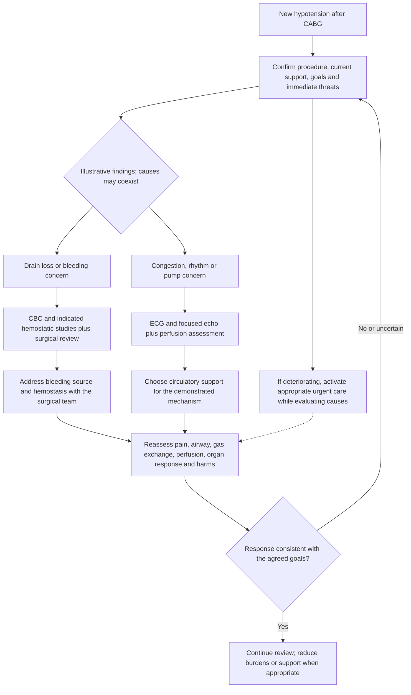

**Condition-specific references:** [POSTCARD](https://doi.org/10.15420/usc.2024.16), [PBM](https://doi.org/10.1093/ejcts/ezae352), [ERASC](https://doi.org/10.1016/j.athoracsur.2023.12.006). General pain/airway, renal, investigation and goals principles are contextualized in the companion source register, not independently validated by each condition-specific citation.

### Aortic, mitral or tricuspid repair/replacement

**Male example:** A man after mechanical aortic replacement develops bradycardia and reduced urine output.

**Female example:** A woman after mitral repair develops breathlessness and congestion.

**Clinical interpretation:** The team distinguishes rhythm/conduction problems, ventricular dysfunction, residual valve problems and obstruction. The exact prosthesis/repair and bleeding status matter.

**Pain, airway and breathing:** Pain treatment permits breathing and neurological assessment. Sedation is reviewed as a contributor to reduced responsiveness; respiratory support is individualized.

**Investigations in the example — purpose and effect on decisions:** ECG and pacing-system assessment address conduction; chemistry, magnesium and renal trends identify contributing abnormalities. Echo evaluates valve/function/loading. CBC/coagulation studies address bleeding and the actual anticoagulant context; INR does not measure every anticoagulant.

**Worked care course:** The man receives specialist evaluation of bradycardia and perfusion, including temporary pacing if clinically indicated. The woman receives evaluation of ventricular and valve function before choosing fluid removal or circulatory support. Antithrombotic planning is specific to valve type, timing and bleeding.

**Reassessment:** Reassessment includes rhythm, perfusion, pulmonary congestion and bleeding/thrombosis balance; tricuspid procedures also require close right-heart assessment. These are illustrative response criteria; no actual outcome is claimed.

**Applied detail:** [Lab example: anticoagulation](CLINICAL_LAB_EXAMPLES.md#anticoagulation) · [Lab example: electrolytes](CLINICAL_LAB_EXAMPLES.md#electrolytes) · [Lab example: bleeding](CLINICAL_LAB_EXAMPLES.md#bleeding); [Care example: pain](AIRWAY_PAIN_AND_VENTILATION_EXAMPLES.md#pain) · [Care example: extubation](AIRWAY_PAIN_AND_VENTILATION_EXAMPLES.md#extubation); [Equipment: pacing](ICU_EQUIPMENT_BASICS.md#pacing) · [Equipment: arterial](ICU_EQUIPMENT_BASICS.md#arterial) · [Equipment: ventilator](ICU_EQUIPMENT_BASICS.md#ventilator). These links explain relevant options; listing equipment is not a recommendation to use every device in the case.

**Visual decision tree — paired worked example**

The branches illustrate the male and female presentations above; they are not exhaustive or mutually exclusive. Assessment, investigations and urgent care can occur in parallel. Read this authored diagram with the narrative and its references; it is not a validated clinical algorithm.

**Condition-specific references:** [POSTCARD](https://doi.org/10.15420/usc.2024.16), [VALVE](https://doi.org/10.1161/CIR.0000000000000923), [RV](https://doi.org/10.1093/ehjacc/zuad157). General pain/airway, renal, investigation and goals principles are contextualized in the companion source register, not independently validated by each condition-specific citation.

### Thoracic aortic repair or dissection

**Male example:** A man after dissection repair becomes hypertensive and reports new pain.

**Female example:** A woman after arch repair develops reduced urine output and a focal neurological change.

**Clinical interpretation:** The team assesses pain and agitation while considering graft/branch-vessel complications and organ malperfusion. New focal findings are not attributed to sedation alone.

**Pain, airway and breathing:** The airway and aspiration risk are reviewed alongside neurological findings. Comfort treatment should preserve the necessary examination when feasible.

**Investigations in the example — purpose and effect on decisions:** Chemistry, CBC and perfusion trends address renal injury/bleeding; ECG/echo add cardiac context. Targeted head or vascular imaging is selected for the new deficit and surgical question, with transport and contrast risk weighed against urgency.

**Worked care course:** The man receives pain assessment and surgeon-directed control of pressure/impulse with perfusion monitored. The woman receives urgent neurological and surgical assessment for the focal change. Neither example uses one universal postoperative pressure target.

**Reassessment:** The response is judged by organ perfusion, neurological findings and surgical integrity, as well as pressure. These are illustrative response criteria; no actual outcome is claimed.

**Applied detail:** [Lab example: kidney](CLINICAL_LAB_EXAMPLES.md#kidney) · [Lab example: lactate](CLINICAL_LAB_EXAMPLES.md#lactate) · [Lab example: bleeding](CLINICAL_LAB_EXAMPLES.md#bleeding); [Care example: pain](AIRWAY_PAIN_AND_VENTILATION_EXAMPLES.md#pain) · [Care example: airwaycare](AIRWAY_PAIN_AND_VENTILATION_EXAMPLES.md#airwaycare); [Equipment: arterial](ICU_EQUIPMENT_BASICS.md#arterial) · [Equipment: infusion](ICU_EQUIPMENT_BASICS.md#infusion) · [Equipment: ventilator](ICU_EQUIPMENT_BASICS.md#ventilator). These links explain relevant options; listing equipment is not a recommendation to use every device in the case.

**Visual decision tree — paired worked example**

The branches illustrate the male and female presentations above; they are not exhaustive or mutually exclusive. Assessment, investigations and urgent care can occur in parallel. Read this authored diagram with the narrative and its references; it is not a validated clinical algorithm.

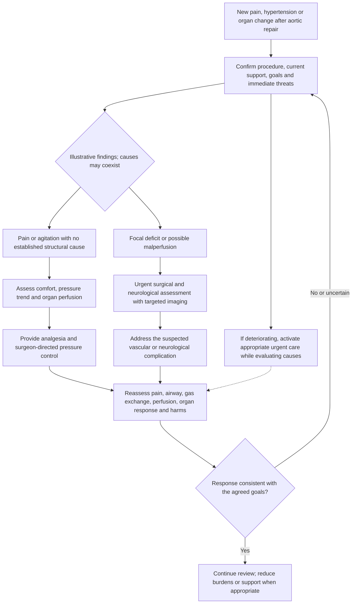

**Condition-specific references:** [AORTA](https://doi.org/10.1161/CIR.0000000000001106), [KIDNEY](https://doi.org/10.1038/kisup.2011.32). General pain/airway, renal, investigation and goals principles are contextualized in the companion source register, not independently validated by each condition-specific citation.

### VA-ECMO for cardiac failure

**Male example:** A man on VA-ECMO after myocardial injury develops cool extremities and rising lactate.

**Female example:** A woman on VA-ECMO after surgery develops pulmonary congestion despite displayed circuit flow.

**Clinical interpretation:** The team separates native heart function, circuit performance, loading and vascular complications. Displayed flow alone cannot establish adequate organ oxygen delivery.

**Pain, airway and breathing:** Airway and lung support continue to be assessed. Analgesia/sedation are individualized to comfort, synchrony and examination needs.

**Investigations in the example — purpose and effect on decisions:** Blood gases are interpreted by sampling site and configuration; CBC, selected hemolysis/coagulation studies and renal chemistry address support complications. Echo and circuit/access assessment evaluate function, congestion and limb perfusion.

**Worked care course:** For the man, examination and access assessment investigate impaired limb/systemic perfusion. For the woman, echo and specialist assessment investigate loading and pulmonary congestion. Device changes belong to the ECMO team using the actual configuration and protocol.

**Reassessment:** Reassessment follows organ perfusion, gas exchange, bleeding, access and ventricular loading, rather than a single circuit number. These are illustrative response criteria; no actual outcome is claimed.

**Applied detail:** [Lab example: oxygenation](CLINICAL_LAB_EXAMPLES.md#oxygenation) · [Lab example: hemolysis](CLINICAL_LAB_EXAMPLES.md#hemolysis) · [Lab example: anticoagulation](CLINICAL_LAB_EXAMPLES.md#anticoagulation); [Care example: airwaycare](AIRWAY_PAIN_AND_VENTILATION_EXAMPLES.md#airwaycare) · [Care example: modes](AIRWAY_PAIN_AND_VENTILATION_EXAMPLES.md#modes); [Equipment: va](ICU_EQUIPMENT_BASICS.md#va) · [Equipment: arterial](ICU_EQUIPMENT_BASICS.md#arterial) · [Equipment: pac](ICU_EQUIPMENT_BASICS.md#pac). These links explain relevant options; listing equipment is not a recommendation to use every device in the case.

**Visual decision tree — paired worked example**

The branches illustrate the male and female presentations above; they are not exhaustive or mutually exclusive. Assessment, investigations and urgent care can occur in parallel. Read this authored diagram with the narrative and its references; it is not a validated clinical algorithm.

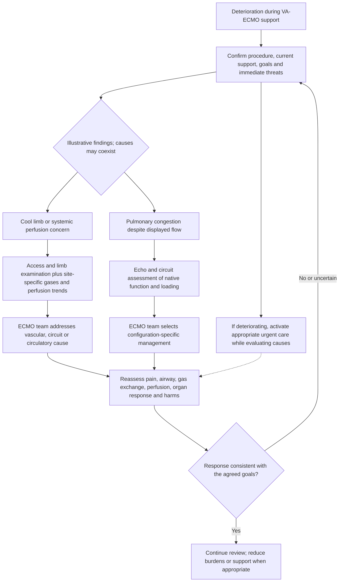

**Condition-specific references:** [VA](https://doi.org/10.1097/MAT.0000000000001510), [RV](https://doi.org/10.1093/ehjacc/zuad157). General pain/airway, renal, investigation and goals principles are contextualized in the companion source register, not independently validated by each condition-specific citation.

### Early or established LVAD support

**Male example:** A man soon after LVAD implantation develops venous congestion and reduced device flow.

**Female example:** A woman with an established LVAD has alarms, dark urine and falling hemoglobin.

**Clinical interpretation:** The first case raises right-heart/loading questions; the second raises bleeding, hemolysis and device concerns. Neither alarm proves thrombosis.

**Pain, airway and breathing:** Pain, ventilation and pulmonary vascular stress are reviewed in the postoperative case. Established-device support still requires comfort and respiratory assessment.

**Investigations in the example — purpose and effect on decisions:** Echo, rhythm and device trends address loading/function. CBC and selected LDH, plasma-free hemoglobin or other hemolysis studies investigate anemia/dark urine; renal chemistry and agent-specific coagulation assessment inform risk. Single abnormal values are not definitive.

**Worked care course:** The man receives specialist evaluation of right-heart function and congestion before fluid/device decisions. The woman receives prompt LVAD-team assessment of anemia and device findings. No speed or anticoagulant change is inferred from one alarm or LDH result.

**Reassessment:** Track perfusion, congestion, renal function, bleeding and device findings after the team-directed intervention. These are illustrative response criteria; no actual outcome is claimed.

**Applied detail:** [Lab example: hemolysis](CLINICAL_LAB_EXAMPLES.md#hemolysis) · [Lab example: kidney](CLINICAL_LAB_EXAMPLES.md#kidney) · [Lab example: anticoagulation](CLINICAL_LAB_EXAMPLES.md#anticoagulation); [Care example: pain](AIRWAY_PAIN_AND_VENTILATION_EXAMPLES.md#pain) · [Care example: support](AIRWAY_PAIN_AND_VENTILATION_EXAMPLES.md#support); [Equipment: lvad](ICU_EQUIPMENT_BASICS.md#lvad) · [Equipment: arterial](ICU_EQUIPMENT_BASICS.md#arterial) · [Equipment: pac](ICU_EQUIPMENT_BASICS.md#pac). These links explain relevant options; listing equipment is not a recommendation to use every device in the case.

**Visual decision tree — paired worked example**

The branches illustrate the male and female presentations above; they are not exhaustive or mutually exclusive. Assessment, investigations and urgent care can occur in parallel. Read this authored diagram with the narrative and its references; it is not a validated clinical algorithm.

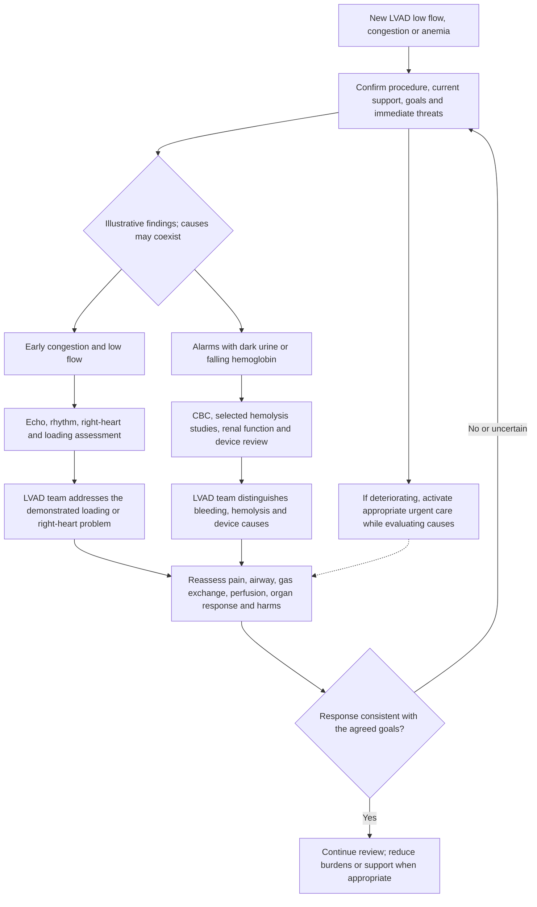

**Condition-specific references:** [LVAD](https://doi.org/10.1016/j.healun.2022.12.004), [RV](https://doi.org/10.1093/ehjacc/zuad157). General pain/airway, renal, investigation and goals principles are contextualized in the companion source register, not independently validated by each condition-specific citation.

### Temporary microaxial flow-pump support

**Male example:** A man supported with an Impella develops access-site swelling and a cooler leg.

**Female example:** A woman supported with an Impella develops dark urine and a falling hemoglobin.

**Clinical interpretation:** The examples distinguish vascular injury/ischemia from bleeding or hemolysis; device position and ventricular filling can contribute.

**Pain, airway and breathing:** Respiratory support and sedation are tailored to the patient, with attention to circulatory effects and neurological assessment.

**Investigations in the example — purpose and effect on decisions:** Access/limb examination and appropriate vascular imaging address the man’s findings. CBC, renal chemistry and selected hemolysis studies address the woman’s findings; echo/device assessment helps evaluate position/loading. Anticoagulant assays must match the actual therapy.

**Worked care course:** The specialist team evaluates the man’s threatened limb and the woman’s possible hemolysis promptly. Device repositioning, purge/systemic anticoagulation and support settings require the actual device instructions and trained team; these examples provide no adjustment recipe.

**Reassessment:** Follow limb viability, organ perfusion, bleeding, hemolysis and device performance. Support is not declared successful from pressure alone. These are illustrative response criteria; no actual outcome is claimed.

**Applied detail:** [Lab example: hemolysis](CLINICAL_LAB_EXAMPLES.md#hemolysis) · [Lab example: bleeding](CLINICAL_LAB_EXAMPLES.md#bleeding) · [Lab example: anticoagulation](CLINICAL_LAB_EXAMPLES.md#anticoagulation); [Care example: support](AIRWAY_PAIN_AND_VENTILATION_EXAMPLES.md#support) · [Care example: airwaycare](AIRWAY_PAIN_AND_VENTILATION_EXAMPLES.md#airwaycare); [Equipment: microaxial](ICU_EQUIPMENT_BASICS.md#microaxial) · [Equipment: arterial](ICU_EQUIPMENT_BASICS.md#arterial) · [Equipment: infusion](ICU_EQUIPMENT_BASICS.md#infusion). These links explain relevant options; listing equipment is not a recommendation to use every device in the case.

**Visual decision tree — paired worked example**

The branches illustrate the male and female presentations above; they are not exhaustive or mutually exclusive. Assessment, investigations and urgent care can occur in parallel. Read this authored diagram with the narrative and its references; it is not a validated clinical algorithm.

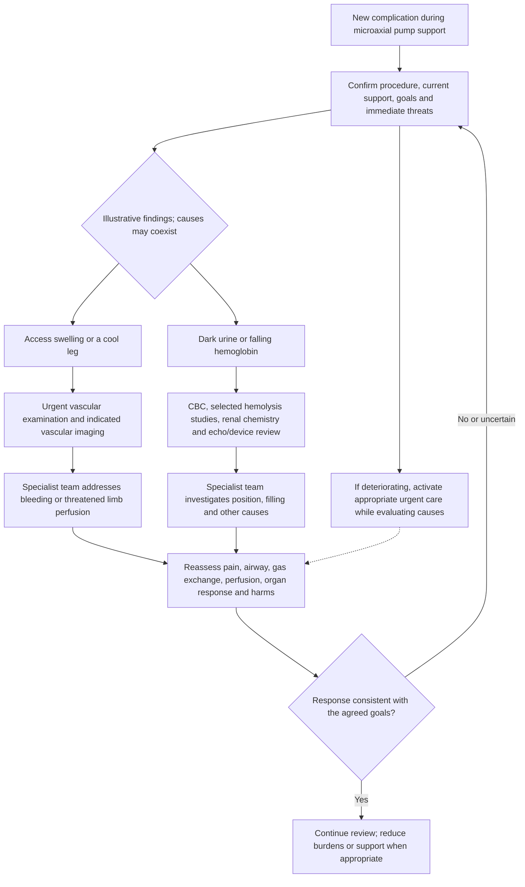

**Condition-specific references:** [CS2025](https://doi.org/10.1016/j.jacc.2025.02.018), [MCSHEM](https://doi.org/10.1016/j.iccl.2026.03.013). General pain/airway, renal, investigation and goals principles are contextualized in the companion source register, not independently validated by each condition-specific citation.

### Immediate heart-transplant recovery

**Male example:** A man after heart transplant develops low output and worsening kidney function.

**Female example:** A woman after heart transplant has a new rhythm change and rising support needs.

**Clinical interpretation:** The transplant team distinguishes graft dysfunction, right-heart/loading problems, bleeding/obstruction, rhythm effects and other causes. Rejection is not diagnosed from one laboratory finding.

**Pain, airway and breathing:** Analgesia and ventilatory support are coordinated with hemodynamics, examination and extubation readiness.

**Investigations in the example — purpose and effect on decisions:** Echo and ECG address graft/rhythm questions. CBC, metabolic/renal chemistry and selected perfusion measures address organ effects. Immunosuppressant levels are obtained and interpreted according to the actual drug, timing, interactions and transplant protocol; infection evaluation is tailored to immune status.

**Worked care course:** The man’s renal change triggers reassessment of perfusion, congestion and drug exposure. The woman’s rhythm/support change triggers urgent graft and rhythm assessment. The transplant service determines immunosuppression and any biopsy or additional imaging.

**Reassessment:** Follow graft function, perfusion, kidney trajectory, infection and medication toxicity with a documented recovery plan. These are illustrative response criteria; no actual outcome is claimed.

**Applied detail:** [Lab example: kidney](CLINICAL_LAB_EXAMPLES.md#kidney) · [Lab example: lactate](CLINICAL_LAB_EXAMPLES.md#lactate) · [Lab example: electrolytes](CLINICAL_LAB_EXAMPLES.md#electrolytes); [Care example: pain](AIRWAY_PAIN_AND_VENTILATION_EXAMPLES.md#pain) · [Care example: extubation](AIRWAY_PAIN_AND_VENTILATION_EXAMPLES.md#extubation); [Equipment: pac](ICU_EQUIPMENT_BASICS.md#pac) · [Equipment: ventilator](ICU_EQUIPMENT_BASICS.md#ventilator) · [Equipment: infusion](ICU_EQUIPMENT_BASICS.md#infusion). These links explain relevant options; listing equipment is not a recommendation to use every device in the case.

**Visual decision tree — paired worked example**

The branches illustrate the male and female presentations above; they are not exhaustive or mutually exclusive. Assessment, investigations and urgent care can occur in parallel. Read this authored diagram with the narrative and its references; it is not a validated clinical algorithm.

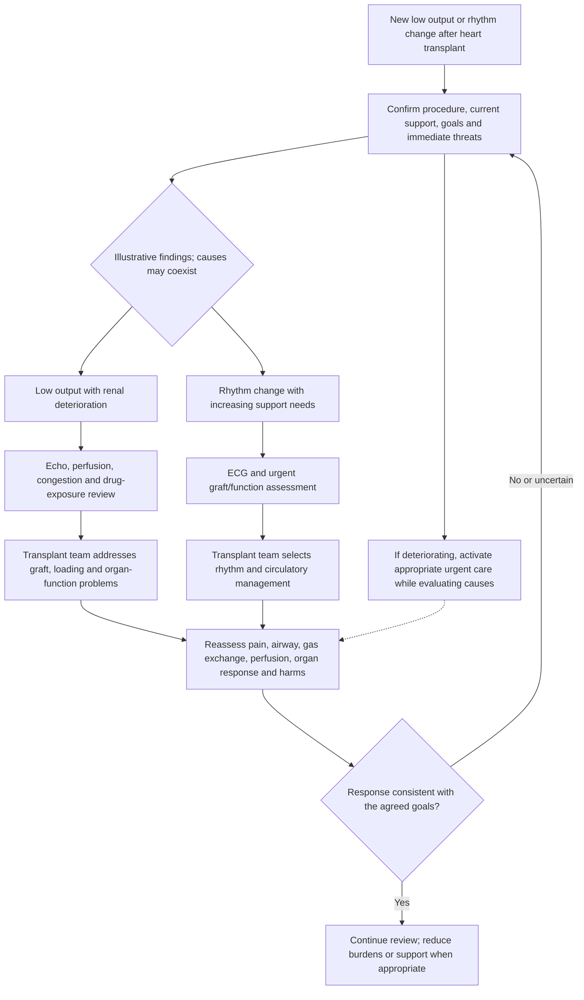

**Condition-specific references:** [HEARTTX](https://doi.org/10.1016/j.healun.2022.10.015). General pain/airway, renal, investigation and goals principles are contextualized in the companion source register, not independently validated by each condition-specific citation.

## 2. Thoracic surgery

### Lobectomy or pneumonectomy

**Male example:** A man after lobectomy has pain-limited coughing and a rising oxygen requirement.

**Female example:** A woman after pneumonectomy develops breathlessness and a new circulation change.

**Clinical interpretation:** The team considers retained secretions/atelectasis, pleural or airway complications, infection and fluid/cardiac causes in the context of the exact resection.

**Pain, airway and breathing:** Multimodal pain treatment is individualized; regional options depend on procedure, coagulation and expertise. Respiratory support and fluid decisions account for remaining lung function.

**Investigations in the example — purpose and effect on decisions:** Chest imaging is obtained for the new problem, not merely the date. Blood gas sampling addresses ventilation/oxygenation when useful; CBC and renal chemistry answer bleeding or fluid/exposure questions. Drain findings are interpreted using the operation-specific plan.

**Worked care course:** The man’s pain and secretion burden lead to coordinated analgesia and respiratory care while complications are assessed. The woman receives prompt surgical/critical-care review of post-pneumonectomy deterioration. A generic bilateral-lung or chest-drain rule is inappropriate.

**Reassessment:** Improvement includes comfortable breathing/coughing, adequate gas exchange, mobilization and a stable circulatory course. These are illustrative response criteria; no actual outcome is claimed.

**Applied detail:** [Lab example: oxygenation](CLINICAL_LAB_EXAMPLES.md#oxygenation) · [Lab example: ventilation](CLINICAL_LAB_EXAMPLES.md#ventilation) · [Lab example: bleeding](CLINICAL_LAB_EXAMPLES.md#bleeding); [Care example: pain](AIRWAY_PAIN_AND_VENTILATION_EXAMPLES.md#pain) · [Care example: airwaycare](AIRWAY_PAIN_AND_VENTILATION_EXAMPLES.md#airwaycare) · [Care example: support](AIRWAY_PAIN_AND_VENTILATION_EXAMPLES.md#support); [Equipment: drain](ICU_EQUIPMENT_BASICS.md#drain) · [Equipment: ventilator](ICU_EQUIPMENT_BASICS.md#ventilator) · [Equipment: hfnc](ICU_EQUIPMENT_BASICS.md#hfnc). These links explain relevant options; listing equipment is not a recommendation to use every device in the case.

**Visual decision tree — paired worked example**

The branches illustrate the male and female presentations above; they are not exhaustive or mutually exclusive. Assessment, investigations and urgent care can occur in parallel. Read this authored diagram with the narrative and its references; it is not a validated clinical algorithm.

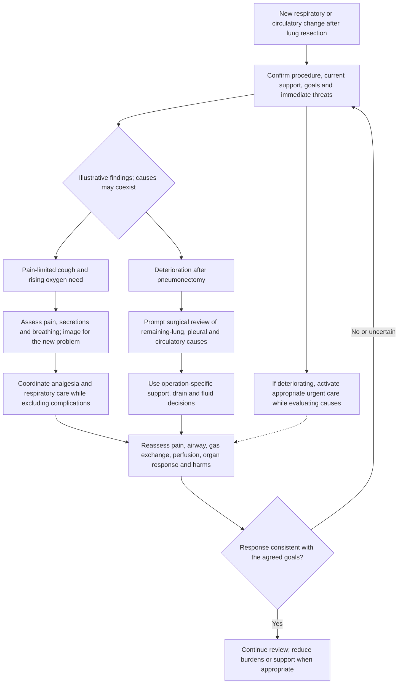

**Condition-specific references:** [LUNGERAS](https://doi.org/10.1093/ejcts/ezy301). General pain/airway, renal, investigation and goals principles are contextualized in the companion source register, not independently validated by each condition-specific citation.

### Single or double lung transplantation

**Male example:** A man early after bilateral transplant develops impaired oxygenation and opacities.

**Female example:** A woman after single-lung transplant develops hypoxemia with altered airway pressures.

**Clinical interpretation:** The transplant team considers graft dysfunction, airway/vascular complications, infection and cardiac/fluid causes; the native lung also matters after single-lung transplant.

**Pain, airway and breathing:** Support is tailored to graft and native-lung mechanics. Pain/sedation are balanced against synchrony, airway clearance and examination.

**Investigations in the example — purpose and effect on decisions:** Gas exchange is assessed with documented support conditions. Imaging and specialist airway evaluation address anatomic/airway questions. Renal chemistry, selected microbiology and drug-level monitoring are tied to immune status, exposure and clinical findings.

**Worked care course:** The man’s findings prompt assessment of graft dysfunction alongside alternatives. The woman’s pressure change prompts airway and mechanical assessment, rather than an oxygen-only response. PGD classification is not a substitute for investigating treatable causes.

**Reassessment:** Follow oxygenation, mechanics, perfusion, airway integrity, renal function and immunosuppression toxicity with the transplant service. These are illustrative response criteria; no actual outcome is claimed.

**Applied detail:** [Lab example: oxygenation](CLINICAL_LAB_EXAMPLES.md#oxygenation) · [Lab example: ventilation](CLINICAL_LAB_EXAMPLES.md#ventilation) · [Lab example: kidney](CLINICAL_LAB_EXAMPLES.md#kidney); [Care example: airwaycare](AIRWAY_PAIN_AND_VENTILATION_EXAMPLES.md#airwaycare) · [Care example: modes](AIRWAY_PAIN_AND_VENTILATION_EXAMPLES.md#modes) · [Care example: extubation](AIRWAY_PAIN_AND_VENTILATION_EXAMPLES.md#extubation); [Equipment: ventilator](ICU_EQUIPMENT_BASICS.md#ventilator) · [Equipment: vv](ICU_EQUIPMENT_BASICS.md#vv) · [Equipment: capnography](ICU_EQUIPMENT_BASICS.md#capnography). These links explain relevant options; listing equipment is not a recommendation to use every device in the case.

**Visual decision tree — paired worked example**

The branches illustrate the male and female presentations above; they are not exhaustive or mutually exclusive. Assessment, investigations and urgent care can occur in parallel. Read this authored diagram with the narrative and its references; it is not a validated clinical algorithm.

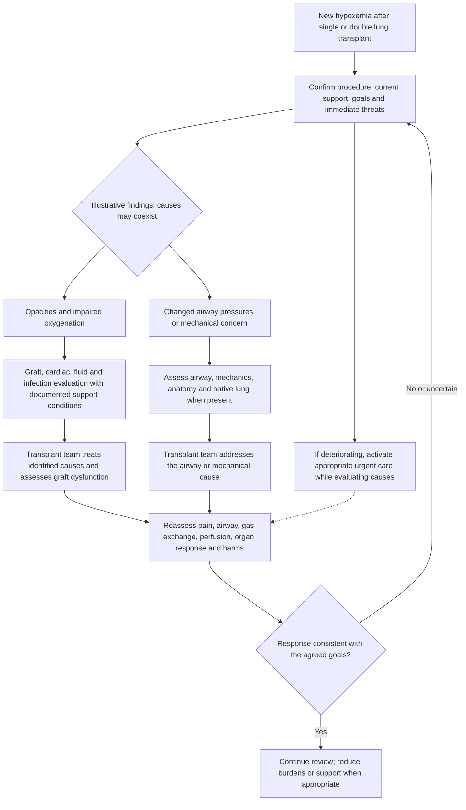

**Condition-specific references:** [PGD](https://doi.org/10.1016/j.healun.2017.07.021), [TRANSPLANT](https://doi.org/10.1016/j.thorsurg.2021.11.006). General pain/airway, renal, investigation and goals principles are contextualized in the companion source register, not independently validated by each condition-specific citation.

### Esophagectomy

**Male example:** A man after esophagectomy develops tachycardia, new oxygen need and chest discomfort.

**Female example:** A woman after esophagectomy develops fever, hypotension and altered drain findings.

**Clinical interpretation:** The team considers pulmonary complications, bleeding, arrhythmia and anastomotic/conduit problems. Nutrition, aspiration risk and reconstruction details are central.

**Pain, airway and breathing:** Analgesia supports breathing and mobility while avoiding excessive sedation. Airway and feeding/decompression devices follow the surgical plan; no blind tube manipulation is implied.

**Investigations in the example — purpose and effect on decisions:** CBC and chemistry assess anemia/organ effects. Cultures and targeted chest/anastomotic imaging are selected when infection or leak is suspected, coordinated with the surgeon. A normal white count alone does not exclude a serious complication.

**Worked care course:** The man receives respiratory/rhythm assessment while the surgical complication differential remains open. The woman receives urgent surgical and critical-care review for possible leak/sepsis with source evaluation and timely treatment. Feeding changes are team-directed.

**Reassessment:** Follow perfusion, respiration, source control and nutritional tolerance, documenting the reconstruction-specific plan. These are illustrative response criteria; no actual outcome is claimed.

**Applied detail:** [Lab example: cultures](CLINICAL_LAB_EXAMPLES.md#cultures) · [Lab example: bleeding](CLINICAL_LAB_EXAMPLES.md#bleeding) · [Lab example: kidney](CLINICAL_LAB_EXAMPLES.md#kidney); [Care example: pain](AIRWAY_PAIN_AND_VENTILATION_EXAMPLES.md#pain) · [Care example: airwaycare](AIRWAY_PAIN_AND_VENTILATION_EXAMPLES.md#airwaycare) · [Care example: support](AIRWAY_PAIN_AND_VENTILATION_EXAMPLES.md#support); [Equipment: drain](ICU_EQUIPMENT_BASICS.md#drain) · [Equipment: ventilator](ICU_EQUIPMENT_BASICS.md#ventilator) · [Equipment: infusion](ICU_EQUIPMENT_BASICS.md#infusion). These links explain relevant options; listing equipment is not a recommendation to use every device in the case.

**Visual decision tree — paired worked example**

The branches illustrate the male and female presentations above; they are not exhaustive or mutually exclusive. Assessment, investigations and urgent care can occur in parallel. Read this authored diagram with the narrative and its references; it is not a validated clinical algorithm.

**Condition-specific references:** [ESOPERAS](https://doi.org/10.1007/s00268-018-4786-4), [FEVER](https://doi.org/10.1097/CCM.0000000000006022). General pain/airway, renal, investigation and goals principles are contextualized in the companion source register, not independently validated by each condition-specific citation.

### Tracheal reconstruction or mediastinal surgery

**Male example:** A man after tracheal reconstruction develops stridor and distress.

**Female example:** A woman after mediastinal tumor surgery develops positional breathing difficulty and hypotension.

**Clinical interpretation:** Anastomotic/airway problems and residual airway or cardiovascular compression require procedure-specific assessment; these are not routine postoperative breathlessness.

**Pain, airway and breathing:** The surgeon and airway team are involved immediately in new obstruction. Airway rescue and positioning are individualized to anatomy and reconstruction; a generic RSI sequence is not provided.

**Investigations in the example — purpose and effect on decisions:** Bedside assessment, targeted imaging and expert airway evaluation address the suspected mechanism. Gas sampling may characterize gas exchange but must not delay response to clinical obstruction; CBC/chemistry answer specific bleeding/metabolic questions.

**Worked care course:** The man’s stridor triggers urgent coordinated airway/surgical management. The woman’s positional findings trigger assessment for airway and circulatory compression. Analgesia/sedation are cautious and coordinated because loss of airway tone or pressure changes can matter.

**Reassessment:** Follow airway patency, gas exchange, hemodynamics and reconstruction integrity under the specialist plan. These are illustrative response criteria; no actual outcome is claimed.

**Applied detail:** [Lab example: ventilation](CLINICAL_LAB_EXAMPLES.md#ventilation) · [Lab example: oxygenation](CLINICAL_LAB_EXAMPLES.md#oxygenation); [Care example: intubation](AIRWAY_PAIN_AND_VENTILATION_EXAMPLES.md#intubation) · [Care example: airwaycare](AIRWAY_PAIN_AND_VENTILATION_EXAMPLES.md#airwaycare); [Equipment: airway](ICU_EQUIPMENT_BASICS.md#airway) · [Equipment: capnography](ICU_EQUIPMENT_BASICS.md#capnography) · [Equipment: ventilator](ICU_EQUIPMENT_BASICS.md#ventilator). These links explain relevant options; listing equipment is not a recommendation to use every device in the case.

**Visual decision tree — paired worked example**

The branches illustrate the male and female presentations above; they are not exhaustive or mutually exclusive. Assessment, investigations and urgent care can occur in parallel. Read this authored diagram with the narrative and its references; it is not a validated clinical algorithm.

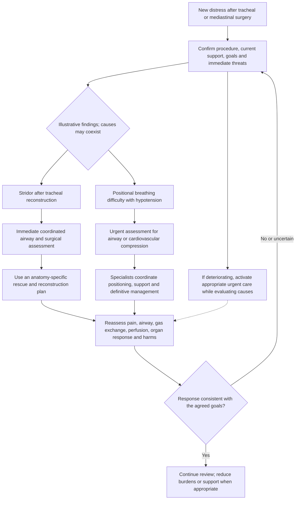

**Condition-specific references:** [TRACHEAL](https://doi.org/10.1016/j.anclin.2012.08.012), [AIRWAY](https://doi.org/10.1097/CCM.0000000000006000). General pain/airway, renal, investigation and goals principles are contextualized in the companion source register, not independently validated by each condition-specific citation.

## 3. Vascular surgery

### Open or endovascular abdominal aortic repair

**Male example:** A man after open AAA repair develops abdominal distension and reduced urine output.

**Female example:** A woman after endovascular repair develops new pain and falling pressure.

**Clinical interpretation:** The exact repair informs evaluation of bleeding, organ/limb ischemia, graft/endoleak and abdominal complications. Not every AAA patient requires CTICU admission.

**Pain, airway and breathing:** Analgesia permits assessment without masking a new pain pattern. Respiratory support is individualized after major abdominal surgery or hemorrhage.

**Investigations in the example — purpose and effect on decisions:** CBC, coagulation studies when bleeding is suspected, renal chemistry and selected perfusion measures address immediate complications. Targeted vascular/abdominal imaging and surgical assessment investigate structural causes; pressure measurements are used only for a defined abdominal-compartment question.

**Worked care course:** The man receives assessment of perfusion, renal/abdominal causes and possible compartment complications. The woman receives urgent vascular evaluation for hemorrhagic or graft-related deterioration. Fluid/pressure treatment accounts for bleeding and organ perfusion, not a universal target.

**Reassessment:** Track abdomen, limb/organ perfusion, bleeding and renal response; laboratory improvement alone cannot exclude a structural complication. These are illustrative response criteria; no actual outcome is claimed.

**Applied detail:** [Lab example: bleeding](CLINICAL_LAB_EXAMPLES.md#bleeding) · [Lab example: kidney](CLINICAL_LAB_EXAMPLES.md#kidney) · [Lab example: lactate](CLINICAL_LAB_EXAMPLES.md#lactate); [Care example: pain](AIRWAY_PAIN_AND_VENTILATION_EXAMPLES.md#pain) · [Care example: support](AIRWAY_PAIN_AND_VENTILATION_EXAMPLES.md#support); [Equipment: arterial](ICU_EQUIPMENT_BASICS.md#arterial) · [Equipment: ventilator](ICU_EQUIPMENT_BASICS.md#ventilator) · [Equipment: crrt](ICU_EQUIPMENT_BASICS.md#crrt). These links explain relevant options; listing equipment is not a recommendation to use every device in the case.

**Visual decision tree — paired worked example**

The branches illustrate the male and female presentations above; they are not exhaustive or mutually exclusive. Assessment, investigations and urgent care can occur in parallel. Read this authored diagram with the narrative and its references; it is not a validated clinical algorithm.

**Condition-specific references:** [AAA](https://doi.org/10.1016/j.ejvs.2023.11.002), [ABD](https://doi.org/10.1007/s00134-013-2906-z), [KIDNEY](https://doi.org/10.1038/kisup.2011.32). General pain/airway, renal, investigation and goals principles are contextualized in the companion source register, not independently validated by each condition-specific citation.

### Carotid endarterectomy

**Male example:** A man after carotid endarterectomy develops neck swelling and voice change.

**Female example:** A woman after the same operation develops severe headache and a new focal deficit.

**Clinical interpretation:** The first case raises a threatened-airway/neck-hematoma concern; the second requires urgent evaluation of stroke, hemorrhage or hyperperfusion-related complications.

**Pain, airway and breathing:** Airway/surgical expertise is mobilized promptly for expanding swelling. Sedation is not used to dismiss or conceal the neurological change.

**Investigations in the example — purpose and effect on decisions:** Focused airway and neurological examinations guide urgent surgical/stroke pathways and targeted imaging. Glucose identifies a reversible mimic; CBC/coagulation studies answer bleeding/therapy questions. Tests must not delay response to a threatened airway.

**Worked care course:** The man receives immediate coordinated airway and surgical assessment. The woman receives urgent neurological and vascular assessment, with pressure management individualized to diagnosis and operative plan. Neither receives one blanket postoperative BP rule.

**Reassessment:** Follow airway, neurological findings, pressure/perfusion and bleeding. Unit placement depends on risk and local service organization. These are illustrative response criteria; no actual outcome is claimed.

**Applied detail:** [Lab example: bleeding](CLINICAL_LAB_EXAMPLES.md#bleeding) · [Lab example: paireddata](CLINICAL_LAB_EXAMPLES.md#paireddata); [Care example: intubation](AIRWAY_PAIN_AND_VENTILATION_EXAMPLES.md#intubation) · [Care example: airwaycare](AIRWAY_PAIN_AND_VENTILATION_EXAMPLES.md#airwaycare); [Equipment: airway](ICU_EQUIPMENT_BASICS.md#airway) · [Equipment: capnography](ICU_EQUIPMENT_BASICS.md#capnography) · [Equipment: arterial](ICU_EQUIPMENT_BASICS.md#arterial). These links explain relevant options; listing equipment is not a recommendation to use every device in the case.

**Visual decision tree — paired worked example**

The branches illustrate the male and female presentations above; they are not exhaustive or mutually exclusive. Assessment, investigations and urgent care can occur in parallel. Read this authored diagram with the narrative and its references; it is not a validated clinical algorithm.

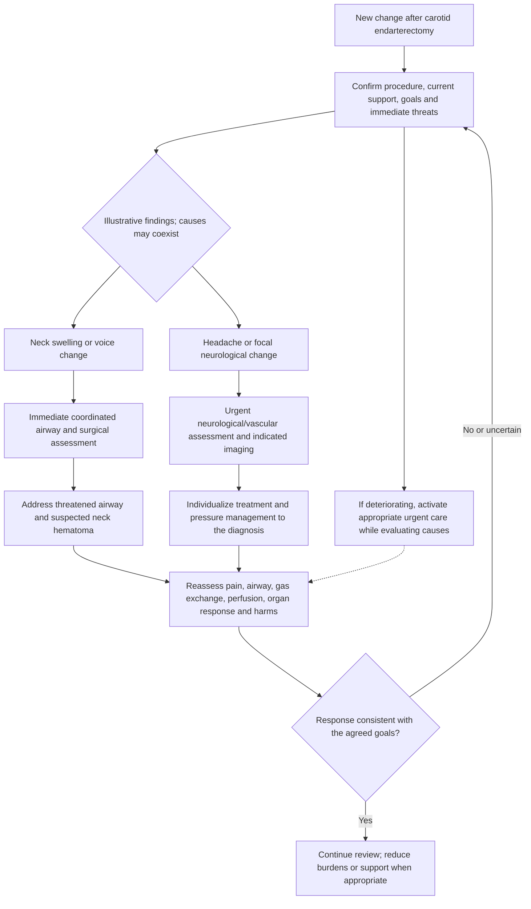

**Condition-specific references:** [CAROTID](https://doi.org/10.1016/j.ejvs.2022.04.011). General pain/airway, renal, investigation and goals principles are contextualized in the companion source register, not independently validated by each condition-specific citation.

### Complex limb revascularization

**Male example:** A man after lower-limb bypass develops increasing pain, tense swelling and sensory change.

**Female example:** A woman after revascularization has a newly cool foot with diminished Doppler signals.

**Clinical interpretation:** The first pattern raises compartment/reperfusion complications; the second raises recurrent ischemia or graft compromise. Both need urgent vascular review.

**Pain, airway and breathing:** Analgesia is provided while repeated neurovascular findings remain documented. Respiratory/circulatory status still require assessment, especially with systemic reperfusion effects.

**Investigations in the example — purpose and effect on decisions:** Examination and vascular studies address limb viability/graft flow. Chemistry including potassium/renal function, and selected muscle-injury studies where indicated, assess reperfusion injury; CBC assesses bleeding. Normal labs do not exclude limb-threatening pathology.

**Worked care course:** The man receives prompt surgical assessment of the swollen painful limb; analgesia alone is insufficient. The woman receives urgent assessment of graft flow/ischemia. Antithrombotic decisions depend on repair, indication and bleeding; no regimen is inferred solely from sex.

**Reassessment:** Follow motor/sensory function, perfusion, renal/electrolyte effects and bleeding. ICU need reflects actual complexity, not every bypass operation. These are illustrative response criteria; no actual outcome is claimed.

**Applied detail:** [Lab example: electrolytes](CLINICAL_LAB_EXAMPLES.md#electrolytes) · [Lab example: kidney](CLINICAL_LAB_EXAMPLES.md#kidney) · [Lab example: bleeding](CLINICAL_LAB_EXAMPLES.md#bleeding); [Care example: pain](AIRWAY_PAIN_AND_VENTILATION_EXAMPLES.md#pain) · [Care example: support](AIRWAY_PAIN_AND_VENTILATION_EXAMPLES.md#support); [Equipment: arterial](ICU_EQUIPMENT_BASICS.md#arterial) · [Equipment: infusion](ICU_EQUIPMENT_BASICS.md#infusion) · [Equipment: crrt](ICU_EQUIPMENT_BASICS.md#crrt). These links explain relevant options; listing equipment is not a recommendation to use every device in the case.

**Visual decision tree — paired worked example**

The branches illustrate the male and female presentations above; they are not exhaustive or mutually exclusive. Assessment, investigations and urgent care can occur in parallel. Read this authored diagram with the narrative and its references; it is not a validated clinical algorithm.

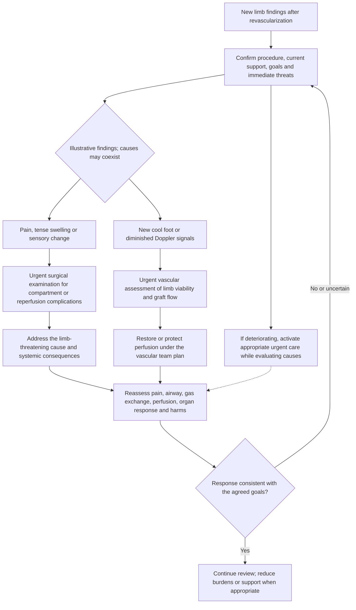

**Condition-specific references:** [PAD2024](https://doi.org/10.1161/CIR.0000000000001251). General pain/airway, renal, investigation and goals principles are contextualized in the companion source register, not independently validated by each condition-specific citation.

## 4. Severe medical/mechanical crises and goals of care

### Cardiogenic shock without a completed operation

**Male example:** A man with acute myocardial injury has cool skin, oliguria and pulmonary edema.

**Female example:** A woman with acute severe ventricular dysfunction has hypotension and increasing respiratory effort.

**Clinical interpretation:** The team evaluates the cause, ventricular/rhythm phenotype and possible mixed shock. Coronary or structural emergencies and reversible causes require prompt specialist pathways.

**Pain, airway and breathing:** Airway planning accounts for physiologic instability; analgesia and sedation can affect pressure and ventilation. Support is selected for the current respiratory failure and goals.

**Investigations in the example — purpose and effect on decisions:** ECG, echo, renal chemistry and perfusion trends connect cause and organ effects. Troponin helps characterize injury in context, but cannot establish every mechanism. Invasive hemodynamics may help selected unresolved cases; a central line does not directly measure cardiac output.

**Worked care course:** The man receives urgent evaluation for an ischemic cause and congestion. The woman receives phenotype-directed circulatory/respiratory assessment. Vasopressor, inotrope or temporary MCS choices are conditional on mechanism, response, risks and available expertise.

**Reassessment:** Reassess clinical perfusion and organ trajectory, not pressure alone; de-escalation also needs evidence of recovery. These are illustrative response criteria; no actual outcome is claimed.

**Applied detail:** [Lab example: lactate](CLINICAL_LAB_EXAMPLES.md#lactate) · [Lab example: kidney](CLINICAL_LAB_EXAMPLES.md#kidney) · [Lab example: oxygenation](CLINICAL_LAB_EXAMPLES.md#oxygenation); [Care example: intubation](AIRWAY_PAIN_AND_VENTILATION_EXAMPLES.md#intubation) · [Care example: support](AIRWAY_PAIN_AND_VENTILATION_EXAMPLES.md#support); [Equipment: pac](ICU_EQUIPMENT_BASICS.md#pac) · [Equipment: iabp](ICU_EQUIPMENT_BASICS.md#iabp) · [Equipment: microaxial](ICU_EQUIPMENT_BASICS.md#microaxial) · [Equipment: va](ICU_EQUIPMENT_BASICS.md#va). These links explain relevant options; listing equipment is not a recommendation to use every device in the case.

**Visual decision tree — paired worked example**

The branches illustrate the male and female presentations above; they are not exhaustive or mutually exclusive. Assessment, investigations and urgent care can occur in parallel. Read this authored diagram with the narrative and its references; it is not a validated clinical algorithm.

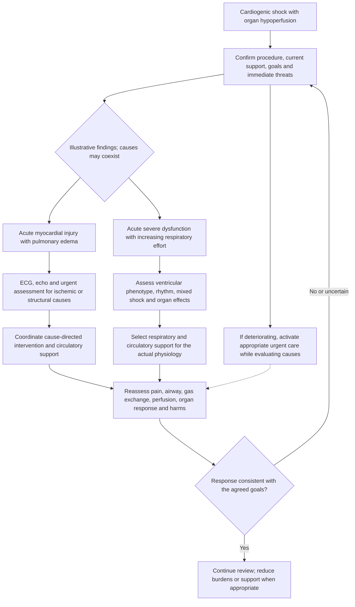

**Condition-specific references:** [CS2025](https://doi.org/10.1016/j.jacc.2025.02.018). General pain/airway, renal, investigation and goals principles are contextualized in the companion source register, not independently validated by each condition-specific citation.

### Severe respiratory failure or ARDS

**Male example:** A man with severe pneumonia develops diffuse lung injury and worsening oxygenation.

**Female example:** A woman with a similar lung injury develops hypercapnia and ventilator dyssynchrony.

**Clinical interpretation:** The team distinguishes oxygenation failure, ventilation failure, mechanical/airway problems and circulatory contributors while treating the cause.

**Pain, airway and breathing:** Lung-protective support uses predicted body weight and respiratory mechanics; one tidal-volume number is not a complete prescription. Pain/sedation and selected adjuncts are assessed for benefit and harm.

**Investigations in the example — purpose and effect on decisions:** An arterial gas interpreted with support conditions addresses oxygenation, carbon dioxide and pH. Imaging and selective microbiology address lung/source questions; chemistry and renal assessment address metabolic contributors.

**Worked care course:** The man’s course leads to cause-directed care and assessment of evidence-based ARDS options. The woman’s course leads to assessment of ventilation, mechanics and sedation rather than simply increasing oxygen. VV-ECMO referral is a specialist selection decision for refractory failure.

**Reassessment:** Follow gas exchange, mechanics, perfusion, comfort and treatment harms. VA and VV support address different physiologic problems. These are illustrative response criteria; no actual outcome is claimed.

**Applied detail:** [Lab example: ventilation](CLINICAL_LAB_EXAMPLES.md#ventilation) · [Lab example: oxygenation](CLINICAL_LAB_EXAMPLES.md#oxygenation) · [Lab example: cultures](CLINICAL_LAB_EXAMPLES.md#cultures); [Care example: support](AIRWAY_PAIN_AND_VENTILATION_EXAMPLES.md#support) · [Care example: modes](AIRWAY_PAIN_AND_VENTILATION_EXAMPLES.md#modes) · [Care example: extubation](AIRWAY_PAIN_AND_VENTILATION_EXAMPLES.md#extubation); [Equipment: hfnc](ICU_EQUIPMENT_BASICS.md#hfnc) · [Equipment: niv](ICU_EQUIPMENT_BASICS.md#niv) · [Equipment: ventilator](ICU_EQUIPMENT_BASICS.md#ventilator) · [Equipment: vv](ICU_EQUIPMENT_BASICS.md#vv). These links explain relevant options; listing equipment is not a recommendation to use every device in the case.

**Visual decision tree — paired worked example**

The branches illustrate the male and female presentations above; they are not exhaustive or mutually exclusive. Assessment, investigations and urgent care can occur in parallel. Read this authored diagram with the narrative and its references; it is not a validated clinical algorithm.

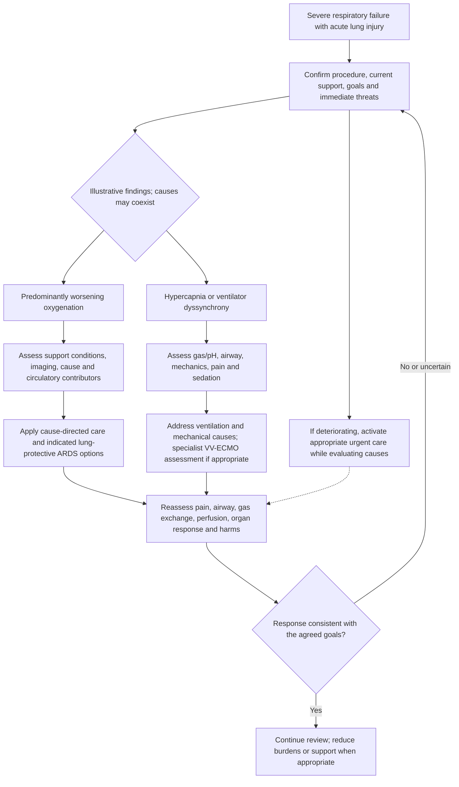

**Condition-specific references:** [ARDS](https://doi.org/10.1164/rccm.202311-2011ST), [VV](https://doi.org/10.1097/MAT.0000000000001432). General pain/airway, renal, investigation and goals principles are contextualized in the companion source register, not independently validated by each condition-specific citation.

### Complicated infective endocarditis

**Male example:** A man with valve infection develops pulmonary edema and low output.

**Female example:** A woman with suspected valve infection develops shock and a focal neurological change.

**Clinical interpretation:** The team considers destructive valve dysfunction, embolic events, infection and mixed shock. Diagnosis and treatment involve infectious-disease, cardiology and surgical expertise.

**Pain, airway and breathing:** Respiratory support and pain/comfort treatment accompany urgent assessment. A new deficit is evaluated before it is attributed to medication or delirium.

**Investigations in the example — purpose and effect on decisions:** Appropriately collected blood cultures, echo and targeted imaging address organism, valve and embolic questions. Renal chemistry informs organ injury and antimicrobial exposure; CBC is contextual rather than diagnostic alone. Sampling should not harmfully delay time-critical care.

**Worked care course:** The man receives urgent evaluation of valve-related failure and source/antimicrobial management. The woman receives neurological and shock evaluation alongside infection treatment. Surgery timing, antimicrobial selection and neurological risks are specialist decisions, not one fixed regimen.

**Reassessment:** Follow perfusion, infection evidence, organ injury and complications; persistent instability triggers re-evaluation of source and structural disease. These are illustrative response criteria; no actual outcome is claimed.

**Applied detail:** [Lab example: cultures](CLINICAL_LAB_EXAMPLES.md#cultures) · [Lab example: kidney](CLINICAL_LAB_EXAMPLES.md#kidney) · [Lab example: lactate](CLINICAL_LAB_EXAMPLES.md#lactate); [Care example: intubation](AIRWAY_PAIN_AND_VENTILATION_EXAMPLES.md#intubation) · [Care example: support](AIRWAY_PAIN_AND_VENTILATION_EXAMPLES.md#support); [Equipment: ventilator](ICU_EQUIPMENT_BASICS.md#ventilator) · [Equipment: arterial](ICU_EQUIPMENT_BASICS.md#arterial) · [Equipment: infusion](ICU_EQUIPMENT_BASICS.md#infusion). These links explain relevant options; listing equipment is not a recommendation to use every device in the case.

**Visual decision tree — paired worked example**

The branches illustrate the male and female presentations above; they are not exhaustive or mutually exclusive. Assessment, investigations and urgent care can occur in parallel. Read this authored diagram with the narrative and its references; it is not a validated clinical algorithm.

**Condition-specific references:** [ENDO](https://doi.org/10.1093/eurheartj/ehad193). General pain/airway, renal, investigation and goals principles are contextualized in the companion source register, not independently validated by each condition-specific citation.

### A goals-concordant course with advanced cardiorespiratory failure

**Male example:** A man with persistent multiorgan failure chooses a comfort-focused plan after an informed discussion.

**Female example:** A woman with severe lung disease declines intubation but requests treatment of a potentially reversible infection.

**Clinical interpretation:** The examples have different goals: comfort focus is not identical to DNI, and palliative care can accompany restorative treatment. Preferences, capacity and surrogate involvement are documented.

**Pain, airway and breathing:** For the man, dyspnea/pain/anxiety relief and any planned support withdrawal are coordinated with the team and family. For the woman, oxygen/noninvasive support is assessed against comfort, tolerance and her treatment limits. No automatic deep sedation or mandatory avoidance of intubation follows from the word palliative.

**Investigations in the example — purpose and effect on decisions:** Testing is chosen only when its result can improve a goal-consistent decision. The man may avoid burdensome draws that would not change comfort care; the woman may still benefit from infection/organ-function assessment. Neither has an automatic rule to stop every investigation.

**Worked care course:** Symptom medication is proportionate to distress, prior exposure and organ function, with reassessment. No unrestricted dose escalation or automatic simultaneous discontinuation of all support is implied. Withdrawal decisions follow the agreed plan and clinical/legal context.

**Reassessment:** Reassessment centers on symptoms, communication, unwanted effects and goal consistency. These examples do not establish legal rules for a jurisdiction. These are illustrative response criteria; no actual outcome is claimed.

**Applied detail:** [Lab example: paireddata](CLINICAL_LAB_EXAMPLES.md#paireddata); [Care example: comfort](AIRWAY_PAIN_AND_VENTILATION_EXAMPLES.md#comfort) · [Care example: support](AIRWAY_PAIN_AND_VENTILATION_EXAMPLES.md#support); [Equipment: infusion](ICU_EQUIPMENT_BASICS.md#infusion) · [Equipment: hfnc](ICU_EQUIPMENT_BASICS.md#hfnc). These links explain relevant options; listing equipment is not a recommendation to use every device in the case.

**Visual decision tree — paired worked example**

The branches illustrate the male and female presentations above; they are not exhaustive or mutually exclusive. Assessment, investigations and urgent care can occur in parallel. Read this authored diagram with the narrative and its references; it is not a validated clinical algorithm.

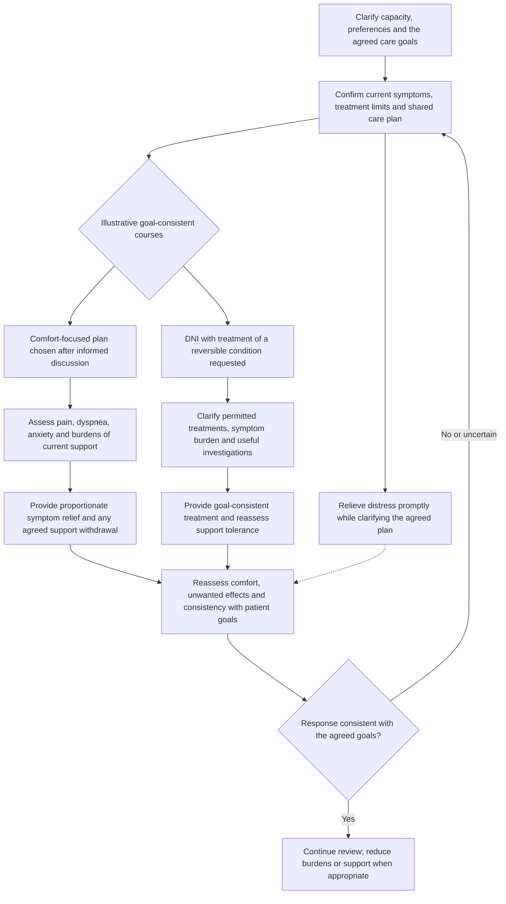

**Condition-specific references:** [GOALS](https://doi.org/10.1007/s00134-024-07579-1), [DNR](https://doi.org/10.4103/ijmr.IJMR_395_20). General pain/airway, renal, investigation and goals principles are contextualized in the companion source register, not independently validated by each condition-specific citation.

## Source register and limits

These are original educational narratives. References identify the relevant literature; the narratives are not copied or society-endorsed pathways. The new procedure references below have DOI identities verified through publisher, society or PubMed records. Availability and review depth are reported candidly; a DOI and peer review do not validate every authored application. Existing source/correction limits remain in the [companion register](ICU_CTICU_WORKUP_CASES.md#sources-and-verification-scope).

| ID | Publication | Verification scope |
|---|---|---|
| ERASC | [Grant et al. cardiac perioperative care consensus (2024)](https://doi.org/10.1016/j.athoracsur.2023.12.006) | Publisher consensus identity/abstract; procedure context, no pathway reproduced. |
| HEARTTX | [ISHLT care of heart transplant recipients (2023)](https://doi.org/10.1016/j.healun.2022.10.015) | Society and PubMed identity; complete guideline not appraised. |
| LUNGERAS | [ERAS/ESTS enhanced recovery after lung surgery (2019)](https://doi.org/10.1093/ejcts/ezy301) | PubMed identity; complete guideline not appraised. |
| ESOPERAS | [Low et al. ERAS esophagectomy recommendations (2019)](https://doi.org/10.1007/s00268-018-4786-4) | Publisher identity/abstract; complete guideline not appraised. |
| TRACHEAL | [Anesthesia for tracheal resection and reconstruction (2012)](https://doi.org/10.1016/j.anclin.2012.08.012) | PubMed abstract; historical review specific to tracheal surgery, not a complete mediastinal surgery guideline. |
| AAA | [ESVS abdominal aorto-iliac aneurysm guideline (2024)](https://doi.org/10.1016/j.ejvs.2023.11.002) | Society PDF and publisher scope; no complete recommendation audit. |
| CAROTID | [ESVS carotid and vertebral artery guideline (2023)](https://doi.org/10.1016/j.ejvs.2022.04.011) | PubMed identity and society postoperative chapter; no complete recommendation audit. |
| PAD2024 | [ACC/AHA multisociety lower-extremity PAD guideline (2024)](https://doi.org/10.1161/CIR.0000000000001251) | Primary guideline identity and available text; no full recommendation audit. |
| CS2025 | [ACC evaluation and management of cardiogenic shock consensus (2025)](https://doi.org/10.1016/j.jacc.2025.02.018) | Publisher text, including structured reassessment; no order schedule reproduced. |
| MCSHEM | [Prevention and Management of Hemolysis when Utilizing Mechanical Circulatory Support (2026)](https://doi.org/10.1016/j.iccl.2026.03.013) | PubMed review abstract; not proof of device benefit and no device adjustment instructions. |
| ENDO | [ESC management of endocarditis guideline (2023)](https://doi.org/10.1093/eurheartj/ehad193) | Primary guideline identity and available text. Corrections 10.1093/eurheartj/ehad625, ehad776 and ehae877 identified; not all correction content fully appraised. |

[Machine-readable case/source index](CTICU_PROCEDURE_EXAMPLES_AUDIT.json). Full-text appraisal and clinical validation are incomplete. These examples do not account for every bedside variable or establish legal clearance for clinical use.
