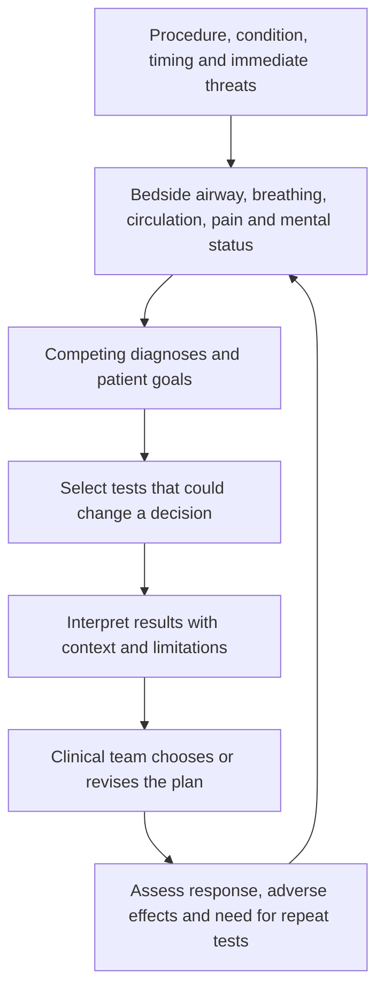

# Integrated ICU and CTICU workups: 42 paired case applications

[Procedure-organized CTICU worked examples](CTICU_PROCEDURE_EXAMPLES.md) — 18 paired narratives across cardiac, thoracic, vascular and acute cardiorespiratory care.

28 October 2026. This supplement expands [the 42 paired ICU topics](APPLIED_CASES.md) beyond anesthesia to diagnostic reasoning, pain/sedation, airway and breathing, circulation, renal/metabolic status, laboratory/imaging choices and reassessment. The 84 profiles remain entirely synthetic. It is an educational workup, not a standing order set, bedside protocol or exhaustive patient assessment.

## How to read proposed tests

A proposed test is a candidate for a specific clinical question, not an instruction to order every listed item. Laboratory tests measure findings; they do not themselves treat a patient. Results may inform a treatment or diagnostic decision only with bedside assessment, trajectory and patient goals. Urgent threats require prompt skilled assessment and stabilization in parallel; do not delay time-critical care waiting for a panel. Specify why the result could change a decision, specimen/site/timing, how results will be interpreted, and the condition for repeating or stopping testing. Routine daily panels are not the default [TESTING].

**Pair assumptions:** as in the original casebook, male and female learning profiles are matched adults (60 years; male 180 cm/80 kg; female 165 cm/65 kg, nonpregnant) with case-specific details below. Sex is not an automatic diagnostic, dose or testing rule. The missing real-world history remains part of the reasoning exercise.

## Integrated bedside domains

1. Confirm procedure/condition, timing, baseline function, current trajectory and immediate threats.
2. Assess reported pain when possible, or an appropriate validated behavioral assessment if needed; document the separate sedation goal and medication exposure. No questionnaire is reproduced [PADISBASE, PADIS].
3. Identify the actual airway and support, airway protection, work of breathing, secretion handling, oxygenation and ventilation.
4. Assess rhythm, pressure, effective flow/perfusion and venous congestion; no single monitor defines stability.
5. Review renal, electrolyte, acid-base, hepatic and medication-exposure questions where relevant.
6. Select labs and nonlaboratory tests to discriminate competing diagnoses or assess response, with explicit limitations.
7. Compare conditional treatment options and monitor intended effects and harms; no isolated laboratory target creates an automatic prescription.
8. Reassess trajectory, communicate ownership of pending results and revisit goals. Also ask about nutrition/glucose, mobility/delirium/sleep, skin/pressure injury, line/catheter need, infection/antimicrobial review, bleeding/VTE risk, rehabilitation and family communication. These are author-created coverage prompts, not a complete or validated rounding checklist.

## Laboratory catalogue: which test, why and what it may change

The rows are authored teaching summaries supported by the mapped disease/guideline concepts. They are not verbatim recommendations for a fixed panel. Repeats depend on instability, expected response, exposure and a decision question, not a fixed interval.

### CBC — CBC: hemoglobin/hematocrit, platelets, differential

- **When it might be requested:** Suspected bleeding, anemia, infection context or thrombocytopenia.
- **Question / diagnostic contribution:** Blood-loss trend, oxygen-carrying capacity and platelet trend.
- **Decision it may inform:** May inform bleeding/transfusion evaluation or drug-exposure review alongside clinical findings.
- **Limit / reason not to order reflexively:** Hemoglobin can lag acute hemorrhage or reflect dilution; WBC does not prove infection; platelets do not measure all platelet function.
- **Concept sources:** [POSTCARD](#sources), [PBM](#sources), [FEVER](#sources).

### GAS — Arterial blood gas when oxygenation, ventilation or acid-base status needs clarification

- **When it might be requested:** New respiratory failure, altered support or unexplained acid-base disturbance.
- **Question / diagnostic contribution:** PaO2, PaCO2 and pH under recorded oxygen/support conditions.
- **Decision it may inform:** May inform respiratory-support assessment and whether a metabolic/respiratory process is changing.
- **Limit / reason not to order reflexively:** Venous PO2 cannot replace arterial oxygenation assessment; record FiO2/device; do not schedule ABGs automatically.
- **Concept sources:** [ARDS](#sources), [NIV](#sources), [AIRWAY](#sources).

### LAC — Lactate, with repeat justified by a response question

- **When it might be requested:** Shock or unexplained change in perfusion.
- **Question / diagnostic contribution:** Trend compatible with altered production/clearance or delivery-demand imbalance.
- **Decision it may inform:** May prompt reassessment of shock mechanism or response to an intervention.
- **Limit / reason not to order reflexively:** Not specific for hypoperfusion and not a standalone fluid, transfusion or inotrope trigger.
- **Concept sources:** [SEPSIS](#sources), [POSTCARD](#sources).

### RENALCHEM — Basic metabolic chemistry: sodium, potassium, bicarbonate/total CO2, urea/BUN, creatinine and glucose

- **When it might be requested:** AKI, oliguria, arrhythmia, diuresis, metabolic or neurologic concern.
- **Question / diagnostic contribution:** Electrolyte/acid-base changes and kidney-function trajectory.
- **Decision it may inform:** May inform medication-exposure review, electrolyte management or renal-support evaluation.
- **Limit / reason not to order reflexively:** Creatinine lags injury; an isolated value does not distinguish low flow from congestion or choose dialysis.
- **Concept sources:** [KIDNEY](#sources), [RENAL](#sources).

### MGPHOS — Magnesium and phosphate when clinically relevant

- **When it might be requested:** Arrhythmia, nutritional risk, ongoing losses or respiratory-muscle concern.
- **Question / diagnostic contribution:** Potential reversible electrolyte contribution.
- **Decision it may inform:** May inform replacement assessment and review of losses or drug effects.
- **Limit / reason not to order reflexively:** Not every abnormal value explains the illness; replacement needs kidney function and local policy.
- **Concept sources:** [POSTCARD](#sources), [KIDNEY](#sources).

### ICAL — Ionized calcium

- **When it might be requested:** Major bleeding/transfusion or unexplained circulatory dysfunction.
- **Question / diagnostic contribution:** Biologically active calcium in the current clinical context.
- **Decision it may inform:** May inform correction assessment while investigating the primary problem.
- **Limit / reason not to order reflexively:** Total calcium is not interchangeable; sampling/pH and clinical context matter.
- **Concept sources:** [PBM](#sources), [POSTCARD](#sources).

### COAG — PT/INR, aPTT and fibrinogen selected for the question

- **When it might be requested:** Bleeding, hepatic/coagulation concern or relevant anticoagulant exposure.
- **Question / diagnostic contribution:** Selected clotting-pathway/fibrinogen abnormalities.
- **Decision it may inform:** May inform hemostatic or anticoagulant assessment with bleeding history and drug identity.
- **Limit / reason not to order reflexively:** Do not equate a normal screen with no bleeding risk or use INR to quantify every anticoagulant.
- **Concept sources:** [PBM](#sources), [VALVE](#sources).

### VET — Viscoelastic/platelet-function testing if indicated and locally available

- **When it might be requested:** Active complex cardiac-surgical bleeding under an established clinical pathway.
- **Question / diagnostic contribution:** More specific clot formation or platelet-function questions.
- **Decision it may inform:** May inform component-directed hemostatic discussion and distinguish hypotheses.
- **Limit / reason not to order reflexively:** Does not replace surgical source evaluation; not a routine screening or independent treatment algorithm here.
- **Concept sources:** [PBM](#sources).

### CROSS — Type and screen / compatibility testing through the transfusion service

- **When it might be requested:** Clinically meaningful bleeding or a realistic transfusion question.
- **Question / diagnostic contribution:** Compatibility and preparation for potential blood-product support.
- **Decision it may inform:** May support timely transfusion logistics if the clinical team determines need.
- **Limit / reason not to order reflexively:** Not a transfusion indication, hemoglobin target or proof of ongoing bleeding.
- **Concept sources:** [PBM](#sources).

### CULT — Source-directed microbiology, including blood cultures when indicated

- **When it might be requested:** Suspected infection, new fever with a plausible source or shock.
- **Question / diagnostic contribution:** Organism identification and susceptibility/context.
- **Decision it may inform:** May refine antimicrobial/source-control decisions and later de-escalation.
- **Limit / reason not to order reflexively:** Avoid reflex cultures from every site; contamination/colonization matter; sampling must not cause harmful treatment delay.
- **Concept sources:** [FEVER](#sources), [SEPSIS](#sources).

### RESPMIC — Respiratory sample / pathogen testing selected for suspected pneumonia

- **When it might be requested:** New pulmonary infection question.
- **Question / diagnostic contribution:** Potential respiratory pathogen evidence.
- **Decision it may inform:** May refine antimicrobial assessment with imaging and clinical course.
- **Limit / reason not to order reflexively:** Positive results may reflect colonization; specimen quality, prior therapy and immune status matter.
- **Concept sources:** [FEVER](#sources), [SEPSIS](#sources), [TRANSPLANT](#sources).

### URINE — Urinalysis, microscopy and selective culture

- **When it might be requested:** Kidney-injury mechanism or suspected urinary infection.
- **Question / diagnostic contribution:** Sediment/urine findings and source-specific microbiology.
- **Decision it may inform:** May inform AKI differential or urinary-source evaluation.
- **Limit / reason not to order reflexively:** Pyuria or bacteriuria is not automatically symptomatic infection; catheter and collection method matter.
- **Concept sources:** [KIDNEY](#sources), [FEVER](#sources).

### SODOSM — Serum sodium with osmolality/urine studies if the specific question warrants them

- **When it might be requested:** Neurocritical electrolyte/water-balance problem.
- **Question / diagnostic contribution:** Patterns of water/solute regulation in context.
- **Decision it may inform:** May inform supervised fluid/medication reassessment and correction planning.
- **Limit / reason not to order reflexively:** No universal sodium target or rapid-correction instruction follows from this vignette.
- **Concept sources:** [TBI](#sources), [SAH](#sources).

### POCGLU — Prompt bedside glucose when mental status or metabolic stability changes

- **When it might be requested:** Reduced consciousness, agitation or unstable metabolic state.
- **Question / diagnostic contribution:** A potentially reversible glucose abnormality.
- **Decision it may inform:** May inform immediate clinical assessment and supervised correction.
- **Limit / reason not to order reflexively:** An abnormal result does not exclude a concurrent neurologic or circulatory event.
- **Concept sources:** [PADISBASE](#sources), [TBI](#sources), [SAH](#sources).

### TROP — Troponin when a myocardial-injury question is present

- **When it might be requested:** New ischemic/rhythm/pump concern after assessment.
- **Question / diagnostic contribution:** Myocardial injury pattern with serial context if justified.
- **Decision it may inform:** May inform coronary/structural evaluation together with ECG and imaging.
- **Limit / reason not to order reflexively:** Postoperative elevation alone does not establish type, mechanism or an infarction diagnosis.
- **Concept sources:** [POSTCARD](#sources).

### HEMOL — Hemolysis evaluation: LDH, plasma-free hemoglobin, bilirubin/haptoglobin as appropriate

- **When it might be requested:** ECMO/LVAD blood-trauma concern, anemia or device alarm.
- **Question / diagnostic contribution:** Evidence compatible with hemolysis, integrated with device data.
- **Decision it may inform:** May prompt specialist evaluation of pump/circuit/loading or alternative causes.
- **Limit / reason not to order reflexively:** Each marker is nonspecific; no single result proves pump thrombosis or selects a speed/anticoagulant change.
- **Concept sources:** [LVAD](#sources), [VA](#sources), [VV](#sources).

### DRUGCOAG — Anticoagulant-appropriate assay, e.g. anti-Xa or aPTT under the actual protocol

- **When it might be requested:** Mechanical support, bleeding/thrombotic concern or anticoagulant monitoring need.
- **Question / diagnostic contribution:** Exposure/effect question specific to the medicine, assay and timing.
- **Decision it may inform:** May inform specialist anticoagulant assessment.
- **Limit / reason not to order reflexively:** Assays are not interchangeable; interferences and concurrent drugs matter; no universal target supplied.
- **Concept sources:** [VA](#sources), [VV](#sources), [LVAD](#sources), [PBM](#sources).

### LIVER — Selected hepatic chemistry/bilirubin

- **When it might be requested:** Congestion, shock, hepatobiliary or medication-exposure concern.
- **Question / diagnostic contribution:** Hepatic injury/cholestasis pattern or congestion context.
- **Decision it may inform:** May inform perfusion/differential assessment and drug handling review.
- **Limit / reason not to order reflexively:** Abnormal tests do not uniquely distinguish ischemia, congestion, obstruction or drug injury.
- **Concept sources:** [POSTCARD](#sources), [PANCREASGUIDE](#sources), [LVAD](#sources).

### LIPASE — Lipase when pancreatitis diagnosis remains a live question

- **When it might be requested:** Compatible abdominal presentation or uncertain diagnosis.
- **Question / diagnostic contribution:** Evidence contributing to diagnostic criteria with history/imaging.
- **Decision it may inform:** May help establish the disease context and need for further evaluation.
- **Limit / reason not to order reflexively:** Serial lipase is not a target for resuscitation or a substitute for organ-failure assessment.
- **Concept sources:** [PANCREASGUIDE](#sources).

### TROUGH — Agent-specific drug level when indicated by the treating transplant/pharmacy protocol

- **When it might be requested:** Potential immunosuppressant toxicity, interaction or exposure problem.
- **Question / diagnostic contribution:** Concentration at the correct timing for the actual agent.
- **Decision it may inform:** May inform specialist exposure/interaction assessment alongside organ function.
- **Limit / reason not to order reflexively:** Not every agent uses the same level/target; an isolated value does not diagnose rejection.
- **Concept sources:** [TRANSPLANT](#sources).

## Imaging, physiology and other tests are not laboratory panels

### ECHO — Focused cardiac imaging, TTE and specialist TEE when appropriate

**Question:** Ventricular function/loading, pericardial or valvular/mechanical questions. **May inform:** May redirect shock assessment toward pump, obstructive or structural causes. **Limit:** A limited study can miss pathology; postoperative windows and loculated collections complicate interpretation. Sources: [POSTCARD](#sources), [RV](#sources), [VALVE](#sources).

### ECG — ECG and rhythm/pacing review

**Question:** Rhythm, conduction and ischemic-pattern questions. **May inform:** May inform rate-related or ischemic evaluation with perfusion assessment. **Limit:** Rate alone does not establish causation or choose a drug/pacing setting. Sources: [POSTCARD](#sources).

### CHEST — Chest imaging / lung ultrasound when indicated

**Question:** Tube/line or pleural/parenchymal explanation for deterioration. **May inform:** May distinguish mechanical or pulmonary hypotheses and guide further evaluation. **Limit:** Not a routine daily-image instruction; findings alone may not separate edema from infection. Sources: [ARDS](#sources), [FEVER](#sources).

### HEAD — Neuroimaging and neurologic reassessment when indicated

**Question:** New structural explanation for reduced consciousness or focal change. **May inform:** May alter neurocritical/surgical assessment. **Limit:** Do not attribute new decline to sedation without evaluating competing urgent causes. Sources: [TBI](#sources), [SAH](#sources).

### VASC — Procedure-appropriate vascular imaging / perfusion assessment

**Question:** Aortic, graft, limb or organ malperfusion question. **May inform:** May prompt surgical/vascular or device-team reassessment. **Limit:** Transport/contrast risks must be balanced against the urgency; a normal lab does not exclude malperfusion. Sources: [AORTA](#sources), [VA](#sources).

### ABDOMEN — Abdominal imaging or pressure assessment chosen for the suspected problem

**Question:** Source control, obstruction, pancreatitis complication or intra-abdominal hypertension. **May inform:** May inform procedural/surgical assessment. **Limit:** Pressure alone does not establish compartment syndrome; a test is not a dressing-change order. Sources: [ABD](#sources), [SEPSIS](#sources), [PANCREASGUIDE](#sources).

### DEVICE — Specialist device/circuit review with appropriate imaging, gases and trends

**Question:** LVAD/ECMO performance, loading, cannula or oxygenator questions. **May inform:** May identify a mechanism requiring expert adjustment. **Limit:** Displayed flow, one gradient or one post-membrane gas is not a complete diagnostic rule. Sources: [LVAD](#sources), [VA](#sources), [VV](#sources).

## ICU-01-01 — Postoperative hemodynamic instability

**Paired source cases:** [male/female application](APPLIED_CASES.md#icu-01-01).

**Situation:** A fictional postoperative adult develops hypotension, rising lactate and chest-drain output. Cardiac function and the bleeding source have not been established.

- **Male profile detail:** Bleeding trend is increasing.
- **Female profile detail:** Prior ventricular dysfunction is documented.

**Case-specific priority:** Separate blood loss, pump failure, obstruction and vascular tone; focused imaging and serial perfusion findings discriminate the branches.

| Domain | Applied assessment / reasoning |
|---|---|
| Diagnostic alternatives | Bleeding, pump dysfunction, obstruction and low vascular tone can coexist after surgery; confirm the operation and trajectory. |
| Pain and sedation | Assess pain and sedation separately; review recent analgesic/hypnotic exposure and its hemodynamic/respiratory effects. |
| Airway control and breathing | Establish whether intubated, extubated or on noninvasive support; evaluate airway patency, gas exchange, mechanics and device/pleural complications. |
| Blood pressure and effective perfusion | Integrate pressure with output, rhythm, examination, drain losses, congestion and organ perfusion; a low MAP does not select one agent. |
| Renal/metabolic and exposure review | Track urine output, chemistry, balance and exposure; differentiate perfusion, congestion and structural/obstructive questions. |
| Treatment/medication context | Vasoactive support does not correct a surgical bleeding source; analgesic/sedative effects also belong in the medication review. |
| Stability and response | Relate each intervention to perfusion, bleeding, respiratory and adverse-effect trends; persistent deterioration requires prompt surgical/critical-care reassessment. |
| Other patient requirements | Revisit the eight-domain coverage prompts above, goals, baseline function, lines/drains, nutrition, prevention, mobility and handoff; document what is relevant or deferred. |

**Candidate laboratory requests, each only if it answers the case question:** [CBC](#test-cbc), [LAC](#test-lac), [RENALCHEM](#test-renalchem), [ICAL](#test-ical), [COAG](#test-coag), [VET](#test-vet), [CROSS](#test-cross), [GAS](#test-gas)

**Nonlaboratory studies / bedside measurements:** [ECHO](#study-echo), [ECG](#study-ecg), [CHEST](#study-chest)

**Result-to-decision reasoning:** use each linked test's question, possible decision and limitation; combine with this case's priority above. A concerning result prompts clinical reassessment rather than a prewritten medication, fluid, ventilator or device adjustment. Record why repeating the test would change a decision and when it can stop.

**Source map:** [POSTCARD](#sources), [PBM](#sources), [AIRWAY](#sources), [PADISBASE](#sources), [KIDNEY](#sources), [TESTING](#sources).

## ICU-01-02 — DNI status and respiratory distress

**Paired source cases:** [male/female application](APPLIED_CASES.md#icu-01-02).

**Situation:** An older fictional adult with COPD and pneumonia is distressed and has difficulty tolerating non-invasive ventilation. DNR/DNI is documented; other treatment preferences are unknown.

- **Male profile detail:** Wants active treatment short of intubation.
- **Female profile detail:** Preferences beyond DNI have not been discussed.

**Case-specific priority:** Clarify the treatment ceiling and trial goals before interpreting NIV intolerance; distinguish reversible distress from a separately chosen symptom-only plan.

| Domain | Applied assessment / reasoning |
|---|---|
| Diagnostic alternatives | COPD/pneumonia, gas-exchange failure, fatigue, interface problems and distress need separate assessment; clarify the treatment ceiling. |
| Pain and sedation | Assess pain, fear and dyspnea before assuming a sedation indication; review respiratory effects of prior medicines. |
| Airway control and breathing | Document NIV/HFNC/oxygen device, work of breathing, consciousness, secretion handling and gas trends; goals determine escalation options. |
| Blood pressure and effective perfusion | Assess perfusion and tolerance of respiratory support, not oxygen saturation alone. |
| Renal/metabolic and exposure review | Review kidney function and acid-base contributors where they would change decisions. |
| Treatment/medication context | Analgesia and anxiolysis require respiratory reassessment; a sedative combination is not implied by DNI. |
| Stability and response | Reassess comfort, respiratory work, ventilation and the agreed trial goals; DNR/DNI does not itself establish comfort-only care. |
| Other patient requirements | Revisit the eight-domain coverage prompts above, goals, baseline function, lines/drains, nutrition, prevention, mobility and handoff; document what is relevant or deferred. |

**Candidate laboratory requests, each only if it answers the case question:** [GAS](#test-gas), [CBC](#test-cbc), [RENALCHEM](#test-renalchem), [CULT](#test-cult), [RESPMIC](#test-respmic), [POCGLU](#test-pocglu)

**Nonlaboratory studies / bedside measurements:** [CHEST](#study-chest)

**Result-to-decision reasoning:** use each linked test's question, possible decision and limitation; combine with this case's priority above. A concerning result prompts clinical reassessment rather than a prewritten medication, fluid, ventilator or device adjustment. Record why repeating the test would change a decision and when it can stop.

**Source map:** [NIV](#sources), [DNR](#sources), [GOALS](#sources), [FEVER](#sources), [AIRWAY](#sources), [PADISBASE](#sources), [TESTING](#sources).

## ICU-01-03 — Worsening septic shock

**Paired source cases:** [male/female application](APPLIED_CASES.md#icu-01-03).

**Situation:** A fictional adult with suspected infection has increasing vasopressor requirements, mottling, oliguria and rising lactate.

- **Male profile detail:** Source is suspected but not controlled.
- **Female profile detail:** Positive fluid balance and congestion are present.

**Case-specific priority:** Reassess infection/source control and perfusion while asking whether additional fluid is both effective and tolerated.

| Domain | Applied assessment / reasoning |
|---|---|
| Diagnostic alternatives | Reassess source, source control and competing noninfectious or mixed-shock causes. |
| Pain and sedation | Assess pain and agitation causes; distinguish analgesic need from the sedation goal and delirium. |
| Airway control and breathing | Evaluate actual airway/support, work of breathing and oxygenation/ventilation; assess deterioration without delaying stabilization for tests. |
| Blood pressure and effective perfusion | Evaluate perfusion and both fluid responsiveness and tolerance; reassess source control alongside circulatory support. |
| Renal/metabolic and exposure review | Review output, kidney chemistry, fluid balance and medication clearance; positive balance and oliguria are not interchangeable indications. |
| Treatment/medication context | Antimicrobials and vasopressor support are distinct interventions; culture/resistance and organ function inform drug discussions. |
| Stability and response | Use clinical response and source information to revisit antimicrobial, procedural and hemodynamic decisions; biomarkers do not independently choose a regimen. |
| Other patient requirements | Revisit the eight-domain coverage prompts above, goals, baseline function, lines/drains, nutrition, prevention, mobility and handoff; document what is relevant or deferred. |

**Candidate laboratory requests, each only if it answers the case question:** [CBC](#test-cbc), [LAC](#test-lac), [RENALCHEM](#test-renalchem), [GAS](#test-gas), [CULT](#test-cult), [URINE](#test-urine)

**Nonlaboratory studies / bedside measurements:** [CHEST](#study-chest), [ABDOMEN](#study-abdomen), [ECHO](#study-echo)

**Result-to-decision reasoning:** use each linked test's question, possible decision and limitation; combine with this case's priority above. A concerning result prompts clinical reassessment rather than a prewritten medication, fluid, ventilator or device adjustment. Record why repeating the test would change a decision and when it can stop.

**Source map:** [SEPSIS](#sources), [FEVER](#sources), [PADISBASE](#sources), [KIDNEY](#sources), [AIRWAY](#sources), [TESTING](#sources).

## ICU-01-04 — Rib fractures and impaired ventilation

**Paired source cases:** [male/female application](APPLIED_CASES.md#icu-01-04).

**Situation:** A fictional trauma patient has chest-wall pain, shallow breathing and increasing oxygen needs. Associated injuries are incompletely described.

- **Male profile detail:** Chest pain limits deep breathing.
- **Female profile detail:** Sleep apnea and other injuries need clarification.

**Case-specific priority:** Evaluate chest injury, ventilation and analgesic adequacy together; a pain score alone cannot exclude worsening respiratory injury.

| Domain | Applied assessment / reasoning |
|---|---|
| Diagnostic alternatives | Pain-limited breathing is one hypothesis; assess associated lung, pleural, vascular and other injuries. |
| Pain and sedation | Compare systemic versus regional/local analgesic options after injury and bleeding-risk review; reassess breathing and function as well as reported pain. |
| Airway control and breathing | Evaluate splinting, secretions, work of breathing and oxygenation; deterioration may reflect injury rather than inadequate analgesia alone. |
| Blood pressure and effective perfusion | Consider blood loss and other shock mechanisms before attributing tachycardia solely to pain. |
| Renal/metabolic and exposure review | Review kidney function and exposure before nonopioid or opioid choices; assess losses if clinically relevant. |
| Treatment/medication context | Local/regional or systemic analgesia are discussion options after injury and bleeding-risk assessment; respiratory effects matter. |
| Stability and response | Link analgesic benefit to respiratory effort/function and unwanted effects; new instability prompts injury-focused reassessment. |
| Other patient requirements | Revisit the eight-domain coverage prompts above, goals, baseline function, lines/drains, nutrition, prevention, mobility and handoff; document what is relevant or deferred. |

**Candidate laboratory requests, each only if it answers the case question:** [CBC](#test-cbc), [GAS](#test-gas), [RENALCHEM](#test-renalchem), [LAC](#test-lac), [COAG](#test-coag), [CROSS](#test-cross)

**Nonlaboratory studies / bedside measurements:** [CHEST](#study-chest)

**Result-to-decision reasoning:** use each linked test's question, possible decision and limitation; combine with this case's priority above. A concerning result prompts clinical reassessment rather than a prewritten medication, fluid, ventilator or device adjustment. Record why repeating the test would change a decision and when it can stop.

**Source map:** [NIV](#sources), [PADIS](#sources), [POSTCARD](#sources), [PADISBASE](#sources), [PBM](#sources), [AIRWAY](#sources), [TESTING](#sources).

## ICU-01-05 — Myocarditis and shock

**Paired source cases:** [male/female application](APPLIED_CASES.md#icu-01-05).

**Situation:** A fictional adult with suspected fulminant myocarditis has poor perfusion despite initial support. Ventricular function, rhythm and the cause of inflammation need reassessment.

- **Male profile detail:** Rhythm disturbance is suspected.
- **Female profile detail:** Biventricular dysfunction is suspected.

**Case-specific priority:** Characterize rhythm and ventricular involvement before comparing pharmacologic support with expert mechanical-support assessment.

| Domain | Applied assessment / reasoning |
|---|---|
| Diagnostic alternatives | Separate native-heart failure, LV loading, circuit dysfunction, bleeding, vascular complications and end-organ injury. |
| Pain and sedation | Assess analgesia, awareness/sedation goals and examination needs; drug exposure is not inferred from device flow. |
| Airway control and breathing | Assess native-lung function and sampling/circuit configuration; systemic gas exchange cannot be interpreted from one oxygenator sample. |
| Blood pressure and effective perfusion | Integrate native output, echo, pulsatility, support configuration and regional perfusion, including the cannulated limb. |
| Renal/metabolic and exposure review | Review kidney output/chemistry, hemolysis, fluid balance and effective perfusion. |
| Treatment/medication context | Inotrope, vasopressor and sedation choices depend on the assessed physiology; suspected myocarditis does not select an empiric immune-treatment regimen. |
| Stability and response | Compare regional and systemic perfusion, gas exchange and bleeding after expert changes; no single trend authorizes a circuit adjustment. |
| Other patient requirements | Revisit the eight-domain coverage prompts above, goals, baseline function, lines/drains, nutrition, prevention, mobility and handoff; document what is relevant or deferred. |

**Candidate laboratory requests, each only if it answers the case question:** [GAS](#test-gas), [LAC](#test-lac), [CBC](#test-cbc), [RENALCHEM](#test-renalchem), [HEMOL](#test-hemol), [DRUGCOAG](#test-drugcoag), [COAG](#test-coag)

**Nonlaboratory studies / bedside measurements:** [ECHO](#study-echo), [VASC](#study-vasc), [DEVICE](#study-device)

**Result-to-decision reasoning:** use each linked test's question, possible decision and limitation; combine with this case's priority above. A concerning result prompts clinical reassessment rather than a prewritten medication, fluid, ventilator or device adjustment. Record why repeating the test would change a decision and when it can stop.

**Source map:** [VA](#sources), [POSTCARD](#sources), [PBM](#sources), [RV](#sources), [KIDNEY](#sources), [PADISBASE](#sources), [TESTING](#sources).

## ICU-01-06 — Pancreatitis with respiratory and renal dysfunction

**Paired source cases:** [male/female application](APPLIED_CASES.md#icu-01-06).

**Situation:** A fictional postoperative adult with pancreatitis has pain, positive fluid balance, worsening breathing and rising creatinine.

- **Male profile detail:** Recent fluids were followed by dyspnea.
- **Female profile detail:** Baseline kidney dysfunction complicates fluid tolerance.

**Case-specific priority:** The WATERFALL result argues against assuming more fluid is better; established organ failure differs from its trial population and requires individualized reassessment.

| Domain | Applied assessment / reasoning |
|---|---|
| Diagnostic alternatives | Assess pancreatitis evidence, cause and complications alongside other explanations for postoperative organ failure. |
| Pain and sedation | Assess analgesic need and unwanted respiratory/circulatory effects; pain alone does not quantify disease severity. |
| Airway control and breathing | Evaluate respiratory failure, aspiration, fluid accumulation and mechanics. |
| Blood pressure and effective perfusion | Reassess perfusion and fluid tolerance; the WATERFALL population is not a complete template for established organ failure. |
| Renal/metabolic and exposure review | Review output, chemistry, balance and medication exposure; avoid inferring further fluid need from creatinine alone. |
| Treatment/medication context | Analgesic choice and renal/hepatic exposure need review; no fixed high-volume fluid or drug infusion follows from the diagnosis. |
| Stability and response | Follow organ function, symptoms and treatment tolerance rather than serial lipase as a response target. |
| Other patient requirements | Revisit the eight-domain coverage prompts above, goals, baseline function, lines/drains, nutrition, prevention, mobility and handoff; document what is relevant or deferred. |

**Candidate laboratory requests, each only if it answers the case question:** [LIPASE](#test-lipase), [LIVER](#test-liver), [CBC](#test-cbc), [RENALCHEM](#test-renalchem), [GAS](#test-gas), [LAC](#test-lac), [ICAL](#test-ical)

**Nonlaboratory studies / bedside measurements:** [ABDOMEN](#study-abdomen), [CHEST](#study-chest)

**Result-to-decision reasoning:** use each linked test's question, possible decision and limitation; combine with this case's priority above. A concerning result prompts clinical reassessment rather than a prewritten medication, fluid, ventilator or device adjustment. Record why repeating the test would change a decision and when it can stop.

**Source map:** [PANCREAS](#sources), [RENAL](#sources), [PANCREASGUIDE](#sources), [KIDNEY](#sources), [PADISBASE](#sources), [TESTING](#sources).

## ICU-01-07 — Brain injury with aspiration and airway decline

**Paired source cases:** [male/female application](APPLIED_CASES.md#icu-01-07).

**Situation:** A fictional adult with traumatic brain injury develops reduced alertness and suspected aspiration.

- **Male profile detail:** Neurologic examination is declining.
- **Female profile detail:** Recent sedatives confound the examination.

**Case-specific priority:** Separate airway/oxygenation threats, injury progression and medication effects; a sedative-adjusted examination is not equivalent to exclusion of intracranial deterioration.

| Domain | Applied assessment / reasoning |
|---|---|
| Diagnostic alternatives | Consider injury progression, aspiration, seizures, oxygenation/ventilation, metabolic disturbance and medication confounding. |
| Pain and sedation | Assess analgesia and sedation in the injury/examination context; paralysis does not provide either. |
| Airway control and breathing | Evaluate protection, secretions and actual respiratory support; trained airway assessment must accompany declining consciousness. |
| Blood pressure and effective perfusion | Avoid treating a pressure or ICP measurement in isolation from perfusion and injury findings. |
| Renal/metabolic and exposure review | Review sodium/water, kidney and acid-base changes that may affect injury and drug handling. |
| Treatment/medication context | Hypnotics, analgesics and osmotic agents have different purposes; no dose or ventilation target can be selected from the abbreviated case. |
| Stability and response | Track neurologic and systemic response together; new decline is not attributed to sedatives without reassessing urgent alternatives. |
| Other patient requirements | Revisit the eight-domain coverage prompts above, goals, baseline function, lines/drains, nutrition, prevention, mobility and handoff; document what is relevant or deferred. |

**Candidate laboratory requests, each only if it answers the case question:** [POCGLU](#test-pocglu), [GAS](#test-gas), [RENALCHEM](#test-renalchem), [SODOSM](#test-sodosm), [CBC](#test-cbc), [COAG](#test-coag)

**Nonlaboratory studies / bedside measurements:** [HEAD](#study-head), [CHEST](#study-chest)

**Result-to-decision reasoning:** use each linked test's question, possible decision and limitation; combine with this case's priority above. A concerning result prompts clinical reassessment rather than a prewritten medication, fluid, ventilator or device adjustment. Record why repeating the test would change a decision and when it can stop.

**Source map:** [TBI](#sources), [PADIS](#sources), [AIRWAY](#sources), [PADISBASE](#sources), [KIDNEY](#sources), [TESTING](#sources).

## ICU-01-08 — Sepsis with ARDS and kidney injury

**Paired source cases:** [male/female application](APPLIED_CASES.md#icu-01-08).

**Situation:** A fictional adult with pneumonia has bilateral opacities, impaired gas exchange, positive fluid balance and kidney dysfunction.

- **Male profile detail:** Lung gas exchange is deteriorating.
- **Female profile detail:** Fluid accumulation accompanies kidney injury.

**Case-specific priority:** Integrate lung-protection assessment, infection/source control and fluid tolerance rather than treating isolated oxygenation or creatinine values.

| Domain | Applied assessment / reasoning |
|---|---|
| Diagnostic alternatives | Confirm clinical syndrome and competing edema, infection or mechanical causes; compare gases under stated support conditions. |
| Pain and sedation | Assess pain, distress and ventilator interaction; sedation or paralysis is not automatically indicated by a ratio. |
| Airway control and breathing | Review tube/support integrity, gas exchange, pressures, volumes, effort and synchrony; conditional adjuncts require actual context. |
| Blood pressure and effective perfusion | Assess how ventilation and lung/RV physiology affect circulation and tolerance. |
| Renal/metabolic and exposure review | Integrate fluid tolerance, output, kidney chemistry and acid-base status. |
| Treatment/medication context | Sedation or neuromuscular-block discussions depend on the actual ventilation problem; renal support is a separate indication-based decision. |
| Stability and response | Assess oxygenation and ventilation alongside mechanics, circulation and adverse effects; a better saturation alone is not complete stability. |
| Other patient requirements | Revisit the eight-domain coverage prompts above, goals, baseline function, lines/drains, nutrition, prevention, mobility and handoff; document what is relevant or deferred. |

**Candidate laboratory requests, each only if it answers the case question:** [GAS](#test-gas), [CBC](#test-cbc), [RENALCHEM](#test-renalchem), [LAC](#test-lac), [RESPMIC](#test-respmic)

**Nonlaboratory studies / bedside measurements:** [CHEST](#study-chest), [ECHO](#study-echo)

**Result-to-decision reasoning:** use each linked test's question, possible decision and limitation; combine with this case's priority above. A concerning result prompts clinical reassessment rather than a prewritten medication, fluid, ventilator or device adjustment. Record why repeating the test would change a decision and when it can stop.

**Source map:** [SEPSIS](#sources), [ARDS](#sources), [RENAL](#sources), [RV](#sources), [FEVER](#sources), [AIRWAY](#sources), [PADISBASE](#sources), [TESTING](#sources).

## ICU-02-01 — Shock immediately after CABG

**Paired source cases:** [male/female application](APPLIED_CASES.md#icu-02-01).

**Situation:** A fictional adult after coronary bypass has hypotension, low estimated output, hypothermia and ongoing drain output.

- **Male profile detail:** Drains show renewed bleeding.
- **Female profile detail:** Echo suggests reduced contractility.

**Case-specific priority:** Use surgical assessment and verified output measurements to distinguish blood loss from pump failure, while allowing coexistence.

| Domain | Applied assessment / reasoning |
|---|---|
| Diagnostic alternatives | Bleeding, pump dysfunction, obstruction and low vascular tone can coexist after surgery; confirm the operation and trajectory. |
| Pain and sedation | Assess pain and sedation separately; review recent analgesic/hypnotic exposure and its hemodynamic/respiratory effects. |
| Airway control and breathing | Establish whether intubated, extubated or on noninvasive support; evaluate airway patency, gas exchange, mechanics and device/pleural complications. |
| Blood pressure and effective perfusion | Integrate pressure with output, rhythm, examination, drain losses, congestion and organ perfusion; a low MAP does not select one agent. |
| Renal/metabolic and exposure review | Track urine output, chemistry, balance and exposure; differentiate perfusion, congestion and structural/obstructive questions. |
| Treatment/medication context | A vasopressor, inotrope or transfusion discussion addresses different mechanisms; none is selected solely by MAP. |
| Stability and response | Relate each intervention to perfusion, bleeding, respiratory and adverse-effect trends; persistent deterioration requires prompt surgical/critical-care reassessment. |
| Other patient requirements | Revisit the eight-domain coverage prompts above, goals, baseline function, lines/drains, nutrition, prevention, mobility and handoff; document what is relevant or deferred. |

**Candidate laboratory requests, each only if it answers the case question:** [CBC](#test-cbc), [LAC](#test-lac), [RENALCHEM](#test-renalchem), [ICAL](#test-ical), [COAG](#test-coag), [VET](#test-vet), [CROSS](#test-cross), [GAS](#test-gas)

**Nonlaboratory studies / bedside measurements:** [ECHO](#study-echo), [ECG](#study-ecg), [CHEST](#study-chest)

**Result-to-decision reasoning:** use each linked test's question, possible decision and limitation; combine with this case's priority above. A concerning result prompts clinical reassessment rather than a prewritten medication, fluid, ventilator or device adjustment. Record why repeating the test would change a decision and when it can stop.

**Source map:** [POSTCARD](#sources), [PBM](#sources), [AIRWAY](#sources), [PADISBASE](#sources), [KIDNEY](#sources), [TESTING](#sources).

## ICU-02-02 — VA-ECMO after myocardial infarction

**Paired source cases:** [male/female application](APPLIED_CASES.md#icu-02-02).

**Situation:** A fictional adult on VA-ECMO has improving lactate but oliguria and concern about limb perfusion.

- **Male profile detail:** A cannulated limb is cool.
- **Female profile detail:** Urine output is low despite falling lactate.

**Case-specific priority:** Falling lactate does not settle limb perfusion or kidney questions; evaluate each organ and circuit configuration.

| Domain | Applied assessment / reasoning |
|---|---|
| Diagnostic alternatives | Separate native-heart failure, LV loading, circuit dysfunction, bleeding, vascular complications and end-organ injury. |
| Pain and sedation | Assess analgesia, awareness/sedation goals and examination needs; drug exposure is not inferred from device flow. |
| Airway control and breathing | Assess native-lung function and sampling/circuit configuration; systemic gas exchange cannot be interpreted from one oxygenator sample. |
| Blood pressure and effective perfusion | Integrate native output, echo, pulsatility, support configuration and regional perfusion, including the cannulated limb. |
| Renal/metabolic and exposure review | Review kidney output/chemistry, hemolysis, fluid balance and effective perfusion. |
| Treatment/medication context | Anticoagulation, vasoactive and analgesic choices require bleeding/perfusion context and specialist oversight. |
| Stability and response | Compare regional and systemic perfusion, gas exchange and bleeding after expert changes; no single trend authorizes a circuit adjustment. |
| Other patient requirements | Revisit the eight-domain coverage prompts above, goals, baseline function, lines/drains, nutrition, prevention, mobility and handoff; document what is relevant or deferred. |

**Candidate laboratory requests, each only if it answers the case question:** [GAS](#test-gas), [LAC](#test-lac), [CBC](#test-cbc), [RENALCHEM](#test-renalchem), [HEMOL](#test-hemol), [DRUGCOAG](#test-drugcoag), [COAG](#test-coag)

**Nonlaboratory studies / bedside measurements:** [ECHO](#study-echo), [VASC](#study-vasc), [DEVICE](#study-device)

**Result-to-decision reasoning:** use each linked test's question, possible decision and limitation; combine with this case's priority above. A concerning result prompts clinical reassessment rather than a prewritten medication, fluid, ventilator or device adjustment. Record why repeating the test would change a decision and when it can stop.

**Source map:** [VA](#sources), [RENAL](#sources), [PBM](#sources), [RV](#sources), [KIDNEY](#sources), [PADISBASE](#sources), [TESTING](#sources).

## ICU-02-03 — Early LVAD and RV function

**Paired source cases:** [male/female application](APPLIED_CASES.md#icu-02-03).

**Situation:** A fictional adult after LVAD implantation has changing displayed flow and pulsatility with borderline RV function.

- **Male profile detail:** RV function is borderline.
- **Female profile detail:** Displayed flow varies with rhythm.

**Case-specific priority:** Interpret loading, rhythm, ventricular interaction and device data together before assigning a device cause.

| Domain | Applied assessment / reasoning |
|---|---|
| Diagnostic alternatives | Compare loading, RV failure, rhythm, inflow/outflow problems and blood trauma; an alarm does not establish pump thrombosis. |
| Pain and sedation | Review pain/sedation and their effects on examination and circulation; identify actual support/airway needs. |
| Airway control and breathing | Evaluate oxygenation, ventilation and respiratory contributors to RV loading. |
| Blood pressure and effective perfusion | Assess device-specific pressure/output context, RV function and congestion rather than relying on displayed flow alone. |
| Renal/metabolic and exposure review | Review urine output, congestion, kidney chemistry and hemolysis signals. |
| Treatment/medication context | Fluid and vasoactive changes are not substitutes for device assessment; no universal speed or dose follows from a display value. |
| Stability and response | Specialist reassessment integrates device data and patient response; do not assign speed, fluid or transfusion changes from one alarm. |
| Other patient requirements | Revisit the eight-domain coverage prompts above, goals, baseline function, lines/drains, nutrition, prevention, mobility and handoff; document what is relevant or deferred. |

**Candidate laboratory requests, each only if it answers the case question:** [CBC](#test-cbc), [RENALCHEM](#test-renalchem), [LAC](#test-lac), [HEMOL](#test-hemol), [DRUGCOAG](#test-drugcoag), [COAG](#test-coag), [LIVER](#test-liver)

**Nonlaboratory studies / bedside measurements:** [ECHO](#study-echo), [ECG](#study-ecg), [DEVICE](#study-device)

**Result-to-decision reasoning:** use each linked test's question, possible decision and limitation; combine with this case's priority above. A concerning result prompts clinical reassessment rather than a prewritten medication, fluid, ventilator or device adjustment. Record why repeating the test would change a decision and when it can stop.

**Source map:** [LVAD](#sources), [RV](#sources), [PBM](#sources), [KIDNEY](#sources), [PADISBASE](#sources), [TESTING](#sources).

## ICU-02-04 — Pneumonia-associated ARDS

**Paired source cases:** [male/female application](APPLIED_CASES.md#icu-02-04).

**Situation:** A fictional adult with ARDS has a reported P:F ratio near 87, increased driving pressure and vasopressor support.

- **Male profile detail:** P:F is 87 with stable sampling conditions.
- **Female profile detail:** A similar ratio was measured under different support.

**Case-specific priority:** Check comparability and mechanics before grading severity; assess lung protection and hemodynamic tolerance before discussing conditional adjuncts.

| Domain | Applied assessment / reasoning |
|---|---|
| Diagnostic alternatives | Confirm clinical syndrome and competing edema, infection or mechanical causes; compare gases under stated support conditions. |
| Pain and sedation | Assess pain, distress and ventilator interaction; sedation or paralysis is not automatically indicated by a ratio. |
| Airway control and breathing | Review tube/support integrity, gas exchange, pressures, volumes, effort and synchrony; conditional adjuncts require actual context. |
| Blood pressure and effective perfusion | Assess how ventilation and lung/RV physiology affect circulation and tolerance. |
| Renal/metabolic and exposure review | Integrate fluid tolerance, output, kidney chemistry and acid-base status. |
| Treatment/medication context | Corticosteroids or neuromuscular blockade are indication-dependent options in the cited guideline, not automatic responses to a ratio. |
| Stability and response | Assess oxygenation and ventilation alongside mechanics, circulation and adverse effects; a better saturation alone is not complete stability. |
| Other patient requirements | Revisit the eight-domain coverage prompts above, goals, baseline function, lines/drains, nutrition, prevention, mobility and handoff; document what is relevant or deferred. |

**Candidate laboratory requests, each only if it answers the case question:** [GAS](#test-gas), [CBC](#test-cbc), [RENALCHEM](#test-renalchem), [LAC](#test-lac), [RESPMIC](#test-respmic)

**Nonlaboratory studies / bedside measurements:** [CHEST](#study-chest), [ECHO](#study-echo)

**Result-to-decision reasoning:** use each linked test's question, possible decision and limitation; combine with this case's priority above. A concerning result prompts clinical reassessment rather than a prewritten medication, fluid, ventilator or device adjustment. Record why repeating the test would change a decision and when it can stop.

**Source map:** [ARDS](#sources), [RV](#sources), [FEVER](#sources), [AIRWAY](#sources), [PADISBASE](#sources), [TESTING](#sources).

## ICU-02-05 — Aortic repair, hypertension and AKI

**Paired source cases:** [male/female application](APPLIED_CASES.md#icu-02-05).

**Situation:** A fictional adult after type A dissection repair develops hypertension, oliguria and rising creatinine.

- **Male profile detail:** Hypertension accompanies new oliguria.
- **Female profile detail:** New perfusion asymmetry is noted.

**Case-specific priority:** Assess anatomy and organ perfusion as well as pressure; distinguish possible malperfusion from congestion or medication-related kidney changes.

| Domain | Applied assessment / reasoning |
|---|---|
| Diagnostic alternatives | Consider malperfusion, bleeding, graft/mechanical complications and nonanatomic explanations after confirming repair details. |
| Pain and sedation | New pain or agitation may be a symptom of a complication; analgesia does not replace evaluation. |
| Airway control and breathing | Assess oxygenation, ventilation and neurologic state; respiratory distress can compound pressure/rate stress. |
| Blood pressure and effective perfusion | Assess rate, pressure, organ perfusion and repair context together; no universal postoperative target is assigned. |
| Renal/metabolic and exposure review | Oliguria requires perfusion, congestion, obstruction and exposure assessment; imaging decisions weigh urgency and risk. |
| Treatment/medication context | Rate/pressure-control discussion is specific to repair and perfusion; repeated fluid or antihypertensive changes are not an imaging substitute. |
| Stability and response | New regional symptoms, neurologic change or worsening organ function require prompt surgical/vascular reassessment; do not wait for a lab target. |
| Other patient requirements | Revisit the eight-domain coverage prompts above, goals, baseline function, lines/drains, nutrition, prevention, mobility and handoff; document what is relevant or deferred. |

**Candidate laboratory requests, each only if it answers the case question:** [CBC](#test-cbc), [LAC](#test-lac), [RENALCHEM](#test-renalchem), [GAS](#test-gas), [COAG](#test-coag)

**Nonlaboratory studies / bedside measurements:** [VASC](#study-vasc), [ECHO](#study-echo), [ECG](#study-ecg)

**Result-to-decision reasoning:** use each linked test's question, possible decision and limitation; combine with this case's priority above. A concerning result prompts clinical reassessment rather than a prewritten medication, fluid, ventilator or device adjustment. Record why repeating the test would change a decision and when it can stop.

**Source map:** [AORTA](#sources), [RENAL](#sources), [POSTCARD](#sources), [KIDNEY](#sources), [AIRWAY](#sources), [PADISBASE](#sources), [TESTING](#sources).

## ICU-02-06 — Lung transplantation and graft dysfunction

**Paired source cases:** [male/female application](APPLIED_CASES.md#icu-02-06).

**Situation:** A fictional lung-transplant recipient develops poor compliance, impaired gas exchange and fluid accumulation.

- **Male profile detail:** Abnormal imaging appears early after transplant.
- **Female profile detail:** Cardiac congestion is a competing explanation.

**Case-specific priority:** Check transplant timing, imaging and competing causes before using PGD classification; donor/recipient size and mechanics need context.

| Domain | Applied assessment / reasoning |
|---|---|
| Diagnostic alternatives | Before labeling PGD, assess timing and competing pulmonary, cardiac, anastomotic, infectious and immune-related explanations. |
| Pain and sedation | Balance analgesia, examination and respiratory recovery; assess drug interactions with the transplant regimen. |
| Airway control and breathing | Review airway/anastomotic concerns, secretion clearance, imaging and gas exchange; transplant-specific evaluation may require specialist procedures. |
| Blood pressure and effective perfusion | Assess cardiac function, pulmonary/RV loading, perfusion and fluid tolerance together. |
| Renal/metabolic and exposure review | Review kidney chemistry, balance and the actual immunosuppressant/exposure history. |
| Treatment/medication context | Diuresis, ventilator support and immune therapy answer different questions; none is established by poor compliance alone. |
| Stability and response | Reassess graft function and other organ trends with the transplant team. General fever guidance does not directly cover severe immunocompromise. |
| Other patient requirements | Revisit the eight-domain coverage prompts above, goals, baseline function, lines/drains, nutrition, prevention, mobility and handoff; document what is relevant or deferred. |

**Candidate laboratory requests, each only if it answers the case question:** [GAS](#test-gas), [CBC](#test-cbc), [RENALCHEM](#test-renalchem), [CULT](#test-cult), [RESPMIC](#test-respmic), [TROUGH](#test-trough), [LIVER](#test-liver)

**Nonlaboratory studies / bedside measurements:** [CHEST](#study-chest), [ECHO](#study-echo)

**Result-to-decision reasoning:** use each linked test's question, possible decision and limitation; combine with this case's priority above. A concerning result prompts clinical reassessment rather than a prewritten medication, fluid, ventilator or device adjustment. Record why repeating the test would change a decision and when it can stop.

**Source map:** [PGD](#sources), [RV](#sources), [TRANSPLANT](#sources), [KIDNEY](#sources), [PADISBASE](#sources), [TESTING](#sources).

## ICU-02-07 — Sepsis and an open abdomen

**Paired source cases:** [male/female application](APPLIED_CASES.md#icu-02-07).

**Situation:** A fictional adult with abdominal sepsis has worsening shock, oliguria and positive fluid balance.

- **Male profile detail:** Abdominal distension accompanies shock.
- **Female profile detail:** Pressure is elevated with new kidney dysfunction.

**Case-specific priority:** Review source control and measured pressure with new organ dysfunction; isolated pressure is not the whole syndrome.

| Domain | Applied assessment / reasoning |
|---|---|
| Diagnostic alternatives | Revisit intra-abdominal source control, compartment physiology and other shock mechanisms; pressure alone is not the diagnosis. |
| Pain and sedation | Assess abdominal pain and distress alongside examination, respiratory and hemodynamic status. |
| Airway control and breathing | Assess support requirements and effects of abdominal mechanics on ventilation. |
| Blood pressure and effective perfusion | Evaluate perfusion, venous congestion and fluid tolerance with surgical findings. |
| Renal/metabolic and exposure review | Review output, electrolyte/acid-base changes, obstruction and pressure effects; do not infer renal-support need from creatinine alone. |
| Treatment/medication context | Antimicrobial and hemodynamic treatment require reassessment; no dressing manipulation or fixed fluid-removal rate is implied. |
| Stability and response | Evaluate source-control and organ response with the surgical team; no dressing alteration or ultrafiltration command is supplied. |
| Other patient requirements | Revisit the eight-domain coverage prompts above, goals, baseline function, lines/drains, nutrition, prevention, mobility and handoff; document what is relevant or deferred. |

**Candidate laboratory requests, each only if it answers the case question:** [CBC](#test-cbc), [LAC](#test-lac), [RENALCHEM](#test-renalchem), [GAS](#test-gas), [CULT](#test-cult), [COAG](#test-coag)

**Nonlaboratory studies / bedside measurements:** [ABDOMEN](#study-abdomen), [ECHO](#study-echo), [CHEST](#study-chest)

**Result-to-decision reasoning:** use each linked test's question, possible decision and limitation; combine with this case's priority above. A concerning result prompts clinical reassessment rather than a prewritten medication, fluid, ventilator or device adjustment. Record why repeating the test would change a decision and when it can stop.

**Source map:** [SEPSIS](#sources), [ABD](#sources), [RENAL](#sources), [FEVER](#sources), [KIDNEY](#sources), [PADISBASE](#sources), [TESTING](#sources).

## ICU-02-08 — SAH with stress cardiomyopathy

**Paired source cases:** [male/female application](APPLIED_CASES.md#icu-02-08).

**Situation:** A fictional adult after aneurysm treatment has cardiac dysfunction and concern about cerebral perfusion.

- **Male profile detail:** Neurologic concern occurs with reduced LV function.
- **Female profile detail:** Hemodynamic support may worsen pulmonary congestion.

**Case-specific priority:** Check cerebral perfusion measurements and whether symptomatic delayed ischemia is present before discussing competing circulatory goals.

| Domain | Applied assessment / reasoning |
|---|---|
| Diagnostic alternatives | Differentiate neurologic deterioration, delayed ischemia, seizures, hydrocephalus, metabolic disturbance and medication effects. |
| Pain and sedation | Review pain and agitation causes while preserving the required neurologic assessment; sedation may confound examination. |
| Airway control and breathing | Assess airway protection and ventilation as well as oxygenation; correlate respiratory changes with cerebral and cardiac context. |
| Blood pressure and effective perfusion | Verify MAP/ICP reference conditions and cardiac tolerance; prophylactic augmentation is not inferred from an SAH label. |
| Renal/metabolic and exposure review | Check water/solute balance, sodium context, output and exposure when relevant. |
| Treatment/medication context | Nimodipine and hemodynamic augmentation have different indications; prophylactic hypertension or a fixed sodium regimen is not inferred. |
| Stability and response | Reassess neurologic trajectory, perfusion and cardiopulmonary harms; a numerical CPP alone is not a complete goal. |
| Other patient requirements | Revisit the eight-domain coverage prompts above, goals, baseline function, lines/drains, nutrition, prevention, mobility and handoff; document what is relevant or deferred. |

**Candidate laboratory requests, each only if it answers the case question:** [POCGLU](#test-pocglu), [RENALCHEM](#test-renalchem), [SODOSM](#test-sodosm), [CBC](#test-cbc), [GAS](#test-gas), [TROP](#test-trop)

**Nonlaboratory studies / bedside measurements:** [HEAD](#study-head), [ECG](#study-ecg), [ECHO](#study-echo)

**Result-to-decision reasoning:** use each linked test's question, possible decision and limitation; combine with this case's priority above. A concerning result prompts clinical reassessment rather than a prewritten medication, fluid, ventilator or device adjustment. Record why repeating the test would change a decision and when it can stop.

**Source map:** [SAH](#sources), [RV](#sources), [TBI](#sources), [AIRWAY](#sources), [PADISBASE](#sources), [TESTING](#sources).

## ICU-03-01 — CABG with vasoplegia, hypothermia and bleeding

**Paired source cases:** [male/female application](APPLIED_CASES.md#icu-03-01).

**Situation:** A fictional bypass recipient has hypotension, a rising lactate trend, reduced calculated vascular resistance and drain output.

- **Male profile detail:** Hypothermia and increasing drains coexist.
- **Female profile detail:** Low calculated resistance coexists with low output.

**Case-specific priority:** Check how resistance was calculated and whether bleeding, pump dysfunction and tone abnormalities overlap.

| Domain | Applied assessment / reasoning |
|---|---|
| Diagnostic alternatives | Bleeding, pump dysfunction, obstruction and low vascular tone can coexist after surgery; confirm the operation and trajectory. |
| Pain and sedation | Assess pain and sedation separately; review recent analgesic/hypnotic exposure and its hemodynamic/respiratory effects. |
| Airway control and breathing | Establish whether intubated, extubated or on noninvasive support; evaluate airway patency, gas exchange, mechanics and device/pleural complications. |
| Blood pressure and effective perfusion | Integrate pressure with output, rhythm, examination, drain losses, congestion and organ perfusion; a low MAP does not select one agent. |
| Renal/metabolic and exposure review | Track urine output, chemistry, balance and exposure; differentiate perfusion, congestion and structural/obstructive questions. |
| Treatment/medication context | Vasopressors do not replace correction of an anatomic or bleeding cause; do not infer vasodilation from low temperature alone. |
| Stability and response | Relate each intervention to perfusion, bleeding, respiratory and adverse-effect trends; persistent deterioration requires prompt surgical/critical-care reassessment. |
| Other patient requirements | Revisit the eight-domain coverage prompts above, goals, baseline function, lines/drains, nutrition, prevention, mobility and handoff; document what is relevant or deferred. |

**Candidate laboratory requests, each only if it answers the case question:** [CBC](#test-cbc), [LAC](#test-lac), [RENALCHEM](#test-renalchem), [ICAL](#test-ical), [COAG](#test-coag), [VET](#test-vet), [CROSS](#test-cross), [GAS](#test-gas)

**Nonlaboratory studies / bedside measurements:** [ECHO](#study-echo), [ECG](#study-ecg), [CHEST](#study-chest)

**Result-to-decision reasoning:** use each linked test's question, possible decision and limitation; combine with this case's priority above. A concerning result prompts clinical reassessment rather than a prewritten medication, fluid, ventilator or device adjustment. Record why repeating the test would change a decision and when it can stop.

**Source map:** [POSTCARD](#sources), [PBM](#sources), [AIRWAY](#sources), [PADISBASE](#sources), [KIDNEY](#sources), [TESTING](#sources).

## ICU-03-02 — VA-ECMO with rising lactate

**Paired source cases:** [male/female application](APPLIED_CASES.md#icu-03-02).

**Situation:** A fictional myocarditis patient on VA-ECMO has rising lactate and concern about hemolysis, LV distension or circuit dysfunction.

- **Male profile detail:** Lactate rises while LV opening is uncertain.
- **Female profile detail:** Hemolysis markers rise with circuit concern.

**Case-specific priority:** Evaluate LV loading, blood trauma and circuit performance separately; apparent circuit flow does not establish effective tissue delivery.

| Domain | Applied assessment / reasoning |
|---|---|
| Diagnostic alternatives | Separate native-heart failure, LV loading, circuit dysfunction, bleeding, vascular complications and end-organ injury. |
| Pain and sedation | Assess analgesia, awareness/sedation goals and examination needs; drug exposure is not inferred from device flow. |
| Airway control and breathing | Assess native-lung function and sampling/circuit configuration; systemic gas exchange cannot be interpreted from one oxygenator sample. |
| Blood pressure and effective perfusion | Integrate native output, echo, pulsatility, support configuration and regional perfusion, including the cannulated limb. |
| Renal/metabolic and exposure review | Review kidney output/chemistry, hemolysis, fluid balance and effective perfusion. |
| Treatment/medication context | An escalation in vasoactive drugs or circuit flow is not a universal response; the ECMO team evaluates competing effects. |
| Stability and response | Compare regional and systemic perfusion, gas exchange and bleeding after expert changes; no single trend authorizes a circuit adjustment. |
| Other patient requirements | Revisit the eight-domain coverage prompts above, goals, baseline function, lines/drains, nutrition, prevention, mobility and handoff; document what is relevant or deferred. |

**Candidate laboratory requests, each only if it answers the case question:** [GAS](#test-gas), [LAC](#test-lac), [CBC](#test-cbc), [RENALCHEM](#test-renalchem), [HEMOL](#test-hemol), [DRUGCOAG](#test-drugcoag), [COAG](#test-coag)

**Nonlaboratory studies / bedside measurements:** [ECHO](#study-echo), [VASC](#study-vasc), [DEVICE](#study-device)

**Result-to-decision reasoning:** use each linked test's question, possible decision and limitation; combine with this case's priority above. A concerning result prompts clinical reassessment rather than a prewritten medication, fluid, ventilator or device adjustment. Record why repeating the test would change a decision and when it can stop.

**Source map:** [VA](#sources), [PBM](#sources), [RV](#sources), [KIDNEY](#sources), [PADISBASE](#sources), [TESTING](#sources).

## ICU-03-03 — LVAD with RV dysfunction

**Paired source cases:** [male/female application](APPLIED_CASES.md#icu-03-03).

**Situation:** A fictional LVAD recipient has rising venous pressure, falling pulsatility and worsening renal function.

- **Male profile detail:** Venous pressure rises with kidney dysfunction.
- **Female profile detail:** Rhythm changes accompany reduced pulsatility.

**Case-specific priority:** Compare RV, rhythm and loading explanations using imaging and device context; a congestion label does not prove fluid responsiveness.

| Domain | Applied assessment / reasoning |
|---|---|
| Diagnostic alternatives | Compare loading, RV failure, rhythm, inflow/outflow problems and blood trauma; an alarm does not establish pump thrombosis. |
| Pain and sedation | Review pain/sedation and their effects on examination and circulation; identify actual support/airway needs. |
| Airway control and breathing | Evaluate oxygenation, ventilation and respiratory contributors to RV loading. |
| Blood pressure and effective perfusion | Assess device-specific pressure/output context, RV function and congestion rather than relying on displayed flow alone. |
| Renal/metabolic and exposure review | Review urine output, congestion, kidney chemistry and hemolysis signals. |
| Treatment/medication context | Fluid, diuretic and inotrope discussions require different supporting findings and device-team review. |
| Stability and response | Specialist reassessment integrates device data and patient response; do not assign speed, fluid or transfusion changes from one alarm. |
| Other patient requirements | Revisit the eight-domain coverage prompts above, goals, baseline function, lines/drains, nutrition, prevention, mobility and handoff; document what is relevant or deferred. |

**Candidate laboratory requests, each only if it answers the case question:** [CBC](#test-cbc), [RENALCHEM](#test-renalchem), [LAC](#test-lac), [HEMOL](#test-hemol), [DRUGCOAG](#test-drugcoag), [COAG](#test-coag), [LIVER](#test-liver)

**Nonlaboratory studies / bedside measurements:** [ECHO](#study-echo), [ECG](#study-ecg), [DEVICE](#study-device)

**Result-to-decision reasoning:** use each linked test's question, possible decision and limitation; combine with this case's priority above. A concerning result prompts clinical reassessment rather than a prewritten medication, fluid, ventilator or device adjustment. Record why repeating the test would change a decision and when it can stop.

**Source map:** [LVAD](#sources), [RV](#sources), [RENAL](#sources), [PBM](#sources), [KIDNEY](#sources), [PADISBASE](#sources), [TESTING](#sources).

## ICU-03-04 — ARDS after supination

**Paired source cases:** [male/female application](APPLIED_CASES.md#icu-03-04).

**Situation:** A fictional adult with ARDS has worsening oxygenation and carbon dioxide retention after supination.

- **Male profile detail:** Worsening follows supination.
- **Female profile detail:** Airway secretions are a competing cause.

**Case-specific priority:** Recheck airway mechanics, comparable gases and positional effects before attributing deterioration to loss of recruitment alone.

| Domain | Applied assessment / reasoning |
|---|---|
| Diagnostic alternatives | Confirm clinical syndrome and competing edema, infection or mechanical causes; compare gases under stated support conditions. |
| Pain and sedation | Assess pain, distress and ventilator interaction; sedation or paralysis is not automatically indicated by a ratio. |
| Airway control and breathing | Review tube/support integrity, gas exchange, pressures, volumes, effort and synchrony; conditional adjuncts require actual context. |
| Blood pressure and effective perfusion | Assess how ventilation and lung/RV physiology affect circulation and tolerance. |
| Renal/metabolic and exposure review | Integrate fluid tolerance, output, kidney chemistry and acid-base status. |
| Treatment/medication context | A mode switch, paralytic or sedative is not guaranteed to reduce lung stress; ECMO assessment is a separate specialist question. |
| Stability and response | Assess oxygenation and ventilation alongside mechanics, circulation and adverse effects; a better saturation alone is not complete stability. |
| Other patient requirements | Revisit the eight-domain coverage prompts above, goals, baseline function, lines/drains, nutrition, prevention, mobility and handoff; document what is relevant or deferred. |

**Candidate laboratory requests, each only if it answers the case question:** [GAS](#test-gas), [CBC](#test-cbc), [RENALCHEM](#test-renalchem), [LAC](#test-lac), [RESPMIC](#test-respmic)

**Nonlaboratory studies / bedside measurements:** [CHEST](#study-chest), [ECHO](#study-echo)

**Result-to-decision reasoning:** use each linked test's question, possible decision and limitation; combine with this case's priority above. A concerning result prompts clinical reassessment rather than a prewritten medication, fluid, ventilator or device adjustment. Record why repeating the test would change a decision and when it can stop.

**Source map:** [ARDS](#sources), [RV](#sources), [FEVER](#sources), [AIRWAY](#sources), [PADISBASE](#sources), [TESTING](#sources).

## ICU-03-05 — Aortic repair with new pain and oliguria

**Paired source cases:** [male/female application](APPLIED_CASES.md#icu-03-05).

**Situation:** A fictional aortic-surgery patient has new back pain, hypertension and deteriorating urine output.

- **Male profile detail:** New back pain accompanies oliguria.
- **Female profile detail:** New leg symptoms accompany hypertension.

**Case-specific priority:** New symptoms after repair require urgent anatomic/perfusion reassessment; a filling-pressure target cannot rule out malperfusion.

| Domain | Applied assessment / reasoning |
|---|---|
| Diagnostic alternatives | Consider malperfusion, bleeding, graft/mechanical complications and nonanatomic explanations after confirming repair details. |
| Pain and sedation | New pain or agitation may be a symptom of a complication; analgesia does not replace evaluation. |
| Airway control and breathing | Assess oxygenation, ventilation and neurologic state; respiratory distress can compound pressure/rate stress. |
| Blood pressure and effective perfusion | Assess rate, pressure, organ perfusion and repair context together; no universal postoperative target is assigned. |
| Renal/metabolic and exposure review | Oliguria requires perfusion, congestion, obstruction and exposure assessment; imaging decisions weigh urgency and risk. |
| Treatment/medication context | Analgesia may be needed but should not become a substitute for evaluation of the underlying complication. |
| Stability and response | New regional symptoms, neurologic change or worsening organ function require prompt surgical/vascular reassessment; do not wait for a lab target. |
| Other patient requirements | Revisit the eight-domain coverage prompts above, goals, baseline function, lines/drains, nutrition, prevention, mobility and handoff; document what is relevant or deferred. |

**Candidate laboratory requests, each only if it answers the case question:** [CBC](#test-cbc), [LAC](#test-lac), [RENALCHEM](#test-renalchem), [GAS](#test-gas), [COAG](#test-coag)

**Nonlaboratory studies / bedside measurements:** [VASC](#study-vasc), [ECHO](#study-echo), [ECG](#study-ecg)

**Result-to-decision reasoning:** use each linked test's question, possible decision and limitation; combine with this case's priority above. A concerning result prompts clinical reassessment rather than a prewritten medication, fluid, ventilator or device adjustment. Record why repeating the test would change a decision and when it can stop.

**Source map:** [AORTA](#sources), [RENAL](#sources), [POSTCARD](#sources), [KIDNEY](#sources), [AIRWAY](#sources), [PADISBASE](#sources), [TESTING](#sources).

## ICU-03-06 — Early lung-graft dysfunction

**Paired source cases:** [male/female application](APPLIED_CASES.md#icu-03-06).

**Situation:** A fictional transplant recipient has low compliance and worsening gas exchange soon after surgery.

- **Male profile detail:** Gas exchange worsens soon after graft implantation.
- **Female profile detail:** Imaging and cardiac findings are incomplete.

**Case-specific priority:** Organize the differential before labeling PGD; ventilation measurements do not independently establish recruitability.

| Domain | Applied assessment / reasoning |
|---|---|
| Diagnostic alternatives | Before labeling PGD, assess timing and competing pulmonary, cardiac, anastomotic, infectious and immune-related explanations. |
| Pain and sedation | Balance analgesia, examination and respiratory recovery; assess drug interactions with the transplant regimen. |
| Airway control and breathing | Review airway/anastomotic concerns, secretion clearance, imaging and gas exchange; transplant-specific evaluation may require specialist procedures. |
| Blood pressure and effective perfusion | Assess cardiac function, pulmonary/RV loading, perfusion and fluid tolerance together. |
| Renal/metabolic and exposure review | Review kidney chemistry, balance and the actual immunosuppressant/exposure history. |
| Treatment/medication context | No PEEP change, immune regimen or ECMO threshold is derived from the limited data. |
| Stability and response | Reassess graft function and other organ trends with the transplant team. General fever guidance does not directly cover severe immunocompromise. |
| Other patient requirements | Revisit the eight-domain coverage prompts above, goals, baseline function, lines/drains, nutrition, prevention, mobility and handoff; document what is relevant or deferred. |

**Candidate laboratory requests, each only if it answers the case question:** [GAS](#test-gas), [CBC](#test-cbc), [RENALCHEM](#test-renalchem), [CULT](#test-cult), [RESPMIC](#test-respmic), [TROUGH](#test-trough), [LIVER](#test-liver)

**Nonlaboratory studies / bedside measurements:** [CHEST](#study-chest), [ECHO](#study-echo)

**Result-to-decision reasoning:** use each linked test's question, possible decision and limitation; combine with this case's priority above. A concerning result prompts clinical reassessment rather than a prewritten medication, fluid, ventilator or device adjustment. Record why repeating the test would change a decision and when it can stop.

**Source map:** [PGD](#sources), [ARDS](#sources), [TRANSPLANT](#sources), [RV](#sources), [KIDNEY](#sources), [PADISBASE](#sources), [TESTING](#sources).

## ICU-03-07 — Abdominal sepsis with refractory shock

**Paired source cases:** [male/female application](APPLIED_CASES.md#icu-03-07).

**Situation:** A fictional adult after bowel surgery remains shocked with oliguria and venous congestion.

- **Male profile detail:** Source control remains uncertain.
- **Female profile detail:** Congestion persists after abdominal surgery.

**Case-specific priority:** Assess infection control, perfusion and kidney complications separately; severe AKI alone is not an automatic accelerated-dialysis mandate.

| Domain | Applied assessment / reasoning |
|---|---|
| Diagnostic alternatives | Reassess source, source control and competing noninfectious or mixed-shock causes. |
| Pain and sedation | Assess pain and agitation causes; distinguish analgesic need from the sedation goal and delirium. |
| Airway control and breathing | Evaluate actual airway/support, work of breathing and oxygenation/ventilation; assess deterioration without delaying stabilization for tests. |
| Blood pressure and effective perfusion | Evaluate perfusion and both fluid responsiveness and tolerance; reassess source control alongside circulatory support. |
| Renal/metabolic and exposure review | Review output, kidney chemistry, fluid balance and medication clearance; positive balance and oliguria are not interchangeable indications. |
| Treatment/medication context | Antimicrobials, fluid/vasoactive treatment and renal support have separate indications and exposure considerations. |
| Stability and response | Use clinical response and source information to revisit antimicrobial, procedural and hemodynamic decisions; biomarkers do not independently choose a regimen. |
| Other patient requirements | Revisit the eight-domain coverage prompts above, goals, baseline function, lines/drains, nutrition, prevention, mobility and handoff; document what is relevant or deferred. |

**Candidate laboratory requests, each only if it answers the case question:** [CBC](#test-cbc), [LAC](#test-lac), [RENALCHEM](#test-renalchem), [GAS](#test-gas), [CULT](#test-cult), [URINE](#test-urine)

**Nonlaboratory studies / bedside measurements:** [CHEST](#study-chest), [ABDOMEN](#study-abdomen), [ECHO](#study-echo)

**Result-to-decision reasoning:** use each linked test's question, possible decision and limitation; combine with this case's priority above. A concerning result prompts clinical reassessment rather than a prewritten medication, fluid, ventilator or device adjustment. Record why repeating the test would change a decision and when it can stop.

**Source map:** [SEPSIS](#sources), [RENAL](#sources), [FEVER](#sources), [PADISBASE](#sources), [KIDNEY](#sources), [AIRWAY](#sources), [TESTING](#sources).

## ICU-03-08 — SAH with cardiac dysfunction

**Paired source cases:** [male/female application](APPLIED_CASES.md#icu-03-08).

**Situation:** A fictional aneurysmal-SAH patient has reduced cardiac function and uncertain cerebral perfusion.

- **Male profile detail:** CPP is reported without an ICP method.
- **Female profile detail:** Poor cardiac function complicates perfusion goals.

**Case-specific priority:** Verify MAP/ICP measurement conditions and distinguish vasospasm from the clinical syndrome of delayed ischemia.

| Domain | Applied assessment / reasoning |
|---|---|
| Diagnostic alternatives | Differentiate neurologic deterioration, delayed ischemia, seizures, hydrocephalus, metabolic disturbance and medication effects. |
| Pain and sedation | Review pain and agitation causes while preserving the required neurologic assessment; sedation may confound examination. |
| Airway control and breathing | Assess airway protection and ventilation as well as oxygenation; correlate respiratory changes with cerebral and cardiac context. |
| Blood pressure and effective perfusion | Verify MAP/ICP reference conditions and cardiac tolerance; prophylactic augmentation is not inferred from an SAH label. |
| Renal/metabolic and exposure review | Check water/solute balance, sodium context, output and exposure when relevant. |
| Treatment/medication context | A preselected pressor target or sodium range is not justified by the label SAH alone. |
| Stability and response | Reassess neurologic trajectory, perfusion and cardiopulmonary harms; a numerical CPP alone is not a complete goal. |
| Other patient requirements | Revisit the eight-domain coverage prompts above, goals, baseline function, lines/drains, nutrition, prevention, mobility and handoff; document what is relevant or deferred. |

**Candidate laboratory requests, each only if it answers the case question:** [POCGLU](#test-pocglu), [RENALCHEM](#test-renalchem), [SODOSM](#test-sodosm), [CBC](#test-cbc), [GAS](#test-gas), [TROP](#test-trop)

**Nonlaboratory studies / bedside measurements:** [HEAD](#study-head), [ECG](#study-ecg), [ECHO](#study-echo)

**Result-to-decision reasoning:** use each linked test's question, possible decision and limitation; combine with this case's priority above. A concerning result prompts clinical reassessment rather than a prewritten medication, fluid, ventilator or device adjustment. Record why repeating the test would change a decision and when it can stop.

**Source map:** [SAH](#sources), [RV](#sources), [TBI](#sources), [AIRWAY](#sources), [PADISBASE](#sources), [TESTING](#sources).

## ICU-04-01 — CABG with low vascular tone

**Paired source cases:** [male/female application](APPLIED_CASES.md#icu-04-01).

**Situation:** A fictional bypass recipient has hypotension, low calculated SVR, rising lactate and hypothermia.

- **Male profile detail:** Resistance appears low but output is uncertain.
- **Female profile detail:** Temperature is low with rising lactate.

**Case-specific priority:** Verify the measurement and recheck tone, flow, blood loss and obstruction; a single calculated resistance cannot determine mechanism.

| Domain | Applied assessment / reasoning |
|---|---|
| Diagnostic alternatives | Bleeding, pump dysfunction, obstruction and low vascular tone can coexist after surgery; confirm the operation and trajectory. |
| Pain and sedation | Assess pain and sedation separately; review recent analgesic/hypnotic exposure and its hemodynamic/respiratory effects. |
| Airway control and breathing | Establish whether intubated, extubated or on noninvasive support; evaluate airway patency, gas exchange, mechanics and device/pleural complications. |
| Blood pressure and effective perfusion | Integrate pressure with output, rhythm, examination, drain losses, congestion and organ perfusion; a low MAP does not select one agent. |
| Renal/metabolic and exposure review | Track urine output, chemistry, balance and exposure; differentiate perfusion, congestion and structural/obstructive questions. |
| Treatment/medication context | Methylene blue and other vasoactive agents are not routine numerical-trigger treatments; interactions and contraindications require review. |
| Stability and response | Relate each intervention to perfusion, bleeding, respiratory and adverse-effect trends; persistent deterioration requires prompt surgical/critical-care reassessment. |
| Other patient requirements | Revisit the eight-domain coverage prompts above, goals, baseline function, lines/drains, nutrition, prevention, mobility and handoff; document what is relevant or deferred. |

**Candidate laboratory requests, each only if it answers the case question:** [CBC](#test-cbc), [LAC](#test-lac), [RENALCHEM](#test-renalchem), [ICAL](#test-ical), [COAG](#test-coag), [VET](#test-vet), [CROSS](#test-cross), [GAS](#test-gas)

**Nonlaboratory studies / bedside measurements:** [ECHO](#study-echo), [ECG](#study-ecg), [CHEST](#study-chest)

**Result-to-decision reasoning:** use each linked test's question, possible decision and limitation; combine with this case's priority above. A concerning result prompts clinical reassessment rather than a prewritten medication, fluid, ventilator or device adjustment. Record why repeating the test would change a decision and when it can stop.

**Source map:** [POSTCARD](#sources), [PBM](#sources), [AIRWAY](#sources), [PADISBASE](#sources), [KIDNEY](#sources), [TESTING](#sources).

## ICU-04-02 — Redo AVR with AKI and congestion

**Paired source cases:** [male/female application](APPLIED_CASES.md#icu-04-02).

**Situation:** A fictional valve-surgery patient has borderline cardiac output, pulmonary edema and worsening kidney function.

- **Male profile detail:** Pulmonary edema accompanies borderline output.
- **Female profile detail:** Venous congestion accompanies kidney dysfunction.

**Case-specific priority:** Low forward flow and venous back-pressure can coexist; choose observations that distinguish mechanisms and response to prior interventions.

| Domain | Applied assessment / reasoning |
|---|---|
| Diagnostic alternatives | Assess preload, afterload, contractility, rhythm and mechanical/anatomic contributors to RV dysfunction. |
| Pain and sedation | Assess distress and sedative/analgesic effects; do not infer comfort from reduced movement alone. |
| Airway control and breathing | Evaluate respiratory support and gas exchange; both collapse and overdistension can alter RV load. |
| Blood pressure and effective perfusion | Integrate effective perfusion and congestion; static venous pressure does not establish fluid responsiveness. |
| Renal/metabolic and exposure review | Assess output/chemistry and congestion together before comparing fluid removal or support options. |
| Treatment/medication context | Inotropes and diuretics address different hypotheses; a cardiac-index cutoff alone does not select either. |
| Stability and response | Assess both decongestion response and perfusion tolerance; avoid blanket prohibitions on PEEP or beta-blockers. |
| Other patient requirements | Revisit the eight-domain coverage prompts above, goals, baseline function, lines/drains, nutrition, prevention, mobility and handoff; document what is relevant or deferred. |

**Candidate laboratory requests, each only if it answers the case question:** [RENALCHEM](#test-renalchem), [GAS](#test-gas), [LAC](#test-lac), [CBC](#test-cbc), [MGPHOS](#test-mgphos), [LIVER](#test-liver)

**Nonlaboratory studies / bedside measurements:** [ECHO](#study-echo), [ECG](#study-ecg), [CHEST](#study-chest)

**Result-to-decision reasoning:** use each linked test's question, possible decision and limitation; combine with this case's priority above. A concerning result prompts clinical reassessment rather than a prewritten medication, fluid, ventilator or device adjustment. Record why repeating the test would change a decision and when it can stop.

**Source map:** [POSTCARD](#sources), [RV](#sources), [RENAL](#sources), [KIDNEY](#sources), [PADISBASE](#sources), [TESTING](#sources).

## ICU-04-03 — Mitral surgery, bradycardia and delirium

**Paired source cases:** [male/female application](APPLIED_CASES.md#icu-04-03).

**Situation:** A fictional adult after mitral surgery and MAZE has bradycardia, altered attention and respiratory support by HFNC.

- **Male profile detail:** Bradycardia coincides with altered attention.
- **Female profile detail:** Sedating medication and HFNC are documented.

**Case-specific priority:** Check rhythm/perfusion and noncardiac delirium contributors; establish the actual airway device before discussing readiness tests.

| Domain | Applied assessment / reasoning |
|---|---|
| Diagnostic alternatives | Determine rhythm and whether bradycardia is causal; compare medication, conduction, metabolic and low-flow explanations for altered attention. |
| Pain and sedation | Assess discomfort/delirium and prior sedatives without labeling every mental-status change a sedation problem. |
| Airway control and breathing | Identify HFNC versus an invasive airway; assess ventilation and oxygenation rather than assigning an extubation SBT to HFNC. |
| Blood pressure and effective perfusion | Correlate rhythm with output/perfusion and pacing/surgical context; rate alone is not a treatment rule. |
| Renal/metabolic and exposure review | Review chemistry, magnesium and kidney/exposure changes when they address reversible contributors. |
| Treatment/medication context | Medication review may reveal rate/sedation effects; HFNC is not an endotracheal tube and does not itself call for an extubation SBT. |
| Stability and response | Reassess attention, perfusion and respiratory effects after clinical decisions; no automatic atropine/pacing dose is implied. |
| Other patient requirements | Revisit the eight-domain coverage prompts above, goals, baseline function, lines/drains, nutrition, prevention, mobility and handoff; document what is relevant or deferred. |

**Candidate laboratory requests, each only if it answers the case question:** [RENALCHEM](#test-renalchem), [MGPHOS](#test-mgphos), [POCGLU](#test-pocglu), [GAS](#test-gas), [LAC](#test-lac), [CBC](#test-cbc)

**Nonlaboratory studies / bedside measurements:** [ECG](#study-ecg), [ECHO](#study-echo)

**Result-to-decision reasoning:** use each linked test's question, possible decision and limitation; combine with this case's priority above. A concerning result prompts clinical reassessment rather than a prewritten medication, fluid, ventilator or device adjustment. Record why repeating the test would change a decision and when it can stop.

**Source map:** [POSTCARD](#sources), [PADIS](#sources), [PADISBASE](#sources), [KIDNEY](#sources), [AIRWAY](#sources), [TESTING](#sources).

## ICU-04-04 — Tricuspid repair and RV dysfunction

**Paired source cases:** [male/female application](APPLIED_CASES.md#icu-04-04).

**Situation:** A fictional adult after CABG and tricuspid repair has RV dysfunction, kidney injury and oxygen needs.

- **Male profile detail:** RV dysfunction and edema coexist.
- **Female profile detail:** Oxygen needs change with respiratory support.

**Case-specific priority:** Compare RV loading and pulmonary mechanics; both inadequate recruitment and overdistension can affect circulation.

| Domain | Applied assessment / reasoning |
|---|---|
| Diagnostic alternatives | Assess preload, afterload, contractility, rhythm and mechanical/anatomic contributors to RV dysfunction. |
| Pain and sedation | Assess distress and sedative/analgesic effects; do not infer comfort from reduced movement alone. |
| Airway control and breathing | Evaluate respiratory support and gas exchange; both collapse and overdistension can alter RV load. |
| Blood pressure and effective perfusion | Integrate effective perfusion and congestion; static venous pressure does not establish fluid responsiveness. |
| Renal/metabolic and exposure review | Assess output/chemistry and congestion together before comparing fluid removal or support options. |
| Treatment/medication context | Neither all PEEP nor all diuresis is categorically excluded; specialist assessment determines suitability. |
| Stability and response | Assess both decongestion response and perfusion tolerance; avoid blanket prohibitions on PEEP or beta-blockers. |
| Other patient requirements | Revisit the eight-domain coverage prompts above, goals, baseline function, lines/drains, nutrition, prevention, mobility and handoff; document what is relevant or deferred. |

**Candidate laboratory requests, each only if it answers the case question:** [RENALCHEM](#test-renalchem), [GAS](#test-gas), [LAC](#test-lac), [CBC](#test-cbc), [MGPHOS](#test-mgphos), [LIVER](#test-liver)

**Nonlaboratory studies / bedside measurements:** [ECHO](#study-echo), [ECG](#study-ecg), [CHEST](#study-chest)

**Result-to-decision reasoning:** use each linked test's question, possible decision and limitation; combine with this case's priority above. A concerning result prompts clinical reassessment rather than a prewritten medication, fluid, ventilator or device adjustment. Record why repeating the test would change a decision and when it can stop.

**Source map:** [RV](#sources), [RENAL](#sources), [POSTCARD](#sources), [KIDNEY](#sources), [PADISBASE](#sources), [TESTING](#sources).

## ICU-04-05 — Mechanical AVR and anticoagulation

**Paired source cases:** [male/female application](APPLIED_CASES.md#icu-04-05).

**Situation:** A fictional adult after mechanical-valve surgery has a reported INR and an incompletely described bleeding risk.

- **Male profile detail:** Valve model and postoperative timing are known.
- **Female profile detail:** INR is supplied but prosthesis details are missing.

**Case-specific priority:** Verify valve position/model, thrombotic context and bleeding history before interpreting the INR.

| Domain | Applied assessment / reasoning |
|---|---|
| Diagnostic alternatives | Identify prosthesis, position, timing, rhythm, bleeding and thrombotic risks before interpreting an isolated INR. |
| Pain and sedation | Assess postoperative pain and drug effects; new symptoms may prompt structural evaluation rather than more sedation. |
| Airway control and breathing | Evaluate actual respiratory support and pulmonary congestion or new mechanical concerns. |
| Blood pressure and effective perfusion | Assess output, rhythm and organ perfusion with valve/surgical findings. |
| Renal/metabolic and exposure review | Review kidney and hepatic function/exposure where relevant to anticoagulation and other medicines. |
| Treatment/medication context | No generic warfarin hold, heparin addition or INR target is supplied; anticoagulation requires the complete clinical context. |
| Stability and response | Reassess clinical bleeding/thrombotic signs and the correct assay; no universal target, hold or bridging instruction is supplied. |
| Other patient requirements | Revisit the eight-domain coverage prompts above, goals, baseline function, lines/drains, nutrition, prevention, mobility and handoff; document what is relevant or deferred. |

**Candidate laboratory requests, each only if it answers the case question:** [COAG](#test-coag), [CBC](#test-cbc), [RENALCHEM](#test-renalchem), [DRUGCOAG](#test-drugcoag)

**Nonlaboratory studies / bedside measurements:** [ECHO](#study-echo), [ECG](#study-ecg)

**Result-to-decision reasoning:** use each linked test's question, possible decision and limitation; combine with this case's priority above. A concerning result prompts clinical reassessment rather than a prewritten medication, fluid, ventilator or device adjustment. Record why repeating the test would change a decision and when it can stop.

**Source map:** [VALVE](#sources), [PBM](#sources), [POSTCARD](#sources), [KIDNEY](#sources), [PADISBASE](#sources), [TESTING](#sources).

## ICU-04-06 — CABG/MVR with pulmonary edema

**Paired source cases:** [male/female application](APPLIED_CASES.md#icu-04-06).

**Situation:** A fictional adult after bypass and mitral surgery has reduced output, pulmonary edema, kidney injury and early fever.

- **Male profile detail:** Edema develops with reduced output.
- **Female profile detail:** Early fever accompanies otherwise similar findings.

**Case-specific priority:** Assess hydrostatic, inflammatory and infectious explanations rather than treating early fever as proof of infection.

| Domain | Applied assessment / reasoning |
|---|---|
| Diagnostic alternatives | Bleeding, pump dysfunction, obstruction and low vascular tone can coexist after surgery; confirm the operation and trajectory. |
| Pain and sedation | Assess pain and sedation separately; review recent analgesic/hypnotic exposure and its hemodynamic/respiratory effects. |
| Airway control and breathing | Establish whether intubated, extubated or on noninvasive support; evaluate airway patency, gas exchange, mechanics and device/pleural complications. |
| Blood pressure and effective perfusion | Integrate pressure with output, rhythm, examination, drain losses, congestion and organ perfusion; a low MAP does not select one agent. |
| Renal/metabolic and exposure review | Track urine output, chemistry, balance and exposure; differentiate perfusion, congestion and structural/obstructive questions. |
| Treatment/medication context | A broad antibiotic regimen or negative-fluid target cannot be selected from fever and edema alone. |
| Stability and response | Relate each intervention to perfusion, bleeding, respiratory and adverse-effect trends; persistent deterioration requires prompt surgical/critical-care reassessment. |
| Other patient requirements | Revisit the eight-domain coverage prompts above, goals, baseline function, lines/drains, nutrition, prevention, mobility and handoff; document what is relevant or deferred. |

**Candidate laboratory requests, each only if it answers the case question:** [CBC](#test-cbc), [LAC](#test-lac), [RENALCHEM](#test-renalchem), [ICAL](#test-ical), [COAG](#test-coag), [VET](#test-vet), [CROSS](#test-cross), [GAS](#test-gas)

**Nonlaboratory studies / bedside measurements:** [ECHO](#study-echo), [ECG](#study-ecg), [CHEST](#study-chest)

**Result-to-decision reasoning:** use each linked test's question, possible decision and limitation; combine with this case's priority above. A concerning result prompts clinical reassessment rather than a prewritten medication, fluid, ventilator or device adjustment. Record why repeating the test would change a decision and when it can stop.

**Source map:** [POSTCARD](#sources), [RENAL](#sources), [SEPSIS](#sources), [PBM](#sources), [AIRWAY](#sources), [PADISBASE](#sources), [KIDNEY](#sources), [TESTING](#sources).

## ICU-04-07 — Post-MAZE bradycardia

**Paired source cases:** [male/female application](APPLIED_CASES.md#icu-04-07).

**Situation:** A fictional adult after MAZE has bradycardia, RV dysfunction, oliguria and altered attention.

- **Male profile detail:** Bradycardia follows MAZE surgery.
- **Female profile detail:** Oliguria and inattention accompany bradycardia.

**Case-specific priority:** Determine temporal association, rhythm and hemodynamic consequences; assess whether a rate change explains organ findings.

| Domain | Applied assessment / reasoning |
|---|---|
| Diagnostic alternatives | Determine rhythm and whether bradycardia is causal; compare medication, conduction, metabolic and low-flow explanations for altered attention. |
| Pain and sedation | Assess discomfort/delirium and prior sedatives without labeling every mental-status change a sedation problem. |
| Airway control and breathing | Identify HFNC versus an invasive airway; assess ventilation and oxygenation rather than assigning an extubation SBT to HFNC. |
| Blood pressure and effective perfusion | Correlate rhythm with output/perfusion and pacing/surgical context; rate alone is not a treatment rule. |
| Renal/metabolic and exposure review | Review chemistry, magnesium and kidney/exposure changes when they address reversible contributors. |
| Treatment/medication context | Review rate-altering and sedating drugs; atropine/pacing decisions are not made from a rate-only threshold. |
| Stability and response | Reassess attention, perfusion and respiratory effects after clinical decisions; no automatic atropine/pacing dose is implied. |
| Other patient requirements | Revisit the eight-domain coverage prompts above, goals, baseline function, lines/drains, nutrition, prevention, mobility and handoff; document what is relevant or deferred. |

**Candidate laboratory requests, each only if it answers the case question:** [RENALCHEM](#test-renalchem), [MGPHOS](#test-mgphos), [POCGLU](#test-pocglu), [GAS](#test-gas), [LAC](#test-lac), [CBC](#test-cbc)

**Nonlaboratory studies / bedside measurements:** [ECG](#study-ecg), [ECHO](#study-echo)

**Result-to-decision reasoning:** use each linked test's question, possible decision and limitation; combine with this case's priority above. A concerning result prompts clinical reassessment rather than a prewritten medication, fluid, ventilator or device adjustment. Record why repeating the test would change a decision and when it can stop.

**Source map:** [POSTCARD](#sources), [PADIS](#sources), [RV](#sources), [PADISBASE](#sources), [KIDNEY](#sources), [AIRWAY](#sources), [TESTING](#sources).

## ICU-04-08 — LV aneurysmectomy with low output

**Paired source cases:** [male/female application](APPLIED_CASES.md#icu-04-08).

**Situation:** A fictional adult after bypass and aneurysm surgery has low measured output, rising lactate and edema.

- **Male profile detail:** Measured output falls after aneurysm surgery.
- **Female profile detail:** Low venous saturation accompanies congestion.

**Case-specific priority:** Confirm output and sampling, then examine mechanical/ischemic causes and the relationship of delivery to demand.

| Domain | Applied assessment / reasoning |
|---|---|
| Diagnostic alternatives | Bleeding, pump dysfunction, obstruction and low vascular tone can coexist after surgery; confirm the operation and trajectory. |
| Pain and sedation | Assess pain and sedation separately; review recent analgesic/hypnotic exposure and its hemodynamic/respiratory effects. |
| Airway control and breathing | Establish whether intubated, extubated or on noninvasive support; evaluate airway patency, gas exchange, mechanics and device/pleural complications. |
| Blood pressure and effective perfusion | Integrate pressure with output, rhythm, examination, drain losses, congestion and organ perfusion; a low MAP does not select one agent. |
| Renal/metabolic and exposure review | Track urine output, chemistry, balance and exposure; differentiate perfusion, congestion and structural/obstructive questions. |
| Treatment/medication context | Low saturation or lactate does not independently select milrinone, transfusion or fluid removal. |
| Stability and response | Relate each intervention to perfusion, bleeding, respiratory and adverse-effect trends; persistent deterioration requires prompt surgical/critical-care reassessment. |
| Other patient requirements | Revisit the eight-domain coverage prompts above, goals, baseline function, lines/drains, nutrition, prevention, mobility and handoff; document what is relevant or deferred. |

**Candidate laboratory requests, each only if it answers the case question:** [CBC](#test-cbc), [LAC](#test-lac), [RENALCHEM](#test-renalchem), [ICAL](#test-ical), [COAG](#test-coag), [VET](#test-vet), [CROSS](#test-cross), [GAS](#test-gas)

**Nonlaboratory studies / bedside measurements:** [ECHO](#study-echo), [ECG](#study-ecg), [CHEST](#study-chest)

**Result-to-decision reasoning:** use each linked test's question, possible decision and limitation; combine with this case's priority above. A concerning result prompts clinical reassessment rather than a prewritten medication, fluid, ventilator or device adjustment. Record why repeating the test would change a decision and when it can stop.

**Source map:** [POSTCARD](#sources), [RENAL](#sources), [PBM](#sources), [AIRWAY](#sources), [PADISBASE](#sources), [KIDNEY](#sources), [TESTING](#sources).

## ICU-04-09 — New postoperative fever

**Paired source cases:** [male/female application](APPLIED_CASES.md#icu-04-09).

**Situation:** A fictional valve/bypass recipient develops fever, leukocytosis and a renewed vasopressor requirement.

- **Male profile detail:** New fever follows a period of improvement.
- **Female profile detail:** Vasopressor needs rise with leukocytosis.

**Case-specific priority:** Revisit infection sources and noninfectious postoperative causes; use cultures and imaging to refine hypotheses.

| Domain | Applied assessment / reasoning |
|---|---|
| Diagnostic alternatives | Reassess source, source control and competing noninfectious or mixed-shock causes. |
| Pain and sedation | Assess pain and agitation causes; distinguish analgesic need from the sedation goal and delirium. |
| Airway control and breathing | Evaluate actual airway/support, work of breathing and oxygenation/ventilation; assess deterioration without delaying stabilization for tests. |
| Blood pressure and effective perfusion | Evaluate perfusion and both fluid responsiveness and tolerance; reassess source control alongside circulatory support. |
| Renal/metabolic and exposure review | Review output, kidney chemistry, fluid balance and medication clearance; positive balance and oliguria are not interchangeable indications. |
| Treatment/medication context | Antimicrobial discussion incorporates likely source, prior exposure, local resistance and organ function, not fever alone. |
| Stability and response | Use clinical response and source information to revisit antimicrobial, procedural and hemodynamic decisions; biomarkers do not independently choose a regimen. |
| Other patient requirements | Revisit the eight-domain coverage prompts above, goals, baseline function, lines/drains, nutrition, prevention, mobility and handoff; document what is relevant or deferred. |

**Candidate laboratory requests, each only if it answers the case question:** [CBC](#test-cbc), [LAC](#test-lac), [RENALCHEM](#test-renalchem), [GAS](#test-gas), [CULT](#test-cult), [URINE](#test-urine)

**Nonlaboratory studies / bedside measurements:** [CHEST](#study-chest), [ABDOMEN](#study-abdomen), [ECHO](#study-echo)

**Result-to-decision reasoning:** use each linked test's question, possible decision and limitation; combine with this case's priority above. A concerning result prompts clinical reassessment rather than a prewritten medication, fluid, ventilator or device adjustment. Record why repeating the test would change a decision and when it can stop.

**Source map:** [SEPSIS](#sources), [POSTCARD](#sources), [FEVER](#sources), [PADISBASE](#sources), [KIDNEY](#sources), [AIRWAY](#sources), [TESTING](#sources).

## ICU-04-10 — RV dysfunction after tricuspid repair

**Paired source cases:** [male/female application](APPLIED_CASES.md#icu-04-10).

**Situation:** A fictional patient has RV dysfunction, kidney injury, congestion and HFNC support.

- **Male profile detail:** Congestion persists after tricuspid repair.
- **Female profile detail:** HFNC and changing work of breathing complicate assessment.

**Case-specific priority:** Assess RV load and fluid tolerance with respiratory context rather than imposing a blanket pressure or volume rule.

| Domain | Applied assessment / reasoning |
|---|---|
| Diagnostic alternatives | Assess preload, afterload, contractility, rhythm and mechanical/anatomic contributors to RV dysfunction. |
| Pain and sedation | Assess distress and sedative/analgesic effects; do not infer comfort from reduced movement alone. |
| Airway control and breathing | Evaluate respiratory support and gas exchange; both collapse and overdistension can alter RV load. |
| Blood pressure and effective perfusion | Integrate effective perfusion and congestion; static venous pressure does not establish fluid responsiveness. |
| Renal/metabolic and exposure review | Assess output/chemistry and congestion together before comparing fluid removal or support options. |
| Treatment/medication context | No categorical beta-blocker/PEEP prohibition or extubation SBT instruction follows from these findings. |
| Stability and response | Assess both decongestion response and perfusion tolerance; avoid blanket prohibitions on PEEP or beta-blockers. |
| Other patient requirements | Revisit the eight-domain coverage prompts above, goals, baseline function, lines/drains, nutrition, prevention, mobility and handoff; document what is relevant or deferred. |

**Candidate laboratory requests, each only if it answers the case question:** [RENALCHEM](#test-renalchem), [GAS](#test-gas), [LAC](#test-lac), [CBC](#test-cbc), [MGPHOS](#test-mgphos), [LIVER](#test-liver)

**Nonlaboratory studies / bedside measurements:** [ECHO](#study-echo), [ECG](#study-ecg), [CHEST](#study-chest)

**Result-to-decision reasoning:** use each linked test's question, possible decision and limitation; combine with this case's priority above. A concerning result prompts clinical reassessment rather than a prewritten medication, fluid, ventilator or device adjustment. Record why repeating the test would change a decision and when it can stop.

**Source map:** [RV](#sources), [RENAL](#sources), [POSTCARD](#sources), [KIDNEY](#sources), [PADISBASE](#sources), [TESTING](#sources).

## ICU-04-11 — Bentall/hemiarch with mixed shock

**Paired source cases:** [male/female application](APPLIED_CASES.md#icu-04-11).

**Situation:** A fictional postoperative adult has vasopressor support, biventricular dysfunction, kidney injury and an INR result.

- **Male profile detail:** Biventricular dysfunction follows root/arch surgery.
- **Female profile detail:** The root prosthesis and INR indication are unclear.

**Case-specific priority:** Separate pump, tone, bleeding and obstruction; identify the operation/prosthesis before discussing anticoagulation.

| Domain | Applied assessment / reasoning |
|---|---|
| Diagnostic alternatives | Bleeding, pump dysfunction, obstruction and low vascular tone can coexist after surgery; confirm the operation and trajectory. |
| Pain and sedation | Assess pain and sedation separately; review recent analgesic/hypnotic exposure and its hemodynamic/respiratory effects. |
| Airway control and breathing | Establish whether intubated, extubated or on noninvasive support; evaluate airway patency, gas exchange, mechanics and device/pleural complications. |
| Blood pressure and effective perfusion | Integrate pressure with output, rhythm, examination, drain losses, congestion and organ perfusion; a low MAP does not select one agent. |
| Renal/metabolic and exposure review | Track urine output, chemistry, balance and exposure; differentiate perfusion, congestion and structural/obstructive questions. |
| Treatment/medication context | Vasoactive and anticoagulation choices solve different problems and require surgical-team context. |
| Stability and response | Relate each intervention to perfusion, bleeding, respiratory and adverse-effect trends; persistent deterioration requires prompt surgical/critical-care reassessment. |
| Other patient requirements | Revisit the eight-domain coverage prompts above, goals, baseline function, lines/drains, nutrition, prevention, mobility and handoff; document what is relevant or deferred. |

**Candidate laboratory requests, each only if it answers the case question:** [CBC](#test-cbc), [LAC](#test-lac), [RENALCHEM](#test-renalchem), [ICAL](#test-ical), [COAG](#test-coag), [VET](#test-vet), [CROSS](#test-cross), [GAS](#test-gas)

**Nonlaboratory studies / bedside measurements:** [ECHO](#study-echo), [ECG](#study-ecg), [CHEST](#study-chest)

**Result-to-decision reasoning:** use each linked test's question, possible decision and limitation; combine with this case's priority above. A concerning result prompts clinical reassessment rather than a prewritten medication, fluid, ventilator or device adjustment. Record why repeating the test would change a decision and when it can stop.

**Source map:** [POSTCARD](#sources), [AORTA](#sources), [VALVE](#sources), [PBM](#sources), [AIRWAY](#sources), [PADISBASE](#sources), [KIDNEY](#sources), [TESTING](#sources).

## ICU-04-12 — Persistent congestion after CABG/AVR

**Paired source cases:** [male/female application](APPLIED_CASES.md#icu-04-12).

**Situation:** A fictional adult has persistent congestion, kidney dysfunction and incomplete response to prior diuretic treatment.

- **Male profile detail:** Congestion remains after prior diuresis.
- **Female profile detail:** Apparent diuretic resistance accompanies low perfusion.

**Case-specific priority:** Examine exposure, delivery, perfusion and urgent complications before comparing decongestion options.

| Domain | Applied assessment / reasoning |
|---|---|
| Diagnostic alternatives | Assess preload, afterload, contractility, rhythm and mechanical/anatomic contributors to RV dysfunction. |
| Pain and sedation | Assess distress and sedative/analgesic effects; do not infer comfort from reduced movement alone. |
| Airway control and breathing | Evaluate respiratory support and gas exchange; both collapse and overdistension can alter RV load. |
| Blood pressure and effective perfusion | Integrate effective perfusion and congestion; static venous pressure does not establish fluid responsiveness. |
| Renal/metabolic and exposure review | Assess output/chemistry and congestion together before comparing fluid removal or support options. |
| Treatment/medication context | More diuretic or renal support is not selected solely because balance is positive; response and tolerance matter. |
| Stability and response | Assess both decongestion response and perfusion tolerance; avoid blanket prohibitions on PEEP or beta-blockers. |
| Other patient requirements | Revisit the eight-domain coverage prompts above, goals, baseline function, lines/drains, nutrition, prevention, mobility and handoff; document what is relevant or deferred. |

**Candidate laboratory requests, each only if it answers the case question:** [RENALCHEM](#test-renalchem), [GAS](#test-gas), [LAC](#test-lac), [CBC](#test-cbc), [MGPHOS](#test-mgphos), [LIVER](#test-liver)

**Nonlaboratory studies / bedside measurements:** [ECHO](#study-echo), [ECG](#study-ecg), [CHEST](#study-chest)

**Result-to-decision reasoning:** use each linked test's question, possible decision and limitation; combine with this case's priority above. A concerning result prompts clinical reassessment rather than a prewritten medication, fluid, ventilator or device adjustment. Record why repeating the test would change a decision and when it can stop.

**Source map:** [RENAL](#sources), [RV](#sources), [POSTCARD](#sources), [KIDNEY](#sources), [PADISBASE](#sources), [TESTING](#sources).

## ICU-04-13 — Rising lactate after CABG/mitral repair

**Paired source cases:** [male/female application](APPLIED_CASES.md#icu-04-13).

**Situation:** A fictional adult develops rising lactate with borderline output and pulmonary congestion.

- **Male profile detail:** Lactate rises with borderline output.
- **Female profile detail:** Congestion coexists with a new rhythm change.

**Case-specific priority:** Review sampling and non-flow causes of lactate, then reassess mechanical, ischemic and rhythm explanations.

| Domain | Applied assessment / reasoning |
|---|---|
| Diagnostic alternatives | Bleeding, pump dysfunction, obstruction and low vascular tone can coexist after surgery; confirm the operation and trajectory. |
| Pain and sedation | Assess pain and sedation separately; review recent analgesic/hypnotic exposure and its hemodynamic/respiratory effects. |
| Airway control and breathing | Establish whether intubated, extubated or on noninvasive support; evaluate airway patency, gas exchange, mechanics and device/pleural complications. |
| Blood pressure and effective perfusion | Integrate pressure with output, rhythm, examination, drain losses, congestion and organ perfusion; a low MAP does not select one agent. |
| Renal/metabolic and exposure review | Track urine output, chemistry, balance and exposure; differentiate perfusion, congestion and structural/obstructive questions. |
| Treatment/medication context | A lactate cutoff alone is not an evidence-based switch to a specific inotrope. |
| Stability and response | Relate each intervention to perfusion, bleeding, respiratory and adverse-effect trends; persistent deterioration requires prompt surgical/critical-care reassessment. |
| Other patient requirements | Revisit the eight-domain coverage prompts above, goals, baseline function, lines/drains, nutrition, prevention, mobility and handoff; document what is relevant or deferred. |

**Candidate laboratory requests, each only if it answers the case question:** [CBC](#test-cbc), [LAC](#test-lac), [RENALCHEM](#test-renalchem), [ICAL](#test-ical), [COAG](#test-coag), [VET](#test-vet), [CROSS](#test-cross), [GAS](#test-gas)

**Nonlaboratory studies / bedside measurements:** [ECHO](#study-echo), [ECG](#study-ecg), [CHEST](#study-chest)

**Result-to-decision reasoning:** use each linked test's question, possible decision and limitation; combine with this case's priority above. A concerning result prompts clinical reassessment rather than a prewritten medication, fluid, ventilator or device adjustment. Record why repeating the test would change a decision and when it can stop.

**Source map:** [POSTCARD](#sources), [RV](#sources), [PBM](#sources), [AIRWAY](#sources), [PADISBASE](#sources), [KIDNEY](#sources), [TESTING](#sources).

## ICU-05-01 — Early low-output physiology

**Paired source cases:** [male/female application](APPLIED_CASES.md#icu-05-01).

**Situation:** A fictional bypass recipient has borderline pressure, rising lactate, oliguria and RV dysfunction.

- **Male profile detail:** Pressure is acceptable but urine output falls.
- **Female profile detail:** RV dysfunction accompanies rising venous pressure.

**Case-specific priority:** Assess effective perfusion and congestion together; acceptable MAP does not resolve the low-flow question.

| Domain | Applied assessment / reasoning |
|---|---|
| Diagnostic alternatives | Assess preload, afterload, contractility, rhythm and mechanical/anatomic contributors to RV dysfunction. |
| Pain and sedation | Assess distress and sedative/analgesic effects; do not infer comfort from reduced movement alone. |
| Airway control and breathing | Evaluate respiratory support and gas exchange; both collapse and overdistension can alter RV load. |
| Blood pressure and effective perfusion | Integrate effective perfusion and congestion; static venous pressure does not establish fluid responsiveness. |
| Renal/metabolic and exposure review | Assess output/chemistry and congestion together before comparing fluid removal or support options. |
| Treatment/medication context | Do not automatically withhold decongestion or lower PEEP without the broader assessment. |
| Stability and response | Assess both decongestion response and perfusion tolerance; avoid blanket prohibitions on PEEP or beta-blockers. |
| Other patient requirements | Revisit the eight-domain coverage prompts above, goals, baseline function, lines/drains, nutrition, prevention, mobility and handoff; document what is relevant or deferred. |

**Candidate laboratory requests, each only if it answers the case question:** [RENALCHEM](#test-renalchem), [GAS](#test-gas), [LAC](#test-lac), [CBC](#test-cbc), [MGPHOS](#test-mgphos), [LIVER](#test-liver)

**Nonlaboratory studies / bedside measurements:** [ECHO](#study-echo), [ECG](#study-ecg), [CHEST](#study-chest)

**Result-to-decision reasoning:** use each linked test's question, possible decision and limitation; combine with this case's priority above. A concerning result prompts clinical reassessment rather than a prewritten medication, fluid, ventilator or device adjustment. Record why repeating the test would change a decision and when it can stop.

**Source map:** [POSTCARD](#sources), [RV](#sources), [RENAL](#sources), [KIDNEY](#sources), [PADISBASE](#sources), [TESTING](#sources).

## ICU-05-02 — Aortic repair and agitation

**Paired source cases:** [male/female application](APPLIED_CASES.md#icu-05-02).

**Situation:** A fictional aortic-surgery patient has agitation, intermittent hypertension and hypoxemia.

- **Male profile detail:** Agitation accompanies pain after repair.
- **Female profile detail:** Hypoxemia and confusion accompany intermittent hypertension.

**Case-specific priority:** Compare pain, respiratory and neurologic explanations before treating agitation as an isolated sedation problem.

| Domain | Applied assessment / reasoning |
|---|---|
| Diagnostic alternatives | Consider malperfusion, bleeding, graft/mechanical complications and nonanatomic explanations after confirming repair details. |
| Pain and sedation | New pain or agitation may be a symptom of a complication; analgesia does not replace evaluation. |
| Airway control and breathing | Assess oxygenation, ventilation and neurologic state; respiratory distress can compound pressure/rate stress. |
| Blood pressure and effective perfusion | Assess rate, pressure, organ perfusion and repair context together; no universal postoperative target is assigned. |
| Renal/metabolic and exposure review | Oliguria requires perfusion, congestion, obstruction and exposure assessment; imaging decisions weigh urgency and risk. |
| Treatment/medication context | Heart rate and pressure both matter in the aortic context; a sedative or antihypertensive is not selected by agitation alone. |
| Stability and response | New regional symptoms, neurologic change or worsening organ function require prompt surgical/vascular reassessment; do not wait for a lab target. |
| Other patient requirements | Revisit the eight-domain coverage prompts above, goals, baseline function, lines/drains, nutrition, prevention, mobility and handoff; document what is relevant or deferred. |

**Candidate laboratory requests, each only if it answers the case question:** [CBC](#test-cbc), [LAC](#test-lac), [RENALCHEM](#test-renalchem), [GAS](#test-gas), [COAG](#test-coag)

**Nonlaboratory studies / bedside measurements:** [VASC](#study-vasc), [ECHO](#study-echo), [ECG](#study-ecg)

**Result-to-decision reasoning:** use each linked test's question, possible decision and limitation; combine with this case's priority above. A concerning result prompts clinical reassessment rather than a prewritten medication, fluid, ventilator or device adjustment. Record why repeating the test would change a decision and when it can stop.

**Source map:** [AORTA](#sources), [PADIS](#sources), [POSTCARD](#sources), [KIDNEY](#sources), [AIRWAY](#sources), [PADISBASE](#sources), [TESTING](#sources).

## ICU-05-03 — Chronic LVAD low-flow alarms

**Paired source cases:** [male/female application](APPLIED_CASES.md#icu-05-03).

**Situation:** A fictional LVAD patient has low-flow alarms, anemia, rising LDH and RV dysfunction.

- **Male profile detail:** Low-flow alarm accompanies anemia.
- **Female profile detail:** LDH rises while RV dysfunction is documented.

**Case-specific priority:** Compare device, rhythm and loading explanations; hemolysis markers do not uniquely identify thrombosis.

| Domain | Applied assessment / reasoning |
|---|---|
| Diagnostic alternatives | Compare loading, RV failure, rhythm, inflow/outflow problems and blood trauma; an alarm does not establish pump thrombosis. |
| Pain and sedation | Review pain/sedation and their effects on examination and circulation; identify actual support/airway needs. |
| Airway control and breathing | Evaluate oxygenation, ventilation and respiratory contributors to RV loading. |
| Blood pressure and effective perfusion | Assess device-specific pressure/output context, RV function and congestion rather than relying on displayed flow alone. |
| Renal/metabolic and exposure review | Review urine output, congestion, kidney chemistry and hemolysis signals. |
| Treatment/medication context | No empirical speed, fluid or transfusion change follows from the alarm; device-specific expert assessment is required. |
| Stability and response | Specialist reassessment integrates device data and patient response; do not assign speed, fluid or transfusion changes from one alarm. |
| Other patient requirements | Revisit the eight-domain coverage prompts above, goals, baseline function, lines/drains, nutrition, prevention, mobility and handoff; document what is relevant or deferred. |

**Candidate laboratory requests, each only if it answers the case question:** [CBC](#test-cbc), [RENALCHEM](#test-renalchem), [LAC](#test-lac), [HEMOL](#test-hemol), [DRUGCOAG](#test-drugcoag), [COAG](#test-coag), [LIVER](#test-liver)

**Nonlaboratory studies / bedside measurements:** [ECHO](#study-echo), [ECG](#study-ecg), [DEVICE](#study-device)

**Result-to-decision reasoning:** use each linked test's question, possible decision and limitation; combine with this case's priority above. A concerning result prompts clinical reassessment rather than a prewritten medication, fluid, ventilator or device adjustment. Record why repeating the test would change a decision and when it can stop.

**Source map:** [LVAD](#sources), [RV](#sources), [PBM](#sources), [KIDNEY](#sources), [PADISBASE](#sources), [TESTING](#sources).

## ICU-05-04 — VV-ECMO with hypoxemia

**Paired source cases:** [male/female application](APPLIED_CASES.md#icu-05-04).

**Situation:** A fictional adult on VV-ECMO has hypoxemia, rising lactate, oliguria and high sedation requirements.

- **Male profile detail:** Systemic hypoxemia persists despite good post-membrane gas.
- **Female profile detail:** Oliguria and high sedation exposure coexist.

**Case-specific priority:** Consider recirculation, native-lung disease, hemoglobin, flow and demand; one circuit gas does not settle systemic oxygen delivery.

| Domain | Applied assessment / reasoning |
|---|---|
| Diagnostic alternatives | Compare native-lung failure, recirculation, circuit performance, oxygen-carrying capacity and demand. |
| Pain and sedation | Review pain, sedation goal and possible drug accumulation; high requirements do not automatically justify more sedation/paralysis. |
| Airway control and breathing | Assess native ventilation and mechanics with systemic and circuit gases interpreted by sampling location. |
| Blood pressure and effective perfusion | Assess circulation independently; VV support is not equivalent to VA circulatory support. |
| Renal/metabolic and exposure review | Review output, chemistry, balance, hemolysis and exposure as clinically relevant. |
| Treatment/medication context | Sweeping gas and blood flow affect different processes; no automatic paralysis, transfusion or sedative escalation is inferred. |
| Stability and response | Reassess systemic delivery, ventilation and circuit/patient interaction after expert decisions; one post-membrane result is insufficient. |
| Other patient requirements | Revisit the eight-domain coverage prompts above, goals, baseline function, lines/drains, nutrition, prevention, mobility and handoff; document what is relevant or deferred. |

**Candidate laboratory requests, each only if it answers the case question:** [GAS](#test-gas), [CBC](#test-cbc), [LAC](#test-lac), [RENALCHEM](#test-renalchem), [HEMOL](#test-hemol), [DRUGCOAG](#test-drugcoag)

**Nonlaboratory studies / bedside measurements:** [DEVICE](#study-device), [CHEST](#study-chest), [ECHO](#study-echo)

**Result-to-decision reasoning:** use each linked test's question, possible decision and limitation; combine with this case's priority above. A concerning result prompts clinical reassessment rather than a prewritten medication, fluid, ventilator or device adjustment. Record why repeating the test would change a decision and when it can stop.

**Source map:** [VV](#sources), [ARDS](#sources), [PADIS](#sources), [PBM](#sources), [KIDNEY](#sources), [PADISBASE](#sources), [TESTING](#sources).

## ICU-05-05 — Explicitly chosen comfort-focused care

**Paired source cases:** [male/female application](APPLIED_CASES.md#icu-05-05).

**Situation:** A fictional adult with advanced illness has separately chosen a comfort-focused plan after a goals-of-care discussion.

- **Male profile detail:** Explicitly values alertness and relief of dyspnea.
- **Female profile detail:** Explicitly prioritizes relief even if some drowsiness occurs.

**Case-specific priority:** Document the separately chosen comfort-focused goals and assess distress, benefit and unwanted effects over time; do not infer these goals from DNR alone.

| Domain | Applied assessment / reasoning |
|---|---|
| Diagnostic alternatives | Define which symptoms and potentially reversible causes matter under the explicitly chosen goals. |
| Pain and sedation | Assess pain, dyspnea, anxiety and desired alertness; use proportionate, individually reassessed symptom treatment. |
| Airway control and breathing | Assess comfort and burden of respiratory interventions against preferences rather than applying an automatic escalation ladder. |
| Blood pressure and effective perfusion | Determine whether pressure/perfusion measurements would change a goal-concordant decision. |
| Renal/metabolic and exposure review | Consider kidney/hepatic exposure and burdens of testing if relevant to symptom medication choices. |
| Treatment/medication context | Proportionate symptom treatment is individualized; routine sedative combinations or disease-driven targets are not substituted for the expressed priorities. |
| Stability and response | Reassess comfort, unwanted effects, communication and family concerns; DNR is not synonymous with this separately specified plan. |
| Other patient requirements | Revisit the eight-domain coverage prompts above, goals, baseline function, lines/drains, nutrition, prevention, mobility and handoff; document what is relevant or deferred. |

**Candidate laboratory requests, each only if it answers the case question:** No routine panel is assumed. Select a test only if its expected benefit changes goal-concordant symptom or medication decisions.

**Nonlaboratory studies / bedside measurements:** No automatic imaging or invasive monitoring; weigh the specific symptom question against burden and the expressed goals.

**Result-to-decision reasoning:** use each linked test's question, possible decision and limitation; combine with this case's priority above. A concerning result prompts clinical reassessment rather than a prewritten medication, fluid, ventilator or device adjustment. Record why repeating the test would change a decision and when it can stop.

**Source map:** [GOALS](#sources), [DNR](#sources), [PADISBASE](#sources), [TESTING](#sources).

## Worked result-to-decision examples

These results are invented teaching data, not diagnostic thresholds or observed responses.

| Fictional context | Example data / interpretation | What the reasoning changes | What it does not establish |
|---|---|---|---|
| Postoperative bleeding concern | Falling hemoglobin together with increasing drain loss and impaired perfusion | Integrate surgical bleeding evaluation, compatibility/hemostatic questions and support planning | A laboratory value alone is not a transfusion dose or proof of a correctable coagulopathy |
| Sepsis with respiratory decline | Lactate rises while fluid balance and oxygen needs also rise | Reassess source control, perfusion and fluid tolerance together | More fluid is not automatically the appropriate response to lactate |
| Respiratory deterioration | ABG shows a change in PaCO2/pH under recorded support; oxygenation also needs review | Separate ventilation from oxygenation and evaluate support/mechanical causes | Saturation alone cannot characterize ventilation or choose a ventilator change |
| Bradycardia with confusion | ECG rhythm, potassium/magnesium and bedside glucose address distinct hypotheses | Identify reversible contributors while assessing perfusion and other neurologic causes | A rate or electrolyte result alone does not select atropine, pacing or a replacement dose |
| LVAD/ECMO concern | Rising LDH with anemia raises a hemolysis question | Add device/loading and corroborating laboratory assessment with the specialist team | LDH does not uniquely diagnose pump thrombosis or authorize a speed change |
| Comfort-focused goals | A proposed blood test would not change symptom treatment or the chosen plan | Explain a reason to omit that test and reassess symptom burden directly | Comfort care is not the absence of assessment, and is not inferred from DNR |

## Specimen quality, repeats and responsibility

For any requested test, document the clinical question, collection/source and relevant drug/device timing; review prior results to avoid duplication. Interpret possible dilution, hemolysis, contamination, sampling-site differences or assay/drug interference where relevant. Assign who reviews and acts on a critical result and how it is handed off. Specify an individualized repeat/stop condition; there are no default q4h/q6h/daily panels in this guide. New instability may require immediate assessment and justified repeat testing; question-driven testing is not withholding needed monitoring.

## Sources and verification scope

| ID | Source / DOI | Scope | Verification available |
|---|---|---|---|
| SEPSIS | Prescott et al. Surviving Sepsis Campaign adult guideline (2026) — [DOI](https://doi.org/10.1007/s00134-026-08361-1) | Adult infection/source-control and individualized hemodynamic assessment. Not a postcardiotomy diagnosis. Publisher correction exists: 10.1007/s00134-026-08410-9; no precise disputed table value is used here. | Publisher guideline passages and PubMed identity; correction identity noted, full correction text not retrieved |
| ARDS | Qadir et al. ATS ARDS update (2024) — [DOI](https://doi.org/10.1164/rccm.202311-2011ST) | Conditional options depend on severity and patient selection; a P:F ratio is not a standalone escalation command. | PMC guideline summary and recommendations |
| POSTCARD | Hall et al. Management of Post-cardiotomy Shock (2024) — [DOI](https://doi.org/10.15420/usc.2024.16) | Review of mixed shock after cardiac surgery. Not a universal drug or lactate threshold. | PubMed abstract and available PMC passages |
| RV | ESC Acute cor pulmonale consensus (2024) — [DOI](https://doi.org/10.1093/ehjacc/zuad157) | RV afterload/preload/contractility assessment; surgical and device populations need additional sources. | Publisher consensus identity and available passages |
| VA | Lorusso et al. ELSO adult VA-ECMO interim guideline (2021) — [DOI](https://doi.org/10.1097/MAT.0000000000001510) | Specialist circulatory-support assessment; not a cannulation or adjustment manual. | PubMed and publisher record/selected passages |
| VV | Tonna et al. ELSO adult VV-ECMO guideline (2021) — [DOI](https://doi.org/10.1097/MAT.0000000000001432) | Respiratory-support/circuit interpretation; differs from VA physiology. | Publisher guideline record/available text |
| LVAD | Saeed et al. ISHLT mechanical circulatory support update (2023) — [DOI](https://doi.org/10.1016/j.healun.2022.12.004) | Device-specific assessment and specialist oversight; displayed flow alone does not establish cause. | Society guideline and PubMed identity/selected text |
| AORTA | Isselbacher et al. ACC/AHA aortic disease guideline (2022) — [DOI](https://doi.org/10.1161/CIR.0000000000001106) | Aortic/perfusion assessment; no universal postoperative BP prescription supplied. | AHA/PubMed DOI identity and available PMC guideline text |
| VALVE | Otto et al. ACC/AHA valvular heart disease guideline (2020, journal publication 2021) — [DOI](https://doi.org/10.1161/CIR.0000000000000923) | Prosthesis and patient context matter for anticoagulation; not a universal INR rule. | PubMed identity; corrections listed in record, exact targets not reproduced |
| PGD | Snell et al. ISHLT PGD definition/grading, 2016 consensus published 2017 — [DOI](https://doi.org/10.1016/j.healun.2017.07.021) | Timing, imaging and gas-exchange context required; definition source is not a complete treatment guideline. | PubMed identity and available published definition context |
| RENAL | STARRT-AKI investigators. Timing of Initiation of Renal-Replacement Therapy (2020) — [DOI](https://doi.org/10.1056/NEJMoa2000741) | Timing trial in selected severe AKI; urgent indications are a separate clinical question. | Primary trial record and available abstract |
| PANCREAS | de-Madaria et al. WATERFALL trial (2022) — [DOI](https://doi.org/10.1056/NEJMoa2202884) | Aggressive fluids increased overload in the studied population; not a fixed replacement strategy for established postoperative organ failure. | Primary NEJM abstract |
| TBI | Carney et al. Severe TBI guideline, fourth edition (2017) — [DOI](https://doi.org/10.1227/NEU.0000000000001432) | Severe-injury-specific neurocritical assessment; no automatic sedation or osmotic-therapy prescription here. | Brain Trauma Foundation executive summary and publisher recommendations |
| SAH | Hoh et al. AHA/ASA aneurysmal SAH guideline (2023) — [DOI](https://doi.org/10.1161/STR.0000000000000436) | Separate delayed ischemia assessment from prophylactic augmentation. | PubMed and AHA guideline record/available passages |
| PADIS | Lewis et al. PADIS focused update (2025) — [DOI](https://doi.org/10.1097/CCM.0000000000006574) | Pain/anxiety/sedation/delirium questions in adult ICU; not every earlier PADIS topic is replaced. | Society recommendations and publisher identity |
| NIV | Rochwerg et al. ERS/ATS NIV guideline (2017) — [DOI](https://doi.org/10.1183/13993003.02426-2016) | NIV suitability and goals differ by etiology and treatment preferences. | Publisher guideline text |
| ABD | Kirkpatrick et al. WSACS definitions/guideline (2013) — [DOI](https://doi.org/10.1007/s00134-013-2906-z) | Pressure interpreted with organ dysfunction and context; not a dressing-change instruction. | PMC guideline |
| GOALS | ESICM end-of-life/palliative care guideline (2024) — [DOI](https://doi.org/10.1007/s00134-024-07579-1) | Patient priorities, communication and symptom reassessment; jurisdiction and culture matter. | Society/publisher guideline record and available passages |
| DNR | ICMR DNAR consensus (2020) — [DOI](https://doi.org/10.4103/ijmr.IJMR_395_20) | DNAR pertains to resuscitation rather than a blanket limit on all treatment; Indian guidance used as ethical context, not US legal authority. | Published consensus text |
| TESTING | CCSC Choosing Wisely policy statement (2014) — [DOI](https://doi.org/10.1164/rccm.201407-1317ST) | Question-driven diagnostic testing; not automatic daily panels. | Society PDF/publisher policy text |
| FEVER | SCCM/IDSA new fever guideline (2023) — [DOI](https://doi.org/10.1097/CCM.0000000000006022) | Source-directed evaluation; does not directly cover severe immunocompromise. | IDSA recommendations and published guideline |
| PBM | EACTS/EACTAIC adult cardiac-surgery blood management guideline (2024; journal issue 2025) — [DOI](https://doi.org/10.1093/ejcts/ezae352) | Bleeding/hemostatic assessment and context-specific transfusion reasoning; not a bedside algorithm reproduced here. | Publisher/PMC selected sections and identity |
| PADISBASE | Devlin et al. PADIS adult ICU guideline (2018) — [DOI](https://doi.org/10.1097/CCM.0000000000003299) | Foundational pain/sedation/delirium assessment, read with the 2025 focused update. | Publisher guideline passages and society version |
| AIRWAY | SCCM rapid sequence intubation in critically ill adults (2023) — [DOI](https://doi.org/10.1097/CCM.0000000000006000) | Critically ill airway preparation/physiologic context; no procedural or medication sequence reproduced. | PubMed guideline identity and available source description |
| KIDNEY | KDIGO AKI guideline, section 2: definition/evaluation (2012) — [DOI](https://doi.org/10.1038/kisup.2011.32) | Foundational AKI evaluation; historical source, not asserted to cover every current specialty issue. | Official KDIGO PDF section 2, including diagnostic evaluation |
| PANCREASGUIDE | ACG management of acute pancreatitis guideline (2024) — [DOI](https://doi.org/10.14309/ajg.0000000000002645) | Disease-specific diagnosis and complication questions; not a fixed ICU fluid prescription. | PubMed/PMC and ACG source text |
| TRANSPLANT | Trinh et al. Early Postoperative Management of Lung Transplant Recipients (2022) — [DOI](https://doi.org/10.1016/j.thorsurg.2021.11.006) | Specialist multi-organ transplant context; drug-level interpretation must follow the actual agent/protocol. | PubMed review identity/abstract; complete full text not appraised |

[Machine-readable coverage audit](INTEGRATED_WORKUP_AUDIT.json) maps all 42 topics, domains and test IDs. Source identities and available supporting passages were checked; not every full text, supplement, correction or newest specialty update was fully appraised. The authored test selections are conditional applications, not society-approved panels or clinical validation. Existing source-version and correction limits remain applicable. No claim is made that these cases contain every variable needed for a real ICU patient or that they substitute for multidisciplinary care.
